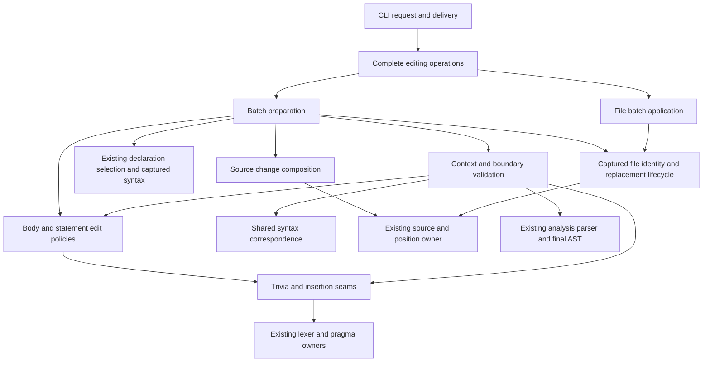

# Source preserving editing technical design

Status: implemented, 2026-10-08, from repository revision `ac24bc5`, for
**E, E1, E2** in `typescript-agent-tools#1`. Historical implementation plans
and reviews are available in Git history. The user selected these capabilities
for design and confirmed **one active writer per worktree during apply**.
The existing [navigation design](navigation-design.md) supplies S, C, Q1,
and Q2.

An agent should select a declaration, supply new source, inspect the resulting
diff, and apply precisely that change. Use syntax to locate and validate edits,
preserve the rest of the source, and put all file changes through one batch
application operation. The implementation needs smaller knowledge boundaries
inside both preparation and application; a single large editing module would
only move complexity away from its callers.

## Scope and operating conditions

Keep the native Rust implementation, TypeScript 7.0.2 baseline, unpublished
checkout-built distribution, and local CLI/library callers. Inputs are existing
UTF-8 TypeScript files, including TSX, under navigation's file-kind rules.
Projects use one explicit configuration and its existing searched-file policy.
Fragments and saved plans are local inputs from the same user; no application
code, formatter, or shell command runs as part of editing.

Files may change during preparation or between preview and apply. Such changes
must either be incorporated into a fresh preview or reject the prepared batch.
During apply the caller keeps other writers idle for every target, including
resolved link destinations. Read-only observers may run, but may see a batch
partway through application. No locks or writer coordination service are needed
under the selected contract.

| Capability | Proposed delivery |
| --- | --- |
| E | Prepare a batch against captured source; detect conflicts; validate proposed files; preview exact changes; apply with stale-file checks and rollback of ordinary write failures. |
| E1 | Replace the complete body syntax of one selected callable, including a function-valued variable or property with a direct callable initializer. |
| E2 | Insert complete statements immediately after a selected declaration's statement in the same statement list. |

E2 initially covers statement insertion, the ticket's motivating use. Inserting
class members, interface members, object properties, or enum members needs
different list and separator policies and is deferred. E1 does cover callable
bodies in classes and object literals. Other exclusions are file creation,
deletion, rename, import repair, semantic edits, type checking, incremental
indexing, simultaneous multi-file visibility, and automatic crash recovery.

Application initially targets local filesystems on macOS and Linux, matching
the service's established platform envelope. Direct preparation can remain
available elsewhere; applying there requires verified replacement/restoration
semantics before claiming support. Files must be regular files with supported
metadata. Preserve permission bits; inode identity and timestamps may change.
Reject hard-linked files and metadata that cannot be preserved rather than
silently breaking their behavior. *Settled during implementation (review round
2):* supported metadata is the mode, owner, group, extended attributes, and
access control lists, which staging sets explicitly on a new file freed
first of the restrictions its directory gave it, the original's list last
since it can deny the writes before it (review rounds 4 and 5), strips of anything the
new file has beyond them (such as a directory's default list), and compares
both ways (review round 3 replaced macOS `fcopyfile`, whose own policies
rewrote quarantine values and merged inherited list entries);
macOS file flags are refused, and Linux file attributes are outside the
envelope. macOS's `com.apple.provenance`, which the system sets on every file a
process writes and which cannot be changed, is the one exemption. Resolve symlinks to their referents, keep the
links themselves intact, and recheck that resolution before writing.

*Removed 2026-10-23:* the preservation of owner, group, extended attributes,
and access control lists was removed, with the output check's freeing of an
inherited list. The tool edits its author's own source files in git checkouts
on a single-user Mac, and the operating envelope (ENVELOPE.md) puts files
whose ACLs, extended attributes, flags, group, or ownership must survive an
edit outside it, so about 330 lines of system calls served no supported case.
Identity is now device, inode, mode, and link count; the new file gets the
proposed bytes and the original's mode; hard-linked files and files with
macOS flags are still refused. `docs/editing.md` states the current contract.

## Agent workflow and public contract

Extend `tsparse` and its existing request and delivery owners. These illustrative
spellings show the interaction; exact option names and the batch-file schema can
be settled with the implementation:

```sh
# Preview only; body.ts contains complete body syntax, such as { ... }.
tsparse --replace-body --name createRunHost.startEligible \
  --from body.ts src/lib/runs/host.ts

# Preview and save the exact batch for later application.
tsparse --insert-after --name projectRunHalts --from helpers.ts \
  --project tsconfig.json --plan .cc/temp/helpers.plan.json

# Several E1/E2 requests, prepared together against the original sources.
tsparse --edit-batch edits.json --plan .cc/temp/change.plan.json

# Apply the saved changes, without resolving names again.
tsparse --apply .cc/temp/change.plan.json
```

A request without an apply operation never modifies a target file. Saving a
plan is optional for preview and required for a later CLI apply. The library
can apply the opaque prepared value directly. Preparation either returns a
complete validated batch or a diagnostic; it never offers an applicable subset
after one requested edit fails. An empty change succeeds as `no_change` and
performs no source-file replacement.

All targets in a batch are selected from the original captured sources, not
from the results of preceding operations. Within project mode they use one
refreshed project generation. A batch has one optional project scope; it cannot
combine different project configurations. File mode needs explicit files and
does not load a project. Relative input paths use the caller's working directory;
saved plans record absolute targets so changing directory cannot retarget them.

Selection is Q2's exact, case-sensitive name or file/position selection, with
the same qualified selectors, separate overload sites, and ambiguity candidates.
An edit never filters candidates by eligibility to manufacture a unique match.
Select first, then decide whether that site supports the requested operation.
No match, several matches, or an unsupported site changes nothing. Positions
keep the existing one-based line and UTF-16-column convention.

Text preview is a unified diff of the final proposed bytes, including generated
separators and whitespace. It identifies the selected site, the actual edit
location, and that validation is **syntax and edit-boundary validation**. JSON
provides the same outcome, paths, changes, and typed diagnostics as one document.
Diff rendering never supplies the data used to apply. Large previews must not
silently omit changes; any future bounded display must point to the complete
saved result. Apply success reports the changed files concisely.

Preserve the existing exit/channel policy for analysis and selection failures.
Edit-specific rejections such as overlap, invalid replacement, or stale inputs
exit 1; usage, I/O, transport, and recovery failures exit 2. JSON includes the
filesystem effect independently of the error. The request parser owns option
validity, and `cli::delivery` owns channels and exit mapping. Plan output must be
a new file; result/plan destinations cannot alias a target or the request's
fragment/batch inputs. *Revised during implementation (review round 3):* an
editing command writes its result, like its plan, only as a new file. Two
rounds of checking outputs against the files a request touches kept finding
paths the check learned too late or never (a target selected before a later
failure, a source that failed to parse, an extended configuration, a stale
recorded alias, a dangling symbolic link); refusing any existing path is one
rule that covers them all, since a rejection's document written over its
target would break the promise that preparation writes nothing. *Settled in
review round 4:* a new file may still be one the command names but that does
not exist, such as a deleted target, which a document would recreate; so the
names the request, its configuration, the plan, and the plan's records give
are reserved too, the plan's even when it cannot be loaded. *Revised in
review round 5:* which spellings name one new file is the file system's
decision (links, case, Unicode forms), so rather than repeat its rules, the
check asks it, creating the output and looking for it under each reserved
name; a plan whose names cannot be read at all reserves every output.
*Refined in review round 6:* the file system is asked only when a reserved
name does not exist, since a name that does cannot be the new output, so
commands whose reserved names all exist create nothing to check, except to
compare a new `-o` with a new `--plan`; the output created for the
question is freed of what its directory gave it if that denies its removal,
and one that still cannot be removed is reported as left (*the freeing was
removed 2026-10-23; see Scope and operating conditions*). A plan's names
are known exactly when its text decodes as a plan, and are otherwise
unknown, rather than read leniently from damaged text. A result-delivery failure after commit reports that the
edits were applied; it is not grounds to replay or roll back the edit.

### E1 body replacement

The fragment is the complete new body: `{ ... }` for a block, or an expression
for a concise arrow. A caller supplies `return` when it wants one; the tool does
not infer return behavior or wrap arbitrary statements. An arrow may change
between block and expression form. Other callables require a block.

Supported sites are function declarations/expressions, arrows, methods,
constructors, and accessors with bodies. For a selected variable or property,
its initializer must directly be a function expression or arrow, allowing
parentheses around it. Do not search through a call, conditional, type assertion,
or other initializer to guess which nested function the caller meant. A nested
callback with its own Q2 anchor can be selected directly. Bodyless overloads,
ambient declarations, signatures, classes, and namespace blocks are unsupported
targets for this operation.

Replace only the callable's body span. Its name, modifiers, type parameters,
parameters, return annotation, and surrounding declaration stay byte-for-byte
unchanged. Comments inside the old body are replaced with it; comments outside
it remain. A selected `const run = () => { ... }, other = 1` replaces only
`run`'s body, even though `show run` displays the entire variable statement.

Parse the proposed complete file in its actual filename and enclosing syntax
context. Also require that the replacement occupies exactly that callable's
body slot: it cannot close the callable and add siblings, absorb following
source, or modify the declaration header. Fragment-edge whitespace and ordinary
comments are allowed when the final boundary and attachment checks establish
that they do not affect preserved syntax. Effectful comments must stay within
the operation's permitted region.

### E2 statement insertion

The anchor must designate a statement in a source file, block, module block, or
switch-clause statement list. A variable binding designates its whole variable
statement; an import/export specifier designates its whole import/export
declaration, consistent with Q2's excerpt. Report that statement boundary in
the preview, including when several bindings share it. Share this statement
designation with Q2's projection, then check direct membership in a supported
list; display consumes the designation rather than defining edit eligibility.
Q2 can still show a loop declaration list even though it supplies no E2 slot.

Do not climb arbitrarily to an enclosing statement. A loop-header binding,
parameter property, class/object member, or callback expression does not select
a statement-list sibling. A declaration used as an unbraced control-flow body
has no sibling slot there and is also unsupported. This prevents an insertion
requested beside a nested site from unexpectedly appearing outside its control
flow or container.

The fragment must produce one or more complete statements in that exact list.
The old statement and its successors must remain separate siblings in the same
order and container. It must not turn a preceding initializer into a call,
absorb a following statement, or escape into an outer block. Separator handling
considers both ends of the fragment and its enclosing list. Insert necessary
statement terminators and show them in the diff; a newline alone does not
reliably separate TypeScript statements.

Keep ordinary same-line trailing comments with the preceding statement. Keep
standalone comments, JSDoc, and leading directives with the following statement;
insert before that following group, not between it and its declaration. Existing
TypeScript comment directives outside the edited content must keep their target.
If a seam cannot preserve these relationships, reject it with a located reason.
For example, a trailing `// @ts-ignore` that governs the following line cannot
be treated as an ordinary trailing comment. Tool-specific comment semantics
outside TypeScript are not interpreted. These relationships are checked again
on the final composed source, including new fragment-edge directives and JSDoc
that could affect preserved syntax; planning a safe seam alone is insufficient.

### Source and layout preservation

Existing bytes outside the explicit replacements and insertion seams remain
identical, including BOM, shebang, comments, line endings, and final-newline
state. Do not pretty-print the AST or normalize a whole file. Layout uses the
surrounding statement/body indentation and local line-ending style, with a
documented deterministic fallback where the local source provides no sample.
The precise style heuristic is an implementation choice.

Rebase only fragment trivia whose role is established from syntax and lexical
ownership. Never rewrite literal contents, including template/JSX text, regexes,
or whitespace inside strings, nor the contents of multiline comments. A line
prefix inside a multiline literal is data, not indentation. If safe rebasing is
unavailable, retain the supplied fragment bytes and perform final validation.
Reject a result that cannot meet the syntax or boundary contract. Every generated
byte appears in the prepared change and is revalidated in the final file.

## Hierarchical ownership

The boxes below are knowledge boundaries, not a mandated file layout or a class
per box. A parent should be understandable from its children's contracts, and
a child should be understandable without reconstructing its parent's workflow.



### Complete operations and existing analysis

Callers prepare an edit batch, inspect its preview, and apply that prepared
batch. They never coordinate raw reads, AST lookup, offset adjustment, validation,
temporary files, and rollback themselves. The complete editing boundary owns
batch invariants, save/load, and preview derivation as well as that sequence.
It establishes a prepared value through one construction path; saving and
rendering consume its exact images, and loading reconstructs it by replay as
described below. No adapter can bypass the batch's checks by supplying ranges
or a serialized validation result.

Extend the existing navigation projection to associate a selected site with its
originating syntax during a selected-file parse. Keep that association private
and tied to its AST and captured source. The selected-file operation lends the
AST and projected syntax identities while both are alive: today's file-navigation
path drops its AST before answering and must be extended at that owner, not
compensated for by callers reparsing an excerpt. The current catalog's public display
kind and excerpt are insufficient: a `variable` can contain a callable, and
several selected sites can share an excerpt. Do not recover identity by matching
rendered source or add a second declaration traversal/name matcher. The existing
projection still owns which declarations exist, names, anchors, and containment;
edit policy owns what can be done to an already selected site. E1's downward
parentheses-only traversal shares one `SkipParentheses` owner with the existing
loop in projection's `assigned_name`. Upward `WalkUpParenthesizedExpressions`
answers a different question and remains separate.

Retain compact project indexes and reparse only selected files from their own
captured generation. Prepare all edits to a file together. Use one original
parse and a final candidate parse; allow at most one extra candidate parse for
layout, as described under [Trivia and layout](#trivia-and-layout). Do not retain
project-wide ASTs or add a mutable syntax cache.
`analysis::Parser` continues to own the deep budget and parsing-thread stack.

Project preparation is a **read-only request** through
`ProjectSession::execute`, also available with `--direct`. *Revised during
implementation (review round 1):* the project contributes selection, and the
invoking process prepares once. The earlier draft had the service prepare a
validated text proposal that binding then had to prepare again, so every
project edit was prepared twice and the service's validation contributed
nothing the binding could trust. All modes now share two contracts:

- **Selection over one generation:** for each edit, the project finds the
  searched file it names, or, for a name alone, the one file whose index
  selects it (several or none is the `show`-style outcome), and checks a
  position against that file's captured text. It returns each file's
  canonical path, display name, captured analyzed text, and edits as
  selectors within that file. Selecting parses nothing and reads no file.
  Transport carries owned data; AST identities never cross processes or
  outlive their generation.
- **Local preparation and binding:** the invoking process captures each
  physical file, requires its decoded text to equal the selected text, and
  prepares every edit to the file from that capture: selection in the file
  as `show` selects, policies, composition, and validation. The source owner
  maps the result to exact raw bytes. Together with the identity and batch
  checks, this constructs the applicable batch. A mismatch rejects
  preparation as stale.

File mode captures once and prepares from that capture. Project/service mode
captures selected physical files locally after the selection is returned.
Both use the same construction. Extend the source owner to preserve the raw
encoding prefix and map analyzed spans without changing existing analysis
reads, which strip a leading BOM. Neither the service adapter nor an edit
policy handles that offset itself.

Only the invoking process applies changes. A lost service reply cannot leave an
unknown write outcome, and transport retries remain read-only. Apply does not
reload the project: it commits reviewed edits to recorded files, not a new query
for declarations currently matching the old selector. Changes to other project
files or configuration do not invalidate this fixed-file batch; project-wide
validity was never promised. The next ordinary project query refreshes through
the existing mechanism, including its full-rebuild cost and failed-refresh
behavior. No explicit cache patching or second freshness protocol is added.

### Inside preparation

| Owner | Knowledge it hides | Contract to the rest of preparation |
| --- | --- | --- |
| Selected syntax | Q2 identity, statement designation, and the relation between a projected site and its actual AST node | Lend a unique site and its syntax from one captured source, or return the existing missing/ambiguous outcome. |
| Operation policies | Callable body eligibility; statement-list membership; the syntax region each operation is allowed to change | Produce edits and the structural obligation that proves they stayed in their intended slot. Keep each operation's planning and validation meaning together. |
| Trivia and seams | Attachment relationships, local layout, and separators | Produce a seam and its preservation obligations; verify those relationships on the final source. Consumers do not scan comments, guess semicolons, or reconstruct attachment policy. |
| Source change composition | Original-coordinate spans, conflicting ranges, application order, and mapping unchanged regions into the result | Produce one deterministic candidate per captured source, with an exact change map; know nothing about callable kinds or filesystem writes. |
| Shared syntax comparison | Correspondence of preserved fields and siblings through a change map; the metadata treatments below | Compare unchanged structure around the slots the operation opens, without deciding which slots an operation may open. |
| Context validation | Running the complete checks over the final candidate | Parse once, invoke operation, comparison, and attachment checks, and certify the file's prepared text. Preserve real parser/resource failures. |

Operation policy owns **what may change**, shared comparison owns **how preserved
structure corresponds**, and context validation runs those checks. These can be
private operations; no registry, validation language, or shared mutable context
is needed.

#### Structural preservation

For E1, consider `const run = () => { return 1; }, other = 2;`. The policy opens
only the selected arrow's `body` field. Comparison maps its containing statement
and callable to the final tree, requires the other fields and `other` binding to
correspond unchanged, and verifies that the replacement fills that body slot.
Changed body contents may alter enclosing spans; they cannot introduce a sibling
or consume a preserved token outside the permitted body/seam.

For E2, an original list `[anchor, next]` becomes
`[anchor, ...inserted, next]` at the designated gap. The change map relates the
preserved statements to their final positions; comparison verifies their fields,
order, and container. Inserted statements occupy only the opened gap. Separator
changes at its two ends are explicit seam edits, not permission to reparse an
old initializer as a call or a preserved statement as part of another one.
Other lists and enclosing fields remain protected. These obligations compose
for nonconflicting requests in a batch.

Compare syntax kinds, logical child fields, exact scalar values, and meaningful
flags by default. Only these named representation treatments differ:

| Data | Comparison treatment |
| --- | --- |
| Token positions and enclosing spans | Relate preserved token bounds through the source change map. Enclosing spans expand around allowed changes; leading-trivia positions at a seam are governed by attachment checks. Arena IDs and raw offsets are not cross-parse identities. |
| `SourceFile.text` | Check against the exact candidate from source composition, rather than demand equality with the original whole-file text. |
| `SourceFile.flags` summaries `POSSIBLY_CONTAINS_DYNAMIC_IMPORT` and `POSSIBLY_CONTAINS_IMPORT_META` | Accept freshly parsed summaries of the changed file: an allowed body/insertion may add or remove these forms. Do not mask these bits on unrelated node kinds or ignore other flags. |
| Syntax attributes, including `DEPRECATED`, ambient/context flags, optional-chain and declaration flags, and literal/scanner fields | Preserve them on protected nodes. A new annotation changing an old declaration is a boundary violation even if its child tree is otherwise identical. |
| Internal parse summaries and compiler caches | `possible_top_level_await` is parser bookkeeping, not a syntax attribute. The existing AST contract already omits compiler caches such as `HasAggregatedChildData`; editing adds no blanket cache/derived-flag exclusion. |
| `assertClause` alias of `attributes` | Consume the existing AST owner's logical-field traversal so the same child is compared once; keep the external JSON compatibility alias unchanged. |

The shared comparator owns these distinctions using the existing AST/compiler
owners; new allowances require a named reason and compiler evidence. Boundary
validation does not preserve binding or runtime behavior. Adding `export {}`
may change a file from script to module and is allowed if protected syntax still
corresponds. If that addition reparses an old `await(foo)` into a different
expression, the changed protected syntax is a rejection.

#### Trivia and layout

Within the seam owner, attachment, separators, and layout are distinct private
operations when that reduces the knowledge each needs. The attachment operation
both records and verifies relationships: ordinary-comment attachment under the
editor policy, JSDoc collection on declarations, and TypeScript directive reach
over source lines. It consumes the composed source and change map, so neither
context validation nor structural comparison must learn these rules.

Check existing protected relationships and fragment-edge effects, keyed by the
relationship rather than by a proxy for it. Every preserved line must be
governed by the same directive as before, or by none on both sides: TypeScript
records which directive each diagnostic used, so a fragment directive taking
over a line another directive governed is a retargeting even though the line
stays covered. The first preserved token after each change must collect
exactly the JSDoc comments it collected, compared with itself, not with
whatever token follows a particular change region. An old directive must not
start or stop governing preserved code; a new directive or JSDoc comment must
not affect syntax outside the opened region. A harmless
trailing `//` comment associated with inserted code is allowed. Directive reach
is TypeScript's line-based rule, not a guessed next AST node, and it is checked
without requiring a diagnostic to exist there. Structural equality cannot
substitute for these checks: the AST omits directives and full JSDoc trees.

Reuse and, where needed, expose the whole existing decisions. Directive
recognition and intervening-line rules live in `pragmas`; the coverage decision
in `project::program::diagnostics::Suppressions` ports
`getDiagnosticsWithPrecedingDirectives` and should move to that shared ownership
when editing needs it, with existing reporting routed through it. The parser's
`deprecated_trivia` contains the JSDoc collection rule from `iterateCommentRanges`;
make that rule shared, including its deliberately narrower CR/LF condition.
Do not implement a second scanner or a complete JSDoc parser for this delivery.

Plan boundaries and separators first, then assemble a candidate with the
supplied fragment bytes. If rebasing requires literal boundaries unavailable
from the original tree, allow one preliminary full-candidate parse through the
analysis parser. *Revised during implementation (review round 1):* the same
draft also decides the fragment-end terminator. Where the statement after the
seam could continue the fragment's last statement, the draft carries a probe
`;` on its own line after the fragment, where no comment can hide it; if the
probe terminated the last fragment statement, the final text puts a `;` right
after that statement's last token, and otherwise none. Substring tests on the
fragment's text (`}` endings, `//` in a string) proved both unsafe and too
strict. The anchor-side terminator stays a token test, since the anchor is
original syntax. Layout uses those protected spans, then the final candidate is
parsed and every syntax/attachment obligation is checked. With no rebasing or
probe, that first candidate can be final. No parse/reformat search loop or one parse per edit
is needed. If safe rebasing is unavailable, retain supplied bytes and validate
them; a syntax/resource failure remains a failure, not a reason to try another
interpretation.

Use the final-tree traversal and token-span operations in `Ast`; allocated
nodes can include discarded parses. Reuse lexer comment/whitespace/line-break
rules, `pragmas` directive rules, and `source` positions. Editor attachment and
layout policies are explicit product rules, not another copy of TypeScript's
scanner. Before adding a compiler-derived rule, search for its TypeScript
function and existing decision owner, then extend that owner with the port named
in its documentation, as [AGENTS.md](../AGENTS.md) requires.

### Inside application

The batch application owner knows which files have been staged, installed, or
restored, and chooses commit or rollback. A per-file replacement owner hides the
path/referent identity checks, original and proposed images, supported metadata,
temporary resources, replacement, and restoration for that file. It exposes
complete file operations with explicit outcomes, not raw temporary paths that
every caller must manipulate. It also hides which combinations of target state
and retained recovery resources are valid. The batch owner derives the reported
filesystem effect from those per-file outcomes.
Preparation uses this same owner's capture and identity checks when it binds a
selection or a plan to a physical file; it does not have a second file-identity
rule.

The transaction owner does not know TypeScript. The per-file owner does not know
batch order or whether another file failed. Cleanup and rollback use the same
per-file state and operations as installation, so separate helpers cannot drift
on which original must be restored. Where filesystem failure classification is
shared with project loading, lift or expose its existing owner; do not copy the
`NotFound`/`NotADirectory` rule into editing.

These boundaries should contain ordinary changes:

- Supporting a new callable form changes E1 eligibility and its boundary
  obligation, without changing selection, batch composition, or rollback.
- Supporting member insertion later introduces its list/separator policy,
  without teaching the file transaction about commas or syntax kinds.
- Changing a lexical character class changes its existing lexical owner;
  layout and directive handling consume that rule where it asks the same
  question, preserving narrower compiler predicates where appropriate.
- Changing replacement mechanics changes the per-file lifecycle; batch
  rollback uses its contract and syntax preparation remains unchanged.

A shared enum dispatcher is reasonable. Repeated syntax-kind switches in
selection, rendering, validation, and writing, or an all-purpose mutable
`EditContext`, would indicate that the decisions have leaked. Split further
when a child can hide a coherent rule; file length alone does not justify either
splitting or keeping a monolith.

## Prepared batches and failure semantics

The prepared batch owns the exact original and proposed bytes of each target,
the resolved target identity, and enough edit intent to verify its contract.
Fragments are embedded, so later fragment-file changes cannot alter it. Its
public representation is inspectable, but callers cannot turn arbitrary ranges
into a trusted prepared value. Save the inputs needed for deterministic replay:
original file images, analysis filenames, resolved per-file site anchors,
requested operations, and embedded fragments, alongside the exact proposed
images and target identities. Original name selectors may remain as explanation;
they are not replay instructions. Do not serialize private validation obligations
or accept a stored claim that validation passed.

Loading validates the plan's shape and build, decodes its recorded originals,
and runs the same preparation, selection-at-anchor, composition, and binding
operations against those originals. Eligibility and all preservation obligations
are reconstructed privately. Require byte-identical proposed output before the
loaded value becomes applicable. Replay reads neither current project state nor
fragment files and does not resolve names against current files. Current physical
identity and byte checks still happen at apply. Reject incompatible-build plans
and request a fresh preview; no durable cross-version format or migration
machinery is needed yet.

All spans refer to the original captured text and must lie on valid UTF-8
boundaries. Multiple operations on one captured source are composed together.
Normalize file-mode aliases through file capture. If distinct captured project
sources resolve to the same physical target, as `preserveSymlinks` can permit,
reject the batch and ask the caller to use one file identity; never install two
independently proposed images of that file. Names and paths keep their exact
values throughout selection, capture, and plan encoding.

Overlapping replacements, nested body replacements,
duplicate requests, and two insertions at the same seam are conflicts. Adjacent
nonempty replacements are allowed. An insertion at the start of a replacement
is rejected in this delivery, avoiding an implicit ordering rule. *Revised
during implementation (review round 2):* an insertion at a replacement's end
follows it. Such an insertion is after a statement that the replaced body
ends, so containment, not a rule, fixes the order; rejecting it made "change
`f` and add a helper after it" impossible in one batch. A caller can
combine same-seam insertions into one fragment. No-op changes can be dropped
only after request conflicts and validation have been checked.

Application is one complete operation:

1. Load/validate the prepared batch, then check **all** targets against their
   original bytes and relevant identity/metadata. Timestamps alone are
   insufficient. Retargeted links, replaced targets, absent targets, and byte
   changes reject the batch. An unreadable file remains an I/O failure.
2. Stage complete proposed files and restorable originals before replacing any
   target. Use replacement resources on the target filesystem, preserve supported
   metadata, and check staging failures. Recheck the originals immediately before
   the first replacement; preparation or staging does not extend a stale check's
   validity indefinitely.
3. Replace files in deterministic order, tracking successful replacements. Each
   individual file replacement avoids exposing a partially written file.
4. On an ordinary failure after replacements begin, restore installed files from
   their originals. If restoration succeeds, report the original failure and
   that the batch was rolled back. If restoration fails, retain recovery copies
   and report the affected paths, observed states, and recovery locations.
5. After every replacement succeeds, clean up temporary resources and report
   application. A cleanup failure still reports the edits as applied, with the
   cleanup error and remaining paths; it must not masquerade as no effect.

Recovery must not knowingly overwrite bytes different from both the recorded
original and this batch's installed image. Such a conflict violates the selected
writer contract but still needs an honest recovery-required result. There is no
force, fuzzy rebase, automatic retry of a write, or selector re-resolution.
Reapplying a successful nonempty plan normally fails its original-byte check.

| Situation | Filesystem effect reported |
| --- | --- |
| Selection, overlap, syntax, stale, or pre-install staging failure | No target changed. |
| All replacements succeed | Batch applied; report cleanup errors separately if any. |
| Installation fails, restoration succeeds | Originals restored; operation failed. |
| Restoration cannot be completed | Recovery required, with per-file states and retained originals. |
| Process termination or machine crash | No automatic recovery guarantee; originals/staging may remain and some files may already have changed. |

This is validated batch application with rollback, not a multi-file filesystem
transaction. Existing queries may observe intermediate files; callers needing a
post-edit answer issue it after apply completes. Ordinary failure handling is
inside E; a durable journal, crash recovery, or coordination with other writers
would change the operating contract and merits a separate design.

## Alternatives and tradeoffs

| Decision | Alternative considered | Choice and reason |
| --- | --- | --- |
| Source representation | Modify an AST and print whole declarations/files | Use ASTs for knowledge and source splices for changes. Printing introduces formatting and comment ownership beyond the requested edit. |
| Preview/apply relation | Rerun selectors and fragment reads with an apply flag | Apply a saved prepared batch. The extra artifact makes the reviewed bytes the committed bytes and avoids accidental retargeting after changes. |
| Project execution | Put writes in the resident service, or bypass it for all editing | Use the service only for read-only preparation and apply locally. Reuse its expensive snapshot without adding write replay, durable transaction state, or lost-reply recovery to the daemon. |
| Internal organization | One edit engine that handles every syntax and filesystem case, or a generic plugin/pipeline framework | Use the concrete owners above. Each hides a present decision; E1 and E2 do not justify registries, pluggable storage, or a generic refactoring framework. |
| Validation | Full compiler integration, or merely parse the result | Native full-file parsing plus edit-boundary checks fits this tranche. Semantic checking needs an explicit compiler/runtime decision and must include affected dependents, not just edited files. |
| Writer coordination | Shared locks and a persistent recovery journal | Use the confirmed single-writer interval and in-process rollback. Add stronger machinery only if that contract changes. |

## Evidence and implementation proof

The current code supports the proposed reuse: navigation keeps a compact index
and reprojects selected captured files; its records currently hold presentation
ranges rather than syntax origins. `source::decode`/`read_text` strip a leading
BOM, and `ProjectSession::execute` is the shared freshness boundary. These facts
were checked in [catalog](../src/navigation/catalog.rs),
[projection](../src/navigation/projection.rs),
[project navigation](../src/project/navigation.rs), [source](../src/source.rs),
and [session](../src/project/session.rs) at the revision above.

Focused design probes with TypeScript 7.0.2, the 6.0.3 syntax API, and the current
parser establish two limits on validation:

- `const run = factory()` followed by `(function added() {})()` is one variable
  statement unless the seam is terminated. Both forms parse successfully. A
  body fragment such as `{} export function unexpected() {}` can likewise leave
  a valid file with an unintended extra declaration. The slot/structure check is
  necessary, not optional validation polish.
- `await` inside a non-async function and `break` inside a function with no loop
  pass parsing and the native compiler's `--noCheck` path. The normal 7.0.2 check
  reports TS1308 and TS1107 respectively. This delivery must not call a prepared
  edit type-safe or promise all compiler grammar/checker diagnostics.

The compiler invocations use `--noEmit --ignoreConfig --target esnext --module
esnext --pretty false`, with and without `--noCheck`; the comparison roles are
those in [validation](validation.md). These are feasibility probes, not evidence
that an editing engine has been implemented.
The historical review records 14 further probes of metadata, directive reach,
harmless comments, and module-induced reparsing that support the refined
validation contracts.

Implementation uses failing behavior-level tests first, scoped through the
registered test command to the single test file under development. Expectations
come from the pinned compilers for language behavior and explicit examples for
the product policies above. Prove the final candidate, disk state, and CLI
outcome rather than only a range helper:

| Boundary | Required observable coverage |
| --- | --- |
| Selection and E1 | Q2 ambiguity/position round trips; overloads; named and anonymous functions, methods, accessors, constructors, async/generators, block/expression arrows, direct callable initializers, multi-binding statements, unsupported wrappers/bodyless sites; no unintended header or sibling changes. |
| E2 and layout | Every supported statement-list container; unbraced/loop/member rejection; comments before/after anchors, JSDoc and directive reach; missing semicolons and ASI-sensitive starts/ends; multiple statements; unchanged old siblings and containing structure. |
| Preservation checks | Final-file and plan-load cases for existing directives retargeted by insertion, fragment-edge directives/JSDoc escaping their region, harmless trailing comments, changed `DEPRECATED`, allowed source-file summaries and `SourceFile.text`, and a changed parse of preserved syntax. Exercise both fragment ends and the complete composed batch. |
| Exact source | BOM and shebang; LF/CR/CRLF/U+2028/U+2029; spaces/tabs/NBSP; non-ASCII and astral positions; literal and multiline-comment contents; mixed line endings; final newline; exact/folded path policy and slash variants. Assert final bytes outside changes. |
| Batch and plans | Same original source for every operation; adjacent, overlapping, nested, duplicate, and tied insertions; path aliases; empty change; deterministic replay with different cwd, changed fragment/current project, incompatible build, malformed data, ineligible recorded target, or altered proposed image. Preview corresponds exactly to applied bytes; no saved validation claim bypasses replay. |
| Filesystem failures | Same-size/same-timestamp changes, BOM-only changes, removal, unreadability, retargeted links and replaced files; staging and each install failure; successful rollback, rollback failure, cleanup failure, and output failure after commit. No silent partial-success result. |
| Analysis integration | File/project/direct/service agreement through the same text-to-image binding; BOM preservation and stale decoded-text rejection; one generation per batch and valid borrowed AST lifetimes; failed project refresh; next-query rebuild after apply and rollback; no write on transport failure. |
| Resource behavior | Parser and transport limits retain their failure kind; just under/at/over supported limits and long flat valid input; bounded traversal and memory for large files/batches. |

Use deterministic filesystem fault injection at the replacement boundary for
failure cases, together with real temporary-file CLI tests. Do not create a
general storage abstraction merely to mock every filesystem call. Exercise
real `show → preview → apply → show/references` flows on a disposable copy of
unchanged Command Center, including a factory method, a TSX function, a large
test, and a multi-file batch. Measure preparation, apply, and next-query rebuild
separately; E does not remove the current rebuild cost. Navigation/reference
checks remain regression obligations wherever their owners change.

Exact Rust types and module paths, plan encoding, diff algorithm, indentation
inference, and platform replacement primitives remain implementation choices.
Choose them by exercising these contracts and measuring representative files.
The behavioral scope, ownership, preview/apply relationship, and failure effects
are the design commitments; a separate implementation plan need not invent more
abstractions to make those commitments concrete.
