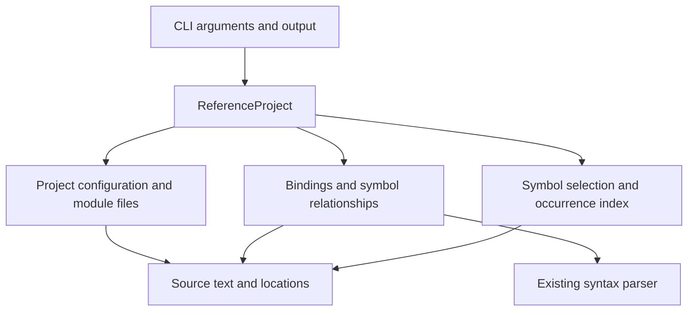

# Find references design

Add project-wide reference lookup to `tsparse` through an immutable
`ReferenceProject`. Its caller supplies a `tsconfig.json` and selects a symbol by
source position or exact name. The implementation owns project loading, binding,
alias resolution, and result grouping. Callers never coordinate compiler passes
or inspect scope tables.

This was the design for implementation. The interview established the
feature scope; the API, result format, compatibility limits, and failure policy
below were recommended design decisions. The implemented behavior, and the
places where TypeScript 7.0.2 behavior overrode this design (such as `types`
defaulting to `[]` and `baseUrl` being removed), are documented in
[find references](references.md).

## Refinements after implementation

The public operation and immutable snapshot remain the intended boundary.
The implementation review refined three private contracts:

- Resolved meanings carry their own type-only provenance. Combining a local
  value with an imported type preserves the local value's accessibility;
  re-exports and alternative star-export routes retain each target's access.
  `binding::targets` owns combination, restriction, and meaning selection.
- The project owns normalized file identity keys and the captured spellings
  used by queries. `project::paths::FileLookup` uses the same normalization and
  case policy as loading, including clamping parent traversal at a path root.
  The public façade and query owner do not reconstruct identity rules.
- A per-file diagnostic policy owns binding leniency, unsupported dependency
  tolerance, `skipLibCheck`, and comment suppressions. File provenance informs
  both that policy and search inclusion during loading; the binder does not
  infer diagnostic permissions from whether occurrences appear in results.

Semantic links use distinct private IDs for scopes, declarations, references,
aliases, requests, and index records. Optional type-parameter-list identity is
an `Option`, rather than an integer sentinel. Built-in `globalThis` resolution
has a semantic variant whose diagnostic text is chosen at the result boundary.

The semantic oracle follows immediate alias chains to retain independent local
meanings along a re-export path. A type-only edge affects the value target only
when that target is actually reached through the edge. The
`mixed-alias-meanings` fixture protects this contract on both sides of the
comparison.

A second review kept the design and gave single owners to rules that had been
reconstructed in several places, each of which had produced a wrong result:

- File identity: loading derives a query spelling under the configuration
  directory as the caller spelled it only for files inside that directory, and
  the result's `project` names the configuration in the canonical directory
  that result paths are relative to. `paths::Case` is the one case policy for
  identity keys, comparisons, and `InputKind`, which classifies an input by its
  extension as TypeScript does.
- Binding errors are reported only through link, after file provenance is
  known. The collector records the all-exported-or-all-local conflict as a fact
  rather than failing before the diagnostic policy exists.
- Comment directives are scanned from the whole source around literal tokens,
  as TypeScript's scanner records them, rather than from the leading trivia of
  whichever nodes the collector visits.
- Leading comments and their reference and JSX pragmas have one owner,
  `crate::pragmas`, using the lexer's whitespace and line breaks. The parser
  validates reference directives from it; `project::directives` decides what
  they ask loading to follow, and the loader settles each outcome by kind
  (`Followed`) rather than by matching error kinds.
- Alias cycles resolve the same way whichever file resolution reaches first.
  A dependency that only fills meanings a name's local declarations lack is a
  fill edge; as in TypeScript, a cycle through one is cut there and resolves
  to those locals (so an import that returns to its own local is TS2440). A
  cycle of aliases alone leaves every member unresolved (TS2303).
- A name query and a position query classify a selected token through one
  function, so neither silently drops an unsupported or unresolved candidate.

The same review moved several decisions to the owner that holds their
knowledge:

- `Sources` alone allocates `FileId`s, reserving one when an input is
  discovered and asserting that inputs are captured in reservation order.
  Loading computes the provenance-free part of the diagnostic policy as it
  captures each file and builds each `ProgramFile` once the dependency graph is
  complete, so no provisional origin exists; an unsupported reference path is
  settled then, like an unsupported module target.
- The resolver interprets file formats: request and type-directive resolution
  modes, and whether a format forces module semantics. It receives the case
  policy for output-directory mapping, as TypeScript does.
- Only `NotFound` and `NotADirectory` mean a path is absent
  (`project::disk`). Any other failure to inspect or read a file or directory
  is an `Io` error, never an empty manifest, directory, or skipped entry. Queries have no I/O error: a path that cannot
  be made absolute names no searched file.
- In the binder, `targets::Slots` hides the per-meaning slot layout and one
  selection rule decides when a type-only value is dropped; one member lookup
  serves qualified names and `export =`; `index::Builder` establishes the
  frozen index's ordering invariants; one exhaustive match decides where each
  scope kind stores its names; and an augmentation of a script in a dependency
  is ignored, so a declaration always has an export host. The collector
  compares `SyntaxKind`s rather than kind strings, builds alias records with
  their anchors, and stores exact token spans.

A third review found rules that still had a second owner, owners that
returned a reduced form of TypeScript's concept, and failures that became
ordinary results, and fixed each where its owner lives:

- Lexical boundaries have one owner, the lexer: where a `#!` line ends (after
  a byte order mark), where comments start and end (`iterateCommentRanges`).
  Pragmas, `@ts-ignore` scanning, and `@deprecated` collection keep their own
  selection rules over it; `crate::pragmas` follows TypeScript 7's directive
  grammar, with spaces and tabs as the only separators.
- `ParseOptions::for_file` decides what a file name means for parsing, with
  TypeScript's case rules; the module indicator is one function
  (`ast::external_module`); `paths` itself reads `\` as a separator; one
  `pattern` module serves `paths` patterns and pattern ambient modules.
- Binding keeps the three-state namespace instance and asks TypeScript's
  `getDeclarationSpaces` question for exported and local declarations; a
  failed `export *` route still exports its name.
- `project::jsonc` reads `tsconfig.json` and `package.json` as TypeScript 7
  reads each, and reports its depth limit, like the package `imports` limit,
  as a failure no file's diagnostic policy tolerates.
- In expressions, a `<` is tried as type arguments only when enough `>`
  tokens remain to close it (`parser::angles`), so speculation no longer
  exhausts the depth budget on long flat lists of comparisons.

## Scope and operating envelope

The confirmed scope is one configured TypeScript project, inherited settings,
file selection, local import aliases, and both query entry points. Resolve
variables, parameters, functions, named types, class names, and import/export
aliases with TypeScript scope and shadowing rules. Defer ordinary property and
method lookup and traversal through linked TypeScript projects.

Assume a local, synchronous CLI invocation over files on disk, with no server,
watcher, concurrent updates to an index, or persistent index. Keep execution in
Rust and preserve the existing parser API and AST JSON contract. No latency or
project-size target was specified; measure full-project indexing before adding
parallelism or caching.

The result is source navigation information within the selected project. It is
not a rename edit set or a promise about runtime uses through reflection, strings,
or dynamic code. A missed or incorrectly grouped source occurrence matters, so
resolution failures must remain distinguishable from an empty successful search.

## Constraints established by the code

| Current contract | Design consequence |
| --- | --- |
| [`Ast` borrows its source](../src/ast.rs), and `NodeId` is arena-local. | Own source text and semantic records in the project; do not build a self-referential collection of sources and borrowed ASTs. |
| `Ast::nodes()` includes discarded parse nodes. | Visit only the final tree with `Ast::walk`, which uses an explicit traversal stack. |
| Syntax fields can share children, such as `attributes` and `assertClause`. | Enumerate semantic children once with `Ast::children`, which skips compatibility aliases. |
| Identifier spans include leading trivia; names use compiler `escapedText`. | `Ast::token_span` and `Ast::identifier_name` own exact token spans and decoded names. Do not compare raw source spelling or emit trivia as a reference. |
| Rust spans are UTF-8 bytes; JSON offsets and diagnostic columns use UTF-16. | Keep byte ranges internally and centralize validated conversion at the query/result boundary. |
| [`src/main.rs`](../src/main.rs) currently reads one file or stdin. | Add an explicit reference mode; put project and semantic work below argument parsing. |
| [`tools/reference-oracle.mjs`](../tools/reference-oracle.mjs) is a TypeScript 6.0.3 syntax oracle. | Add a separate semantic oracle. Existing AST conformance does not establish binding correctness. |

## Public operation and ownership

The interface comment should state the complete operation before implementation:

```rust
/// An immutable reference index for one configured project.
///
/// Loading reads each participating file once and resolves the supported
/// declaration and module relationships. Queries perform no filesystem I/O.
/// Results describe those captured contents, not later edits on disk.
/// Scope tables, aliases, and internal IDs never escape this object.
pub struct ReferenceProject { /* private */ }

impl ReferenceProject {
    pub fn load(config: &Path) -> Result<Self, ProjectError>;
    pub fn find_references(&self, query: ReferenceQuery)
        -> Result<ReferenceResult, QueryError>;
}

pub enum ReferenceQuery {
    At { file: PathBuf, position: SourcePosition },
    Name { name: String, file: Option<PathBuf> },
}

/// One-based line and one-based UTF-16 column.
pub struct SourcePosition { pub line: usize, pub column: usize }
```

These are signature sketches, not a request to expose the private index layout.
`load` returns a usable object or a diagnostic; there is no partially initialized
state or public `parse`, `bind`, and `link` sequence. Results own their small
location/name records, so they can outlive the project. Multiple library queries
reuse the same immutable index, which is already useful for the two entry points.



Use a public `references` module with private implementation modules. Start with
the following ownership boundaries; file splitting is secondary to the contracts.

| Owner | Knowledge it hides | What consumers receive |
| --- | --- | --- |
| `references::project` | JSONC configuration, inheritance, path provenance, file selection, resolution modes, package metadata, and file identity | Captured files, effective binding settings, resolved module edges, and which files belong in results |
| `references::binding` | AST field roles, scope creation, declaration compatibility, meaning-aware lookup, namespace exports, and alias relationships | A completed semantic index with symbol identity for supported occurrences |
| `references::query` | Position selection, exact-name candidate selection, reverse occurrence lookup, deduplication, and stable ordering | Owned reference groups |
| `references::source` | Source ownership, line positions, and byte/UTF-16 conversion | Validated locations and source access by private `FileId` |
| `references::mod` | Construction order and consistency between these parts | The public operation above |
| Existing CLI boundary | Flags, printing, output files, and exit codes | The existing command behavior plus reference mode |

Do not create a public scope-graph framework, resolver plugin system, injectable
filesystem hierarchy, or generic compiler pipeline. There is one implementation
and one filesystem. Unit tests can bind source strings; loader tests can use
temporary project directories. Keep the binder's passes and shared tables in one
owner even if they later occupy several private files.

## Command and result contract

Use an additive flag rather than reserving a subcommand that could collide with
an existing positional filename:

```sh
tsparse --references --project ./tsconfig.json --at 12:8 src/app.ts
tsparse --references --project ./tsconfig.json --name run
tsparse --references --project ./tsconfig.json --name run src/app.ts --pretty
```

`--project` is required in reference mode. It names a configuration file, without
ancestor discovery. `--at LINE:COLUMN` and `--name NAME` are mutually exclusive.
Position queries require a file. For name queries, an optional file narrows the
candidate bindings, while returned references still span the project. Paths in
arguments are relative to the working directory. `--pretty` and `-o` retain their
existing meanings. Reject stdin, `--check`, and `--tsx` in reference mode; project
configuration and filename determine the input set and syntax mode.

Name lookup is exact and case-sensitive on decoded identifier text. It is not
substring search. Two shadowed declarations with the same name yield separate
groups. Searching an alias name selects the underlying symbol through that alias;
two matching aliases of the same symbol yield one group. Position and name queries
share the same grouping operation rather than implementing separate resolvers.
Candidates include declaration names, local import names, and explicit exported
alias names in the search files. An exported alias is discoverable even when that
spelling introduces no local lexical binding.

A position must fall within an identifier token, start inclusive and end
exclusive. Whitespace and punctuation return an empty result; an out-of-range
line/column or a column inside a surrogate pair is an invalid query. Selecting a
known property/method name returns `UnsupportedTarget`, rather than a misleading
empty reference list. An unresolved identifier returns `UnresolvedTarget`.
An explicit query file must belong to the search files; reject a file outside
that boundary rather than adding it to the already constructed project.

Use one result shape for either entry point:

```text
ReferenceResult {
  project: absolute path to the selected tsconfig,
  groups: [
    {
      declarations: [ NamedLocation ],
      occurrences: [ { name, location, roles } ]
    }
  ]
}
```

`NamedLocation` contains `name` and `location`. A location contains `file`, `start`,
and `end`; positions are one-based lines and UTF-16 columns with an exclusive end.
File paths use `/` separators and are relative to the selected configuration's
directory, including `../` when necessary. Internal file identities do not leak.

`declarations` identifies the underlying symbol's declarations, including valid
merged declarations. `occurrences` includes declarations in the search boundary,
uses, and import/export name tokens. Roles are a small set drawn from
`declaration`, `use`, `import`, and `export`; one token may have several roles.
Do not add read/write or rename-safety classifications to this version.

Each file/range appears once per group, combining roles. Sort locations by file
and start position, and groups by their earliest declaration location. This keeps
results reproducible without persistent symbol IDs. An ordinary absence is
`groups: []`, with exit code 0. The CLI serializes the domain result directly; it
does not reproduce filtering or alias policy.

## Binding model

Keep private, project-local `FileId`, `ScopeId`, `SymbolId`, and `OccurrenceId`
newtypes. During parsing, `NodeId` remains paired with its originating AST. Copy
only semantic facts needed after that AST is dropped: declarations, scope edges,
occurrences, qualified-name paths, and module directives. Retain source text and
its position index, not every project's full syntax arena.

Use a scope's name entry to represent its value, type, and namespace meanings.
Lookup asks for the meaning required by the occurrence and searches the enclosing
scopes accordingly. A same-named declaration in the wrong meaning must not
automatically shadow the required meaning. A class or enum can introduce more
than one meaning; an unrelated type alias and variable with the same spelling
must not become one reference group merely because they share a name.

Separate three concepts:

1. A **binding** is a name visible in a particular scope and meaning.
2. A **symbol** is the declaration identity to which an occurrence resolves.
3. An **alias edge** relates an import/export binding to a target symbol, with
   the allowed meanings and the alias's own declaration location.

Declaration merging is an explicit compatibility operation owned by the binder.
It handles valid overloads, interface merges, and supported namespace/class/
function combinations, preserving every declaration. Invalid duplicate bindings
are a binding error, not an arbitrary choice of the first declaration. Namespace
merges share exported declarations, while non-exported declarations remain local
to their declaration block.

Keep alias edges directed. Do not use a global union of same-spelled identifiers,
and do not erase type-only restrictions while following an alias. Cache resolved
alias targets within the immutable project once the graph is complete.

### Building the index

The construction sequence is private and has these invariants:

1. Load effective configuration and discover root files. Discover additional
   module/directive dependencies as files are parsed; canonical file identities
   prevent repeated loading.
2. For each file, parse once, visit the final tree, and record all declarations,
   scopes, pending uses, export entries, and exact token locations. Resolve no
   forward use by scanning only declarations seen so far. Drop the AST after its
   owned facts have been captured.
3. Complete project/global declaration tables and export relationships. Resolve
   re-export cycles using an explicit worklist or strongly connected components.
   An edge cycle is not itself an error; a required name with no declaration
   target, or conflicting star-export targets, remains unresolved or ambiguous.
4. Resolve pending occurrences by lexical meaning or a proven namespace export
   path. Record either a symbol or an explicit non-reference/unresolved/
   unsupported classification. Build the exact-name and reverse occurrence
   indexes from the same records.
5. Freeze the complete project before serving a query.

Scope discovery and lookup are separate passes within the binder, not separate
public modules. This handles forward declarations and shadowing without making
callers understand hoisting. A use in the temporal dead zone still resolves to
the inner binding for navigation; runtime initialization checks are outside scope.

### Syntax rules that require deliberate treatment

| Syntax | Binding obligation |
| --- | --- |
| `var`, `let`, `const`, `using`, and `await using` | Distinguish function/global and block bindings, including loops, switch clauses, catch bindings, and class static blocks. |
| Functions, arrows, and named expressions | Model parameters, generic parameters, the inner expression name, and body declarations. Parameter initializers cannot simply see all body-local declarations. |
| Destructuring | Introduce bindings from patterns; visit default/computed expressions as uses. Property keys are not automatically identifier references. |
| Object shorthand and assignment patterns | `{value}` uses the lexical value; `{value: other}` uses `other`. Assignment targets and declaration patterns have different roles. |
| Types | Type references use type/namespace lookup; `typeof value` in a type uses value lookup. Handle generic, mapped, and conditional `infer` scopes, including the true-branch boundary. |
| Classes and interfaces | Bind their names and generic parameters. Traverse method bodies, annotations, decorators, and computed names in their correct scopes even though member searches are deferred. |
| TSX | Component identifiers and expression containers can be lexical uses. Intrinsic tag names and attribute names are not local variables. |
| Global scripts and namespaces | Distinguish module-local declarations from project globals. Do not assume every file is a module, or every namespace block shares all locals. |
| Non-reference identifiers | Labels, noncomputed property names, import attribute keys, and similar syntax must not enter lexical lookup. |

Own these rules alongside scope construction. A generic walk that treats every
`Identifier` as a use cannot meet the contract. Conversely, excluding a method
name must not exclude lexical uses inside that method.

Known transparent syntax may recurse without special treatment. Unknown
scope-bearing or declaration-bearing syntax must produce an unsupported-feature
diagnostic until a behavior test and binding rule exist. This prevents parser
coverage from being mistaken for reference coverage.

### Aliases and qualified names

Given:

```ts
// api.ts
export function run() {}

// barrel.ts
export { run as execute } from "./api";

// app.ts
import { execute as start } from "./barrel";
start();
function local(start: () => void) { start(); }
```

Selecting the top-level `start` or searching for `execute` returns the `run`
symbol, the import/export occurrences, and the top-level call. The parameter and
its call form a different group. Searching `start` without a file restriction
returns both groups. Ordinary value flow, such as `const copy = run`, does not
make `copy` an alias of `run`.

Support named/default imports, named re-exports, star re-exports, namespace
imports/exports, type-only aliases, and TypeScript import/export assignments where
the syntax establishes an alias. Do not equate an arbitrary default-export
expression with all identifiers it contains. Anonymous default declarations need
a synthetic default-export symbol anchored at their declaration, not a fabricated
identifier occurrence.

`ns.run` may resolve `run` when `ns` is proven to be an imported or declared
namespace. This is export-table lookup, requiring no receiver-type inference.
The lexical receiver in `object.run` is still a reference to `object`, but ordinary
object properties, class members, enum members, and inferred receiver types remain
outside target selection. The same distinction applies to qualified type names.

## Project configuration and resolution

The project owner is a substantive part of this feature. It cannot be replaced
with a directory walk and a string comparison on module specifiers.

Keep path-valued configuration entries associated with the configuration file
that declared them. Inherited `include`, `exclude`, and `paths` must not all be
reinterpreted relative to the leaf configuration. (This design also listed
`baseUrl`; TypeScript 7 removed it, and the implementation rejects it.) Handle JSONC comments,
trailing commas, ordered `extends` inheritance, and inheritance-cycle errors.
Keep JSONC parsing behind this owner; `serde_json` alone does not accept JSONC.

Define these sets explicitly:

- **Roots:** TypeScript files selected by the effective `files` and
  `include`/`exclude` rules, including declaration files and TSX.
- **Program inputs:** roots plus transitive static imports/re-exports, supported
  reference directives, and ambient type dependencies selected by `types` and
  `typeRoots`. (This design assumed automatic package discovery when `types` is
  absent; TypeScript 7.0.2 defaults `types` to `[]`, and the implementation
  follows the compiler, with `"types": ["*"]` selecting every package.)
  An excluded file can still enter through an import, as in TypeScript.
- **Search files:** roots and their locally resolved source/declaration
  dependencies. Installed package declarations can establish identity without
  recursively reporting every reference inside dependency packages.

Installed package declarations participate in resolving imported names; a group's
underlying declaration location may consequently be outside the search files.
Package declaration files reached only as resolution dependencies are not
themselves name-discovery candidates. Local import bindings for those symbols
remain candidates, and project-local occurrences are returned.

The recommended initial compatibility profile covers `.ts`, `.tsx`, `.mts`,
`.cts`, and their declaration counterparts; relative imports, configured local
aliases, and installed packages with TypeScript declarations. Implement the
effective TypeScript 7 `node16`, `nodenext`, and `bundler` resolution behavior,
including importer format, extension substitution, package `exports`/`imports`,
type conditions, and namespace/default export distinctions. Package names are
not interchangeable with filesystem paths. Do not fall back from an explicitly
unsupported resolution mode to an approximate algorithm.

Honor settings that affect this graph or binding, including module detection,
package format, `types`/`typeRoots`, and symlink identity. Emit-only settings can be
ignored. Record the supported configuration surface next to resolver tests; any
new option gets its interpretation in this owner, not a CLI branch. A config's
mere presence of an irrelevant option should not reject an otherwise supported
project.

There are explicit first-version limits:

- Do not follow project references. A project requiring that traversal receives
  an unsupported-project diagnostic rather than an apparently complete workspace
  result.
- JavaScript/JSDoc binding, JSON and asset module declarations synthesized by
  tooling, and arbitrary `require`/dynamic-import value flow need later support.
  Report an unsupported input when such a dependency is necessary to resolution.
- Do not invent built-in standard-library symbols. References to ambient names
  without a declaration among the supplied program inputs are unresolved targets.
  Automatic TypeScript standard-library provisioning is deferred; this makes the
  supported universe narrower than the editor's complete default program. An
  explicit `lib` setting or reference directive requiring an unavailable library
  must receive an unsupported-input diagnostic, rather than being ignored.
- Resolve ambient module declarations and global augmentations supplied by the
  program before declaring an import missing. A literal import can be satisfied
  by an ambient declaration without an on-disk module.

These limits belong in command help and acceptance fixtures. They are compatibility
boundaries of the proposed implementation, not claims of full compiler parity.
Changing automatic ambient-library loading later belongs in the project owner and
does not change the query API.

## Errors and resource behavior

| Condition | Proposed behavior |
| --- | --- |
| No matching name or no token under a valid position | Successful empty result. |
| Several distinct matching declarations | Successful separate groups. |
| Valid overloads or declaration merging | One symbol group with all underlying declarations. |
| Unsupported target or unresolved selected identifier | Query diagnostic; no successful empty substitute. |
| Invalid flags/position, missing file, unreadable config | Usage/I/O diagnostic, exit 2. |
| Syntax error, unsupported required semantic input, invalid binding, unresolved required import, or ambiguous required export | Project/query analysis diagnostic, exit 1 in reference mode. |

Preserve the existing parse-mode exit contract. Reference help explains its wider
meaning of exit 1. The library returns typed errors carrying path and source/config
location where available; only the CLI chooses an exit code or prints diagnostics.
Stop before emitting reference JSON if project construction fails. Do not add a
partial-results switch to the first version.

An ordinary unresolved name elsewhere in otherwise bindable code need not abort
every query: store it as unresolved and report it if selected. Missing module or
ambient-dependency inputs are different because they can change the project graph
or global binding environment. Unrelated type errors are not checked; binding
success does not claim that the whole project type-checks.

The captured file contents are authoritative for the lifetime of the index.
Reading different files is not an atomic filesystem snapshot. File disappearance
or read failure is an I/O error; the tool takes no locks and promises no protection
against concurrent edits during loading. The index is disposable navigation data,
so retries, journaling, durable IDs, and cross-process coordination add no value.

Parse files sequentially and release each AST after extraction. Retained memory
is source text plus semantic records and indexes, with only one file's parse
working set added at a time. Use worklists for graph cycles and iterative syntax
walks so the existing parser's depth safeguards are not undermined by a later
recursive walk. Cache module-resolution and alias results only inside this load.
Measure construction time, peak memory, and query time separately.

## Alternatives and reasons for the choice

| Alternative | Common caller and change cost | Decision |
| --- | --- | --- |
| Bind declarations while parsing and store semantic state on syntax nodes | Saving a traversal also couples module loading and scope rules to speculative parsing, reparsing, and a borrowed arena. Parser changes can invalidate symbol state; parse-only callers pay or gain mode switches. | Use a separate semantic pass over the final tree. The parser keeps its syntax contract. |
| Search independently for each query by scanning names and walking imports | Avoids an initial full index, but position and name searches repeatedly reconstruct identity, cycle handling, and shadowing. Negative matches are especially hard to establish. | Build one complete immutable index and reuse its selection/grouping logic. Reconsider lazy indexing only with measured need. |
| Expose loaders, scope builders, and linkers as public library operations | Flexible sequencing moves configuration and initialization invariants to every caller. Changes to one pass propagate to clients. | Expose the complete project operation; keep construction stages private. |
| Invoke the TypeScript language service at runtime | Offers established semantic behavior and lowers implementation cost, but changes distribution/runtime dependencies and the native-Rust direction assumed in the brief. | Use TypeScript for test evidence, not as the production backend. Revisit this explicitly if native compatibility cost exceeds the desired investment. |

The chosen design applies deep modules and information hiding to two difficult
decisions: what constitutes a project, and what declaration an occurrence denotes.
The CLI does not know either algorithm. A module-resolution fix changes the
project owner and its fixtures; an `infer`-scope fix changes the binder and its
fixtures; a JSON-format change stays at the result boundary. There is no reason
for those changes to require edits in all three places.

## Implementation and verification sequence

This document changes no executable behavior, so test-first implementation is not
applicable to this design change. Implementation should use behavior-level
red-green-refactor steps, with these milestones:

1. **Make semantic evidence executable.** Establish a pinned semantic oracle and
   marker-based source fixtures that compare declaration identity and occurrence
   locations. First cover shadowing, type/value meanings, and alias selection;
   these settle the representation before broad syntax coverage. An initial
   end-to-end test should fail on the missing lookup behavior after a minimal
   callable skeleton exists.
2. **Complete the local binder.** Add the public project/query shape with private
   owned records, then test the scope families above using source strings.
   Include names with escapes/leading underscores, astral characters, all supported
   line breaks, trivia, shared children, and reparsed unreachable nodes.
3. **Complete project identity.** Use temporary multi-file projects for inherited
   configuration, aliases, namespace imports, barrels, cycles, ambiguous stars,
   excluded-but-imported files, package declarations, globals, and augmentations.
   Configuration and module-resolution fixtures also compare against the pinned
   compiler's file selection and resolution behavior.
4. **Wire the CLI.** Add both entry points, consistent sorting, file narrowing,
   empty results, failure exits, and JSON output. Retain all existing parse CLI
   behavior tests. Add one full CLI fixture combining cross-file aliases and an
   identically named shadowing parameter.
5. **Broaden evidence before release.** Run generated combinations and sampled
   real projects through the semantic oracle; record unsupported cases rather
   than filtering mismatches away. Measure whole-project costs separately from
   the parser-only benchmarks, then run the registered pre-merge checks.

Assertions should name expected declaration/occurrence relationships, not private
scope counts or allocation layouts. Querying any supported occurrence of the
same symbol should give the same group. Compare aliases after normalizing the
tool's deliberate whole-symbol grouping: an editor may return several alias
groups. Do not call those output-format differences binding failures, and do not
discard missing or extra occurrence locations during normalization.

The existing syntax oracle is pinned to TypeScript 6.0.3, while the parser
targets TypeScript 7, so reference parity needs a TypeScript 7 semantic oracle.
(This design planned interim 6.0.3 evidence because no TypeScript 7 interface
had been verified. The implementation uses TypeScript 7.0.2's language service
through its unstable sync API; [validation](validation.md#reference-semantics)
records the version, comparison surface, and results.)

For the TDD loop, the Rust `test` command's changed wrapper
([`scripts/validate/test-changed.sh`](../scripts/validate/test-changed.sh),
`pathArgs: "paths"`) runs explicit top-level integration-test files,
`tests/<target>.rs`, and rejects directories, source files, and other layouts
rather than widening the run; without paths it runs the full suite. Command
Center resolves registered wrappers from the canonical project root, so a
wrapper change takes effect only after integration.

## Main implementation risks

Module resolution and TypeScript's less common binding scopes are substantial
language work. Keeping them behind a small API contains their change cost; it
does not remove the need to implement and test them. Prototype package resolution
and the semantic oracle early enough to discover feasibility problems before
building broad CLI functionality.

The compatibility limits above, especially ambient standard libraries and dynamic
module constructs, must remain visible. If real target projects require those
inputs, extend the project/binding contracts and fixtures before advertising
support for them. The architecture accommodates those additions without adding
a second query path or changing the syntax parser into a type checker.
