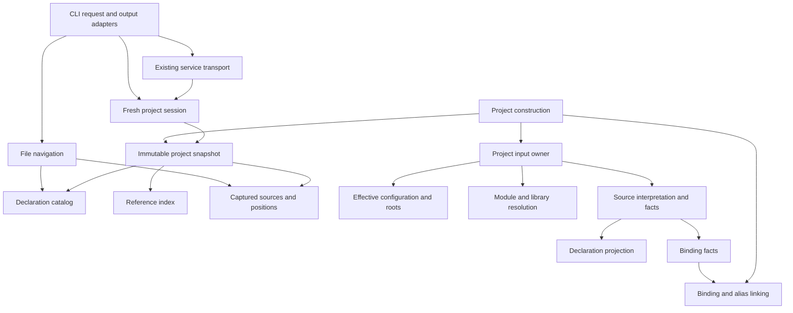

# Native project navigation: technical design

Status: implemented (plan steps 1–6, completed 2026-10-08) for the first
deliverable of `typescript-agent-tools#1`; revised from step-1 compiler
evidence, from each step's findings, and from seven implementation review
rounds, and reconciled with the implementation at step 6 and after the final
(seventh) review: lookup keys for imports and exports, grouped import lines in
text outlines, pasteable locations, and the comment-directive rules.
Scope selected by the user: **S, C, Q1, Q2**. This document records the behavior
and architecture as implemented; it does not authorize implementation of the
other ticket ideas. Historical implementation plans and reviews are available
in Git history; maintained validation is recorded in [validation](validation.md).

## Purpose and operating envelope

Let an agent find a declaration, read exactly that declaration, and navigate the
unchanged Command Center project without copying anchors out of whole files or
maintaining compatibility shims.

Keep the current native Rust implementation and TypeScript 7.0.2 semantic
baseline. The unpublished crate is built and run from its checkout; there is no
installed/relocatable distribution or known external Rust API consumer to support
in this delivery. Callers are local CLI processes and in-repository Rust library
consumers. Projects are one explicit tsconfig and its inputs, including installed
dependencies; project-reference traversal and JavaScript binding remain outside
this delivery.
Files can change between requests. The existing service serializes requests and
refreshes its captured inputs; its concurrency and failure contract remain the
baseline. Commands read source files and may start/reuse that service, but do not
edit the project or execute application code.

This delivery includes:

- **S:** the selection, output, and service support needed by outline and show.
- **C:** native project loading with standard libraries, JSON modules, and the
  augmentation behavior needed by unchanged Command Center.
- **Q1:** a declaration outline with kinds, locations, and syntactic signatures.
- **Q2:** the original source of one selected declaration, with line numbers.

Type inference, member reference searches, editing, dependency queries, test
selection, incremental indexing, and a general query/plugin framework are future
proposals. Recognizing a method declaration in syntax does not require resolving
calls to that method.

## User behavior

Extend the existing executable with explicit operation flags. This avoids a
second executable and preserves the interpretation of existing positional files.

```sh
tsparse --outline src/lib/runs/host.ts
tsparse --outline --project tsconfig.json --depth 2 src/lib/runs/host.ts
tsparse --show --project tsconfig.json --name createRunHost.startEligible
tsparse --show --name startEligible src/lib/runs/host.ts
tsparse --show --at 42:10 src/lib/runs/host.ts
tsparse --outline --project tsconfig.json src/lib/runs/host.ts --json
```

Without `--project`, navigation requires a named file and analyzes just that
file. With `--project`, it uses the project snapshot and the existing searched-file
set. Outline still names one file; show may search declarations across that set.
Project selection remains explicit: there is no implicit tsconfig discovery.
Navigation does not use stdin in this delivery; existing parse-mode stdin stays
available. A project-mode failure never falls back to a file-only answer.

### Request validity

One parsed-request boundary owns operation selection and option validity. It
produces an executable request or a usage error; downstream handlers never
re-decide which flag combinations make sense. Preserve established parse and
reference CLI behavior while adding this matrix for navigation:

| Operation | Project | File | Selector | Operation-specific options |
| --- | --- | --- | --- | --- |
| Parse (no operation flag) | Forbidden | Optional, including stdin | None | Existing parse options |
| `--outline` | Optional | Exactly one named file | None | `--depth`, `--json`, `--pretty` with `--json` |
| `--show` by name | Optional | Required without a project; optional with one | Exactly `--name` | `--json`, `--pretty` with `--json` |
| `--show` by position | Optional | Exactly one named file, as the operand or in `--at FILE:LINE:COLUMN` | Exactly `--at` | `--json`, `--pretty` with `--json` |
| `--references` | Required | Required for position, as for show; optional for name | Exactly one of `--name` (one identifier) / `--at` | Existing reference options |
| Existing service administration | Required | None | None | Existing administration options |

`-o` selects the result destination for queries. `--direct` selects direct
execution of a project query (outline, show, or references), and is invalid for
file-only navigation, parse, and administration. Keep `--references-direct` as
the existing reference-operation spelling. Reject conflicting operations,
selectors without an applicable operation, navigation stdin, and options outside
their rows. Output mode never changes selection semantics.

A position is `--at LINE:COLUMN` with the FILE operand, or
`--at FILE:LINE:COLUMN` without one, the form every text result prints, so an
agent can paste a printed location back. The value is read from the right, so
FILE may contain `:` (a Windows path); a FILE operand beside a located `--at`
is a usage error rather than a choice between two files. A reference name is
one identifier: reference candidates never contain `.`, so a dotted
`--references --name` would silently match nothing, and is instead a usage
error that points to show's qualified names and to `--at`.

### Declaration selection

Outline and show share one declaration catalog. Entries describe syntax sites,
not merged semantic symbols: two declarations of one symbol, such as interface
merges, overloads, or two `namespace N` blocks, are two entries. The
[catalog contract](#catalog-contract) lists which syntax produces an entry,
what it contains, and how it is named. Show does not follow an import or export
to its definition; those sites show their own declaration.

A qualified selector describes **syntactic containment**. For example,
`createRunHost.startEligible` selects a declaration named `startEligible` inside
`createRunHost`; it does not infer the type of a returned object. If containment
cannot identify one site, the caller uses the returned file and position.

A selector is lookup-key segments joined with `.`. Every key is one segment
except a dotted namespace's, which is its chain's segments (`namespace A.B.C`
has `A`, `B`, `C`). One rule decides what a selector can spell: a non-empty
segment containing no `.`. A selector with an empty segment (`a..b`, `.a`, `a.`,
or the empty name) matches nothing. An entry whose key segment cannot be spelled
(`"a.b"`, `""`), and every entry beneath it, has no qualified selector and is
selected by position; there is no quoting language. A selector matches an entry
when its segments, read from the end, equal the entry's key segments followed by
the key segments of its nearest keyed ancestors, in order, ending anywhere.
Unkeyed ancestors (anonymous functions and classes) are skipped and ancestors
beyond the selector are unconstrained, so `b.c` also matches `X.a.b.c`, and `C`,
`B.C`, and `A.B.C` select `namespace A.B.C` while `A` and `A.B` do not. An
unqualified name is the one-segment case. An entry reports its qualified
`selector` exactly when every segment is spellable (`settings.display-name`,
`@scope/pkg.X`). Case remains exact. Name matching never fuzzy-selects the first
result.

Keep lookup identity separate from presentation. A lookup key exists only for a
decoded identifier, a private name, an exactly representable string-literal
name, or a numeric-literal name (its normalized text). For imports and exports,
a key exists only at a site that declares a name in TypeScript's own
project-wide name question, "which declarations are named N"
(`ProvideWorkspaceSymbols` over `SourceFile.computeDeclarationMap`, which the
projection's specifier rule ports and names). That map adds an import or export specifier only when it
renames (has a property name), and a default import's name never yields one,
as the pinned `tsc --lsp` `workspace/symbol` confirms: `createThing` finds
its function declarations but not `import { createThing }` or
`export { createThing }`, while `made` in `import { createThing as made }`,
a namespace import, and `import x =` are found. Such a specifier keeps its
entry, label, anchor, `--at` targets, and excerpt, but has no key or
selector. Other sites keep the catalog's keys even where workspace symbols
differ (product rule): object-literal properties are keyed, so a name shared by
a declaration and a property, often a test mock, stays ambiguous and `--at`
chooses; a dotted namespace is keyed by its segments. The final review measured why this matters: on Command Center,
specifiers that repeat an exported declaration's name made a project-wide
`--show --name` ambiguous for 9,917 of 14,530 exported declarations that are
otherwise unique by name ([validation](validation.md#command-center-checkpoint)). Computed names,
string names containing an unpaired surrogate, and every label the catalog
supplies for an unnamed site (`default`, `<function>`, `constructor`, and the
others below) have no key. A site without a key still exists, retains its
anchor/range, and is selectable by position. Its label is original source text
or a lossless escaped rendering; that label is never a lookup key. In
particular, two distinct lone surrogates must neither merge with each other nor
with a literal U+FFFD. A valid surrogate pair has its normal exact key. Building
navigation alongside references must not make a previously loadable,
unreferenced member name fail project loading. Do not use the binder's
identity-required text conversion for optional keys.

`--at` selects a declaration's name token or its displayed anchor. It is a
disambiguation mechanism, not go-to-definition at an arbitrary use. Outline and
ambiguity results always supply a usable anchor. A name that identifies several
overloads, merged declarations, same-named block locals, or a renaming import
beside a declaration of its name is ambiguous; show lists the candidate
locations, with their qualified selectors, instead of choosing one. No match is a diagnostic.
Keeping overloads separate makes name lookup less convenient, but preserves one
selected syntax site and avoids introducing overload-family/grouping rules into
the catalog. The returned anchors provide the explicit choice.

### Outline baseline and deliberate differences

TypeScript 7.0.2's document symbols are the comparison baseline for inclusion,
naming, and containment. TypeScript 7 has no port of the older
`getNavigationTree`/navigation-bar code: the native language server computes
document symbols in `internal/ls/symbols.go` (`ProvideDocumentSymbols`,
`getDocumentSymbolsForChildren`, `newDocumentSymbol`, `getUnnamedNodeLabel`,
`mergeExpandos`), served by `tsc --lsp --stdio` as `textDocument/documentSymbol`.
Those symbols answer an editor-outline question; this catalog answers the
related question of selecting exact syntax sites. The projection follows the
compiler's traversal and labels where they serve selection, names the Go
functions it ports, and labels product rules as such.

The synchronous semantic API has no navigation method, so a bounded test-only
harness speaks the language-server protocol to the pinned binary
(`tools/navigation-oracle.mjs`), and `tools/navigation-conformance.mjs` compares
the catalog with it inside `semantic` validation: labels, containment, fine
kinds against the syntax at each range, and ranges, with each allowance decided
per entry by its own syntax and never inherited by descendants. The compiler's own expected outputs in
`testdata/baselines/reference/fourslash/documentSymbols/` supply further cases.
AST evidence remains authoritative for exact tokens/spans. Deliberate
differences:

| Catalog policy | Reason for the difference from editor navigation |
| --- | --- |
| No shorthand-property or spread entries; a spread's expression is traversed | Reading `return { run }` must not duplicate the declaration of `run`; a spread declares no name. The compiler lists a spread as a leaf labelled by its expression and hides declarations inside it. |
| No merging: same-named namespaces, ambient modules, and `declare global` blocks, and properties that share a name with a sibling function, class, or variable, remain separate entries | The compiler merges these into one editor entry and keeps only the first span (a property beside several same-named siblings merges into each, so its contents repeat under every one); each syntax site must stay selectable with its own excerpt. |
| One entry per variable binding; show includes its variable statement | Each binding remains selectable, while its excerpt preserves declaration syntax. Bindings in one statement are siblings at the same depth; there is no statement-level outline container. |
| Overload signatures and implementation remain separate sites | Same as the compiler; recorded because selection depends on it. |
| Parameters, type annotations, type parameters, decorators, and heritage clauses are not traversed | They contribute to signatures. The compiler lists destructured parameters and type-literal members of function-valued initializers but not of function declarations; one rule for every function is easier to predict. |
| No expando entries for `f.x = …` assignments | Assignments are not declaration syntax; JavaScript-style binding is outside this delivery. |
| No entries for JSDoc `@typedef`/`@callback` tags | In TypeScript files they declare nothing; the compiler lists them in every file kind, even a `@typedef` mentioned mid-sentence. |
| Unnamed sites have labels but no lookup keys | Labels such as `describe('x') callback` or `default` are presentation, not declared names. |
| Names are not truncated | The compiler truncates at 150 code points; exact names are identities here. |
| Two visible declaration levels by default | This is an output filter for bounded agent reading, not a compiler traversal or parsing limit. |
| Position-only sites for nonrepresentable/computed names | Preserve sites and exact-name guarantees without inventing lookup names. |
| Product kind vocabulary | The compiler reports type aliases as classes and accessors, index signatures, imports, and exports as properties or variables; agents need the syntax family. |

Anonymous functions and classes follow the compiler: each is an entry with the
compiler's label and contains its declarations. An earlier draft made them
transparent, but on a 318 KB Command Center test the compiler lists 5,198
entries under 273 callbacks: flattening them would put every test's locals at
file level, while `describe('…') callback` entries give agents the test
structure and a position for showing one test.

<a id="catalog-contract"></a>
### Catalog contract

The projection walks the final tree from the root with an explicit stack and
ports the containment of `getDocumentSymbolsForChildren`. Every projection
helper, not only the walk, is bounded by its input rather than by native
recursion, because the parser reads some unbounded shapes in loops that no
grammar budget limits: a callback's callee chain, which TypeScript's
`getCallExpressionName` recurses down, is walked in a loop and its label
assembled once, and a signature reads its source, and finds the bodies it
elides, only as far as it renders. Apart from output that repeats input, such
as a label naming a long chain, projection work is linear in the tree and its
text. A selection index's projection renders no signature and no label of an
unnamed site, since it keeps neither. An entry's children
are the entries found inside it; any other syntax is transparent, so entries
inside it belong to the nearest enclosing entry. Every entry consumes one
display-depth level.

| Syntax | Entry | Kind | Children come from |
| --- | --- | --- | --- |
| Function declaration; function expression or arrow that is not the initializer of a listed variable/property | yes | `function` | body only |
| Class declaration; class expression that is not such an initializer | yes | `class` | members; a static block is transparent |
| Interface | yes | `interface` | members |
| Type alias | yes, leaf | `type` | none |
| Enum / enum member | yes | `enum` / `enum_member` | members / none |
| `namespace A.B.C` (one entry for the dotted chain) | yes | `namespace` | the innermost body |
| `declare module "m"`, `declare global` | yes | `module` | body |
| Method (class or object literal), method signature | yes | `method` | body |
| Get/set accessor (any container) | yes | `accessor` | body |
| Constructor | yes | `constructor` | body; parameter properties follow it as `property` siblings |
| Call, construct, and index signatures | yes, leaf | `signature` | none |
| Property declaration, property signature, property assignment | yes | `property` | the initializer's contents |
| Variable declaration or binding element with an identifier name | yes | `variable` | the initializer's contents |
| Variable declaration with a binding pattern | no; each identifier binding is an entry | — | the pattern only, not the initializer |
| Default/namespace import name, import specifier, `import x =` | yes, leaf | `import` | none |
| Export specifier; `export =` | yes | `export` | none / the expression's contents |
| Shorthand property, spread (object, array, argument), `export default <expression>`, `export *`, expando assignment | no | — | transparent: a spread's expression and a shorthand's destructuring default contribute their declarations to the enclosing entry |

"The initializer's contents" means the initializer is visited as transparent
syntax: a function, arrow, class, or object-literal initializer adds no entry of
its own, so `const run = () => { function step() {} }` lists `step` inside
`run`, while `const run = wrap(() => …)` lists `wrap() callback` inside `run`.
Function bodies are traversed; parameters and types are not.

Labels port `newDocumentSymbol`/`getTextOfName` and `getUnnamedNodeLabel`:
identifiers and private names as decoded; string-literal names as a
double-quoted, escaped rendering; numeric names as their normalized text;
computed names as their source text; the dotted namespace chain joined with
`.`; `export=`; `default` for an anonymous default-exported function or class;
the assignment target's name for a function or class assigned with `=`
(`GetAssignedName`); `name(args) callback` for an anonymous function passed
directly to a call whose callee is a name or property-access chain, with
string/template arguments as written; otherwise `<function>`/`<class>`;
`constructor`; and `()`, `new()`, and `[]` for call, construct, and index
signatures. Only the cases listed in [Declaration selection](#declaration-selection)
have lookup keys.

An entry's anchor is its name token, the first segment of a dotted namespace,
or the first token of an unnamed site. Its range and show excerpt run from the
first declaration token, including decorators and modifiers, through its last
token. A variable binding's excerpt is its variable statement (a loop's or
`catch` clause's declaration list or declaration when there is no statement);
an import specifier or export specifier shows its whole import or export
declaration. Every entry with a name token is selectable with `--at` on that
token or on its anchor.

There is one projection-owned kind vocabulary shared by text and JSON:
`function`, `variable`, `class`, `interface`, `type`, `enum`, `namespace`,
`module`, `method`, `accessor`, `constructor`, `signature`, `property`,
`enum_member`, `import`, and `export`. Map declaration syntax families there,
never separately in renderers. A function-valued variable remains `variable`; a
class arrow field or object property remains `property`. Expose no numeric AST
kind IDs as the navigation contract.

### Output and spans

New navigation operations default to compact text; `--json` returns structured
results. Existing parse/reference JSON contracts and defaults stay intact.
`--pretty` formats navigation JSON when `--json` is selected; `-o` selects the
output destination. Mutually exclusive operations and irrelevant options fail
as usage errors. `--direct` permits comparison with service results; retain
existing reference-mode options.

Outline is in source order with containment visible. Its default depth is two
declaration levels; `--depth` selects another positive depth, and `--depth all`
requests the complete hierarchy. An entry whose children are cut by the depth
reports how many it has. The library returns the complete outline as a flat
preorder list with each entry's depth, so service transport never nests deeply;
the CLI builds the nested JSON shown below without recursion. Signatures
summarize written syntax without inferred
types: the declaration header through its parameters and return type, the
class or interface header, a type alias or variable with its type and an
abbreviated initializer. Runs of whitespace and comments between tokens may
collapse to one space and long text may end in `…`, but token and literal
contents are never altered, including whitespace inside a literal or JSX text
token at the abbreviation point. A signature is absent where the label says
more: callbacks and other unnamed function expressions, bindings inside a
pattern, and import/export specifiers. Exact declaration source remains
available through show.

Each entry carries its label, optional lookup key, optional qualified selector
(its keyed ancestors and key joined with `.` when every segment is
identifier-like), kind, anchor, declaration range, and signature. Positions use
existing one-based line/UTF-16 column conventions and exclusive ends. Positions
use the text TypeScript reads (`decodeBytes`): a leading UTF-8 byte order mark
is not text, so line-1 columns, excerpts, and syntax-error positions match `tsc`
and editors (`\u{FEFF}const a = 1;` has `a` at 1:7). One source owner applies
this to file navigation and project loading (sources, configurations,
manifests); parse mode keeps the mark in its AST. Lines are ECMAScript lines
(CR, LF, CRLF, U+2028, U+2029) as `tsc` reports them; the oracle converts the
language server's protocol lines, which break only at CR and LF. A project response names its configuration file,
as references do, and uses paths relative to its directory; a file-only
response names its absolute file. No arena or symbol IDs escape as durable
selectors.

```json
{
  "operation": "outline",
  "outcome": "ok",
  "project": "/abs/app/tsconfig.json",
  "file": "src/runs/host.ts",
  "entries": [{
    "label": "createRunHost", "key": "createRunHost", "selector": "createRunHost",
    "kind": "function",
    "anchor": { "line": 12, "column": 17 },
    "range": { "start": { "line": 12, "column": 1 }, "end": { "line": 40, "column": 2 } },
    "signature": "export function createRunHost(deps: RunHostDeps): RunHost",
    "children": [],
    "omitted_children": 3
  }]
}
```

The text form prints the file, then one line per entry, indented by depth, as
`LINE:COLUMN kind signature` (or the label when there is no signature), and a
line naming how many children the depth omitted. One exception keeps imports
from dominating the text: an import declaration's entries, which share its
range, print as one line at the first name's anchor, listing their labels
(`1:8 import def, alias, Only`; past eight names, `… N more`). That anchor, not the `import` keyword, is the
line's location because `--at` selects it, and shows the whole declaration.
On Command Center, imports were 22% of all default-depth text outline lines.
This is presentation only: the catalog and JSON keep one entry per imported
name, and the line shows labels rather than the module, because a renderer
lays out library results and the specifier entries carry no declaration
text. A follow-up option, not implemented, would hide the locals of function
bodies at the default depth unless an entry is a function or class; on
Command Center, object-literal properties and locals inside function bodies
are a further 27% of the default text.

Show returns the exact source slice from the first declaration token, including
decorators/modifiers, through its last token. Leading comments/trivia outside
that span are excluded. A variable binding displays its enclosing variable
statement, which may include sibling bindings; its selection anchor still names
one binding. Overload signatures are separate sites. JSON preserves the exact
slice; text adds original line numbers without reformatting the source. Show
does not silently truncate a large declaration.

An empty outline succeeds. Show's missing/ambiguous target, syntax, unsupported
input, and project-analysis errors use exit 1; usage, position, outside-project,
I/O, and transport errors use exit 2. Errors remain typed until the CLI chooses
an exit. As implemented, every operation, file or project, reports the
crate-level `analysis::AnalysisError`: an `InputError` for inputs that could
not be analyzed (`Io`, `Config`, `Syntax`, `Unsupported`, `Binding`,
`UnresolvedImport`; file navigation produces only the first three) or a
`QueryError` for a request that does not fit them (`OutsideProject`,
`InvalidPosition`, `UnsupportedTarget`, `UnresolvedTarget`), with positions
as `source::SourcePosition`s, and one CLI function decides each kind's exit
code. Neither `source` nor `navigation` depends on `project`; reference
results keep their configuration-relative `references::Location`.
Missing show targets deliberately differ from reference name queries,
which retain their successful empty-result contract.

### Show outcomes and delivery channels

Show has three selection outcomes: `found` (one declaration and exact source),
`ambiguous` (all matching candidates, no source excerpt), and `not_found` (the
requested selector/scope, with no candidates). The latter two exit 1. An
ambiguity candidate carries the file, display label, owned kind, exact name and
qualified selector when available, and a one-based line/UTF-16-column anchor;
the text form prints each as `FILE:LINE:COLUMN kind label (selector)`.
Include the project/path base so a consumer can turn that anchor directly into
`--show --project ... --at ... FILE`. Do not overload today's single-location
`QueryError` and lose the candidate collection. A typed outcome or typed error
payload is an implementation choice.

| Mode | Found | Ambiguous or missing |
| --- | --- | --- |
| Text | Result on stdout; no stderr | No stdout; diagnostic and candidate anchors on stderr |
| JSON | One document with `outcome: "found"` and the declaration/source | One document with `outcome: "ambiguous"` and `candidates`, or `outcome: "not_found"` and selector/scope; no stderr |

For JSON, the document's common `operation`, `outcome`, and path-base fields
identify the result independently of exit status. Other analysis failures for a
valid navigation request use `outcome: "error"` with the typed kind and location;
they follow the same JSON destination policy. Text failures go to stderr.
`-o` redirects the result document rather than stderr: successful output and JSON
selection/error outcomes go to that file, leaving stdout empty. A text failure
does not create or replace the output file. Usage errors before a valid request
and failures to write the result are stderr diagnostics with exit 2; do not emit
a second purported JSON result to compensate for a failed write. One CLI delivery
policy applies these rules to file, direct-project, and service outcomes.

File-only navigation intentionally knows nothing about unrelated
project failures. Project navigation retains complete-project loading and
failure behavior; it does not establish a new partial-analysis mode.

## Architecture: manage complexity at each level

The following view shows owners and their dependencies, not a required directory
layout or a class per box. Each boundary must let its caller understand the operation
without reconstructing the child's algorithm. Private visibility alone is
insufficient: children must also own coherent state and invariants.



### Complete operations and snapshot ownership

Extend the current immutable project snapshot and refreshable session with
complete outline/show operations alongside references. Rename the reference-named
owners to `Project` and `ProjectSession` when integrating navigation. With the
unpublished crate and no known external API consumer, update in-repository
callers and docs directly; do not add compatibility aliases or wrapper state.
This naming change does not rename existing CLI commands or reference-result
formats. File navigation offers the same result semantics
using a single captured source and the same declaration projection.

CLI and service callers request an operation. They do not load files, resolve
names, convert positions, or coordinate index builders themselves. A request
makes its own file operand absolute against the caller's working directory
(`ProjectRequest::make_absolute`, which alone knows each operation's operand)
before either entry answers it, and gives the operand's spelling back to the
diagnostics that name it, so the service, whose working directory differs,
answers as a direct load would. A query path names a searched file only by
its exact text: the shared lookup (`FileLookup::find`) rejects a path that is
not Unicode as `Unsupported` for every operation, as file navigation does,
rather than matching its lossy form. Session
execution owns refresh-before-query for every operation; one dispatch boundary
enforces freshness rather than leaving each handler to remember it. The service
owns transport/process lifecycle, not analysis rules or terminal rendering.
Verify that there is one session execution boundary, not three operation methods
each calling refresh. Direct CLI project queries and service requests both use
it; an immutable library snapshot remains explicitly captured, without hidden
filesystem refresh. The CLI has one discoverable outcome-to-exit/channel policy.

File navigation owns its parsing stack as part of the complete operation. Use
the same deep grammar budget as project loading (`DEEP_MAX_DEPTH`, currently
1,024) on an operation-owned thread with `DEEP_PARSE_STACK_BYTES`. Callers do not
choose a stack size or create the thread. Any query-time reparse uses this same
policy. As implemented, the thread hands its work the only means of parsing
analysis text (`analysis::Parser`, for TypeScript and JSON), which parses only
with that budget and cannot leave the thread, so loading, configuration and
JSON reading, file navigation, and project reprojection cannot pair the budget
with another stack. Existing parse-mode defaults remain unchanged. `--depth`
filters outline presentation only; it cannot admit or reject syntax.

The catalog representation stays behind its complete operations. Plan step 4
compared two materializations ([measurements](navigation-performance.md)) and
keeps the second:

- **Eager records (measured, not kept):** capture complete declaration facts
  during each existing parse, then discard ineligible dependency records when
  provenance is known. Warm queries avoid parsing, but on unchanged Command
  Center the records retained about 181 MiB beyond the reference index (+58%)
  for the life of the snapshot.
- **Compact index plus selected-file projection (the implemented
  architecture):** while each input's syntax tree is alive, the same
  projection, without rendering signatures or the labels of unnamed sites,
  captures each keyed site's key, nearest keyed container, kind, anchor, and
  ordinal among the complete records; provenance then keeps the indexes of
  searched files only (about 25 MiB, +8%, on Command Center). The index is
  the one owner of name selection and of each keyed site's key, selector,
  and candidate, so every name search, across the searched files, narrowed
  to one, or in file mode, applies one rule. A missing or ambiguous name
  reads only the indexes, and ambiguity candidates come from them. Outline,
  show by position, and a name that matches one site project the selected
  file's captured text again with the shared parsing capability, the
  file-mode path, so a successful unique-name show pays the index search plus
  that reprojection. On Command Center's largest file the reprojection costs
  about 30 ms and 8 MiB per query, under a tenth of the 370–400 ms that a warm
  request there spends validating freshness; on a project that validates
  quickly, such as the compiler sources (about 7 ms), the reprojection of a
  3 MB file (about 160 ms) is most of the request.

Both use the same declaration projection and the same captured source; neither
keeps all ASTs, rereads current disk for a snapshot query, or reparses the whole
project per query. Each index holds the captured text it describes, so a
reprojection reads the text of its own generation. There is no mutable
per-file cache. Source, selection indexes, and any projected result belong to
one generation; no index is independently refreshed.

### Inside navigation

| Internal owner | Knowledge hidden | Contract to its parent |
| --- | --- | --- |
| Declaration projection | Syntax families, the kind vocabulary, exact optional lookup keys versus labels, containers, anchors, excerpts, and signatures | Project one final AST into self-consistent declaration records. No module resolution or filesystem access. |
| Catalog and selection | File/name/containment indexes and ambiguity | Return exactly one declaration, all matching candidates for a diagnostic, or an explicit failure. Outline and show use these same records. One selection index owns name matching and each keyed site's key, selector, and candidate, for a snapshot's captured index and a reprojected or file-mode catalog alike. |
| Source/position owner | Captured text, byte ranges, UTF-16 coordinates, all ECMAScript line breaks | Convert/slice against the captured source with boundary validation. Reuse the existing source owner. |
| Output adapters | Text layout, JSON encoding, depth presentation, and line-number decoration | Render the selected result without making declaration or selection decisions. |

The projection keeps a small traversal context for containment; declaration
shape operations own syntax-family differences such as callable headers,
container members, and variable statement excerpts. These operations return
facts rather than mutating the entire project builder. Share them where the
same rule is needed; do not introduce one visitor per command or expose arbitrary
AST fields to renderers. Preserve iterative final-tree traversal and existing
token-span/name rules from `Ast`; allocated speculative nodes are not declarations.

### Inside project loading and binding

The loader orchestrates graph discovery and capture. Effective options, input
classification, library selection, JSON interpretation, and symbol merging are
separate decisions, each with a narrow contract. Extend those owners rather
than adding feature-specific branches throughout `load_file` and `link`.

In particular, augmentation work must give declaration combination a complete
operation over canonical symbol identities. Alias resolution owns route and
meaning restrictions; merging owns compatible declaration identity and table
updates; diagnostics owns whether a proven failure is reported. An augmentation
must not manipulate all three independently. Resolve and merge to a stable
identity before publishing resolution/index results; cached alias answers cannot
survive a merge that invalidates them.

This does not call for splitting the entire binder upfront. Extract or reshape
the touched operation when doing so hides its invariants from surrounding code.
Moving `impl Linker` methods into more files while every method still accesses
all linker state would not establish an internal boundary. Conversely, helpers
whose meaning cannot be understood without their caller should stay together.

## C: compatibility without special cases for Command Center

### Standard libraries

Vendor the pinned TypeScript 7.0.2 declarations as on-disk data in this checkout,
with provenance and license. One internal data owner resolves that directory
from the build's checkout location; it does not search for a nearby compiler,
download data, or require a runtime compiler process. The binary depends on
that checkout data, as fits current use. Missing data is an explicit I/O failure;
moving the checkout requires rebuilding. Reference declaration paths stay real
and inspectable.

| Provisioning alternative | Benefit and cost | Decision |
| --- | --- | --- |
| Plain vendored directory | Reuses normal file capture/observation and readable declaration paths; depends on the build checkout | Choose for the present envelope |
| Installed/relocatable data with caller-selected roots | Supports a separately distributed binary/embedding; adds lookup, option, validation, and service-identity contracts | Defer: no such distribution or caller is established |
| Build-time embedding | Small fixed payload and no bundled-data filesystem reads; declaration locations have no openable file | Defer: changing the path guarantee or adding source extraction/virtual-source retrieval costs more than this delivery needs |

The local pinned package contains about 3.8 MB of declaration data, so size alone
does not select the option. The decisive factor is preserving existing readable
locations with the fewest new mechanisms. There is no installation override or
relocation promise in this delivery.

Keep library *selection* separate from data *provisioning*. Selection owns the
pinned compiler's target/default-lib rules (`GetDefaultLibFileName`; an unset
target is ES2025, selecting `lib.es2025.full.d.ts`), explicit `lib` including an
empty list (no libraries), `noLib` (which also ignores every
`/// <reference lib>`), transitive `/// <reference lib>` directives from any file
including library files, order/deduplication (`getDefaultLibFilePriority`: libraries
first), and `libReplacement` (off by default; `@typescript/lib-*` packages resolved
as `require`-mode modules from the configuration directory, never for
`lib.d.ts`). Config decodes relevant options once; the library selector consumes
those values. In 7.0.2 a `no-default-lib="true"` attribute only makes the parser
ignore that whole directive; it does not affect library selection. The rule for
which reference directive applies had two owners (`directives.rs` and the
parser's pragma validation); as implemented it has one, `crate::pragmas`, which
the parser's validation and loading both ask. Use the
resolver's module operation for replacement lookup, which is the distinct
resolution question TypeScript asks (`resolveLibrary`).

Use a versioned catalog from the pinned compiler (`tsoptions.LibMap`,
`GetLibFileName`) instead of separately maintained name lists in config
validation and lookup. Search membership and diagnostic tolerance remain
separate policies: standard libraries supply globals and declaration identities
without flooding project navigation/reference occurrences. Library files get a
third provenance, beside project and external-library files, rather than an
overloaded dependency flag; like the compiler, a library is never external and
never searched, even when a replacement package supplies it. The semantic oracle
already defines searched files as neither default-library nor external-library
files, so this matches its model; TypeScript's own find-all-references also
searches library files, which remains a documented difference. An explicitly
selected declaration root keeps its proper provenance.

All library reads and replacement-resolution probes join the existing observation
set. Missing vendored data, unreadable inputs, and resource limits stay failures.
The existing build identity already watches vendored data; no selectable data
installation needs a new service-identity field. Changes to disk inputs still
require freshness checks between builds. Replacement libraries from installed
packages remain ordinary observed filesystem inputs regardless of how bundled
data might be provisioned in a future delivery.

### JSON modules

Add JSON as an explicitly interpreted program input. Extend existing file-kind,
root-selection, literal-file, and resolver owners together, so imported JSON and
explicit JSON roots do not follow inconsistent support rules. Preserve the
`resolveJsonModule` option's effects and ordinary filesystem error semantics.

Use one lossless owner for the TypeScript JSON syntax shared by configuration
and source modules; keep the strict package-manifest dialect separate. The native
7.0.2 source confirms one grammar: configuration files and JSON modules both use
`parser.ParseSourceFile(..., ScriptKindJSON)`, which runs `parseJSONText`. The
sites differ only after parsing: a configuration root must be an object (or an
array holding one; empty or comment-only text is an empty configuration) and
repeated keys keep the last value, while a JSON module accepts any root value and
an empty or comment-only file. The reader this delivery started from differed
from that grammar in both directions (it rejected `0x10`, `1_000`, `.5`, a
leading `#!` line, and empty text, and accepted `01` and `\8`); as implemented,
its token rules are the parser's, in the same owner.

Extend that reader's representation to retain full value/key spans, exact
UTF-16 keys, and repeated properties in source order. Put configuration
conversion above that lossless representation, in TypeScript's three steps,
which ask different questions. Raw conversion
(`convertObjectLiteralExpressionToJson`) keeps each key's last value, `null`
included, and leaves out a property with an empty name. A file's own option
setting (`onPropertySet`) is the last occurrence, across its `compilerOptions`
objects, whose converted value is not nil: `null` and an empty enumeration
string set nothing, while a list's `null` clears the list. Inheritance
(`applyExtendedConfig`, `mergeCompilerOptions`) takes `files`, `include`, and
`exclude` from a file's raw object whenever it has the key, `null` included,
and otherwise from the last base whose value is a list; and, for a file with
an `extends` key, merges each base's merged options and then the file's own,
where a zero-valued setting does not replace an inherited one and the file's
explicit `null` (the last value in its last `compilerOptions` object) unsets
it. JSON module projection uses the same parsed facts and applies the
compiler's module/export rules; neither consumer reconstructs facts the reader
discarded. Do not copy the
current config reader's omission of unrepresentable option keys into identity
handling, or duplicate the parser to avoid fixing its representation. If the
native evidence distinguishes a grammar rule at a site, model that narrow
distinction in this owner rather than assuming whole dialects differ.

The JSON module adapter supplies module/export facts needed by linking without
generating fake TypeScript declaration text or implementing value-type inference.
The binder gives a JSON file one export, `export=`, a property whose declaration
is the source file (`bindSourceFileIfExternalModule`). Default, namespace,
`import =`, and `{ default as x }` imports resolve to it. Any other name, through
a named import, a re-export, a qualified name, or a module whose `export =` is
the value or a property of it, selects a property of the value's widened type
without `Object`'s members (`getExternalModuleMember`, `getPropertyOfType` with
`skipObjectFunctionPropertyAugment`): an object's key, along every path of keys,
or, for a string, number, boolean, or array, a member of the global `String`,
`Number`, `Boolean`, or `Array` interface as the loaded libraries and global
declarations declare it. A name the type lacks, any name of `null` or an empty
file, and a value used as a type or namespace are unresolved. Linking keeps that
target, the file and value or the interface and member, with its value-only
meaning, until the query boundary projects it to `UnsupportedTarget`, so star
exports compare it and later names select its properties. Where a member is
inherited or its own type is needed, linking reports the name unsupported rather
than inferring types. Admitting a resolved file to the program is separate from
finding it (`GetResolutionDiagnostic`): a `.tsx` file needs `jsx`, JSON
`resolveJsonModule`, and an arbitrary-extension declaration such as
`data.d.json.ts` `allowArbitraryExtensions` or a declaration-file importer, and a
blocked request is unresolved without falling back to the JSON file beside it.
A valid JSON dependency must not prevent loading the project. Do not substitute
an unrelated successful reference group. JSON property navigation/type
inference is outside Q1/Q2; explicitly navigating a JSON file reports
unsupported navigation input.

### Module augmentation

Fix the TypeScript rule exposed by TipTap, without matching package names or
suppressing binding errors. Investigation found the relevant shape: an interface
declared locally in a dependency, exposed through an export specifier, then
augmented from another file. The pinned compiler merges the original and
augmentation declarations. A reproduction confirmed the failure path: the
linker binds augmentation declarations directly into the target module's export
table; where that entry holds only an export alias, it creates a separate symbol
and its deferred alias-conflict check then fails the load. TypeScript's
`mergeModuleAugmentation` calls `mergeSymbol`, which follows such an alias
(`resolveSymbol`), checks exclusions against its target, clones the target as the
merged identity, and replaces the alias in the merged export table. The alias
target and merged identity, not just the conflict diagnostic, are the question
to port. The same probes show related silent differences to settle in the same
owner: augmentations reached through `export *`, through `export =` (including
the TS2671 error for a non-namespace target), pattern ambient modules, and
`declare global` nested in an augmentation (TS2669). Name those functions in the
owning implementation's comment.

Start with a minimal Rust reproduction and pinned semantic expectations. Extend
the declaration-combination owner for the established rule, including export
aliases/re-exports, type parameters, meanings, and negative conflict cases the
rule distinguishes. Fixing only the final diagnostic would conceal incorrect
symbol identity. Reference queries from original declarations, augmentations,
and consumers must agree before the real-project probe can count as success.

The merge is one complete operation over effective symbols, and it builds the
global table as well as augmented modules, in TypeScript's `initializeChecker`
order: in program order, each script's top-level declarations, bound by the
binder's same-table rule, merge into the global table by the checker's
`mergeSymbol` (`mergeGlobalSymbol`), and after each file its UMD globals
(`export as namespace`, declared only at the top level of a declaration file's
module) enter only where no global has their name; then every file's `declare
global` blocks merge by `mergeModuleAugmentation` and `mergeSymbolTable`; then
the ambient modules TypeScript defers (`ambientModuleSymbols`): each script's
declarations of one ambient module name, exact or pattern, form one symbol and
table by the binder's rule, the first such file's becoming the module and each
later file's merging into it by the same `mergeGlobalSymbol`, so the module's
first declaration in that order decides whether it is shorthand
(`isShorthandAmbientModuleSymbol`); then module augmentations merge. Ordinary
same-scope conflicts (TS2451, TS2300 within one table) stay the binder's
decision.

A checker merge consumes every target an alias or star export resolves to,
including a value that is not a reference target (a JSON value or property, or
a library member): it holds the value as a symbol with the property's flags, so
a `const` or instantiated namespace conflicts (TS2451, TS2300) and an interface
or namespace of types merges beside it; the name keeps the value meaning, which
the query boundary projects to `UnsupportedTarget`. A resolved value is never
treated as an unresolved alias.

The merge keeps three relations apart. A symbol's owned declarations are what it
declares and what merges gave it, both ways or one way (a pattern ambient
module); compatibility checks such as identical type parameters (TS2428), and
type-parameter identity, read only these. Its alias-reachable declarations are
those an alias among its declarations names; queries list them in the group,
one way, but nothing about the target merges into the symbol. The view a
declaration selects is the symbol it denotes after merging; checks run from the
declarations the diagnostic policy covers, against the views they select. An
augmented pattern specifier exposes the pattern's complete exports while merges
run, so a temporarily absent export is never taken for an unknown alias.

Classifying a declaration as an augmentation follows one scope rule
(`IsModuleAugmentationExternal`) for string-named modules and `global`,
including a module directly inside a script's top-level ambient module or
`declare global` block, plus the parser's gate (`collectModuleReferences`): a
string-named module counts only in an ambient context. An augmentation of a
specifier that only a pattern ambient module matches decides its target at its
own turn (`mergeModuleAugmentation`): while no merge has merged into the pattern
module, it creates the specifier's module, which merges the pattern one way,
and from then on the specifier's requests denote it, while earlier merges saw
the pattern; once a merge has merged into the pattern, the augmentation merges
into it both ways. An augmentation's name adds no file (`shouldAddFile`); its
target is an input only by another route.

Whether a diagnostic at a place fails the load is one decision,
`Diagnostics::reports(file, offset)`, for every binding error and every missing
input (module, reference directive, augmentation target): TypeScript's complete
`SkipTypeChecking` (`noCheck`; `skipLibCheck` on a declaration file;
`skipDefaultLibCheck` on a default library; JSON and `// @ts-nocheck`), comment
directives, and the product's dependency leniency (only project files are
reported). Comment directives keep TypeScript's narrow lexical rules, owned by
`crate::pragmas` with the other comment syntax: `processCommentDirective`
accepts only spaces and tabs between a directive's parts, and
`getDiagnosticsWithPrecedingDirectives` reaches past a line only when
`isCommentOrBlankLine` accepts it, after spaces and tabs only, empty up to CR,
LF, or the end of the text, or a `//` comment. These are deliberately not the
lexer's whitespace and line breaks: before the final review a Unicode trim let
a no-break space, vertical tab, form feed, or an empty line ended by U+2028
extend a directive, so projects that `tsc` rejects loaded and answered
queries. `fixtures/json-probes` holds the compiler's answers for every space
class and line break in each position. Where TypeScript reports one diagnostic at several declarations, any
reported one fails; where none is, same-table conflicts merge and the checker's
choice stands. Product limits (resource, depth, I/O, unsupported inputs) are
failures outside this decision.

Program order is TypeScript's `collectFiles` order for every input (each file
after its subtasks; libraries first by priority), and global, pattern, and
augmentation merges follow it. Library provenance follows the task TypeScript's
loader starts first; equally deep routes race in TypeScript and take the earlier
one here. One store owns tables, symbols, modules, and request targets; its
methods are the only writers and mark every change, so a resolution made
before a write is redone.

Identity policy (product rule): every route to an augmented declaration reaches
one canonical merged identity. The compiler instead keeps alias targets it
resolved before a later merge, so a module that re-exports an augmented
declaration, or two augmentations reaching it through different modules, can
leave tokens on an unmerged clone and split one declaration into several
reference groups depending on program order. Those splits are compiler
bookkeeping, not a language rule an agent could act on, so this tool keeps the
canonical identity and records the difference. Maintained exception tests hold
both the compiler's expectation and this tool's for each such shape, so a later
change to either is visible.

## Alternatives and complexity checks

| Decision | Chosen direction | Alternative and tradeoff |
| --- | --- | --- |
| Native versus production compiler backend | Keep native analysis for this scope; bundle declarations as data | A compiler backend could serve future type queries, but adds runtime/distribution and semantic-adapter work unnecessary for syntax navigation. |
| Reuse reference occurrences for navigation | Add a syntax declaration catalog | Occurrences retain token locations, not declaration hierarchy, bodies, or signatures. Adding these meanings to the reference index couples two different questions. |
| Project storage | A compact selection index per searched file, projecting the selected file at query time (step 4 measurements) | Eager complete records answer without parsing but retained several times the index's memory on Command Center; both preserve one projection and snapshot semantics. |
| Outline rules | Use native document symbols as a comparison baseline for a syntax-site catalog, with recorded differences | Exact editor-tree parity adds synthetic labels/groupings unsuited to declaration selection; an undocumented custom outline conceals its departures. |
| Freshness | One session and coherent snapshot; full refresh initially | Per-command caches or independently lazy indexes introduce invalidation/state combinations before measured need. |
| Public command surface | Extend `tsparse` with operation flags | New executables or a command/plugin framework add packaging and configuration without helping these two operations. |

At each implementation checkpoint, exercise concrete change scenarios:

- Adding a declaration syntax family should change its projection and evidence,
  not CLI dispatch, selection, or service freshness.
- Changing text presentation should not change catalog identity or JSON source.
- Changing a library-selection rule should affect its owner and compiler
  comparisons, not navigation or every loading caller.
- Changing a merge rule should have one decision owner; original declarations,
  exports, and augmentations must not each reimplement it.

These are change-cost checks, not mandates for a fixed file count. Beyond the
top-level owner names, leave Rust types, data structures, helper placement,
catalog indexing strategy, and signature formatting machinery to implementation.
Decide from actual call
sites and measurements while preserving the contracts above.

## Evidence and remaining uncertainty

**Final evidence (plan step 6, 2026-10-08, commit `dfc65e2`, Command Center
`7706073d2`).** The unchanged configuration loads with no shim: its 7,639
program inputs equal the pinned compiler's in set, order, and provenance;
ordinary, library (`Promise`, `Map`, `document`), JSON, and TipTap `Commands`
(78 declarations) references answer as the compiler and the documented model
expect; every one of its 5,319 searched files matches TypeScript's document
symbols apart from the documented differences; and outline, qualified show,
and the ambiguity round trip answer identically through the service and
`--direct` ([validation](validation.md#command-center-checkpoint)). Two
defects surfaced only on the real project and were fixed with regressions:
dynamic imports in an `else if` chain took the wrong place in program order,
and the navigation comparison did not recognize the compiler's merges of
repeated ambient module blocks and its copies of a property merged into two
variables. The costs are in [Command Center
performance](performance-command-center.md#current-state-2026-10-08); a warm
query there spends over 90% of its 0.4 s validating freshness, and an edit
costs a full load. The supported behavior and limits are documented in
[navigation](navigation.md).

**After the final review** (2026-10-08, same Command Center revision), the
proof reruns from maintained tools (`tools/program-inputs.mjs`,
`tools/navigation-flows.mjs`, `tools/name-selection.mjs`): the inputs still
equal the compiler's, the flows and checkpoint references pass through the
service and `--direct` byte for byte, a project-wide name finds 14,227 of
the 14,229 exported declarations that are unique by name (4,463 before the
key rule), and grouped import lines cut the default text outlines by 10%.

The design was grounded in revision `a7da843`, the current Command Center config
(`lib`, JSON imports, bundler resolution), the existing project/service design,
and small TypeScript 7.0.2 probes of JSON and augmentation behavior. Step-1
evidence then read the native 7.0.2 source (tag `typescript/v7.0.2`, commit
`2bd066d`) and ran the pinned binary's language server, configuration
listing, and semantic API; those results revised the outline baseline, the
treatment of anonymous functions, library selection, and the JSON and
augmentation diagnoses above. Scratch evidence lives under `.cc/temp/`;
implementation must turn the relevant cases into maintained regressions.

The main risks were additional binding gaps revealed by default libraries, the
exact augmentation failure mechanism, the native navigation/JSON comparison
paths, and catalog memory/query costs on large tests. Early probes, repeated
unchanged-project loading after each compatibility change, and the final
real-project evidence above closed them: C was complete only after a full
unchanged-config load and representative ordinary, library, JSON, and
augmentation reference checks, and isolated fixtures alone were not accepted
as establishing it. The three originally observed blockers were not the only
differences; the further ones found (program admission, configuration
inheritance, JSON linking, the global table and program order, ambient-module
merges, the reporting decision, and the order of dynamic imports) were fixed
in their owners. A requirement for a new language capability, such as
JavaScript binding or project-reference traversal, still calls for revisiting
scope, not silently ignoring inputs.
