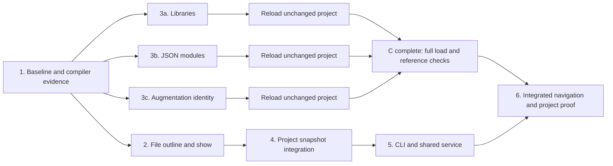

# Native project navigation: implementation plan

Scope: S, C, Q1, Q2 from `typescript-agent-tools#1`, as defined by the
[technical design](navigation-design.md). This plan selects behavior, ownership,
dependencies, and evidence. Internal Rust layouts and algorithms remain choices
for the implementer. It is not a plan for the remaining proposal ticket.
Revised after [round-one review](navigation-review-response.md).

## Working method

Use behavior-level red–green–refactor. Every new behavior starts with a failing
public operation or CLI test; scaffold a minimal callable module first if needed
so the failure concerns missing behavior rather than missing imports. Every
compatibility fix starts with a failing reproduction whose expected result comes
from TypeScript 7.0.2. Search for the corresponding TypeScript function and all
existing implementations of that decision before changing an owner.

Run the registered test command against the **single integration-test file**
being developed, for example:

```sh
cctl validate run test --queue-if-busy -- tests/navigation.rs
cctl validate run test --queue-if-busy -- tests/reference_loading.rs
```

The examples identify proposed/existing test files; create any new file before
running it. Node oracle/harness changes use the registered `harness-test` command
with a single `tools/*.test.mjs` path. Pure API wiring or mechanical moves may
skip test-first, with the reason stated; keep relevant behavioral checks green.
Broader checks are checkpoints, not a replacement for the scoped TDD loop.

## Sequence and dependencies



The three compatibility pieces can be developed independently after their shared
input/provenance contracts are clear. They touch common loader/binder code, so
independent development is not a recommendation for concurrent edits to those
owners. Project integration can proceed on supported fixtures before C is done.
The C checkpoint repeats after each of 3a, 3b, and 3c; it is not deferred until
all three are finished. Record the next blocker as a maintained reproduction.
C is complete only after a full unchanged-config load and representative
ordinary, library, JSON, and augmentation reference checks succeed. Step 6 adds
navigation, freshness, and performance evidence to that compatibility proof.

### 1. Establish evidence and settle the narrow contracts

- Record the parser revision and the Command Center checkout/config being used.
  Reproduce the unchanged-config load, without benchmark shims or root-list
  substitutions. Record every discovered blocker as evidence, not a presumed
  complete inventory.
- Make small maintained compiler fixtures for library selection/provenance, JSON
  source grammar and imported identities, and the augmentation-through-export
  shape. Confirm the Rust augmentation reproduction fails for the expected
  identity/binding reason before deciding the correction.
- Confirm the shared configuration/JSON-source parser entry points in the native
  7.0.2 implementation before extending the JSON owner. The existing probe
  establishes some accepted syntax, not complete shared-grammar parity.
- Add a bounded native document-symbol protocol probe for the outline comparison
  cases; the current synchronous semantic API does not expose navigation. Record
  intentional departures from editor navigation alongside the evidence.
- Settle declaration inclusion, kinds, containment, and excerpt examples as
  public-operation tests: the factory/nested-function example, object/function
  property initializers, class arrow fields, nested anonymous containers,
  overloads, same-named declarations, and multi-binding statements at one depth.
  Include position-only computed/punctuated names, two distinct lone surrogates,
  a valid surrogate pair, and a literal U+FFFD. Optional lookup keys must not make
  a previously valid reference load fail.
- Include a file that distinguishes the default and deep parsing budgets, plus
  structured ambiguity whose returned anchor is used for a successful show.
  These examples constrain both file-only and project navigation.
- Agree the internal exchange facts needed by source capture, the declaration
  catalog, and binding before extending their shared state. Document the owner
  of each fact; do not create a framework for future query kinds.

Exit evidence: executable small cases distinguish intended behavior from current
limitations, and no feature depends on a guessed compiler rule.

### 2. Build file navigation through one declaration catalog

- Implement source capture and declaration projection using the existing parser,
  final-tree walker, token spans, name decoding, and position owner. The complete
  navigation operation owns the deep-budget parse and its large-stack thread;
  use the same policy for file mode, project loading, and any later query reparse.
- Keep exact optional lookup keys separate from source/escaped display labels.
  Own syntax-to-kind mapping and containment in projection, including initializer
  cases; renderers receive the same vocabulary and records.
- Deliver outline first, then selection/show using the same catalog. Add depth
  presentation without changing the indexed declaration universe. Keep the
  source excerpt independent of its abbreviated signature.
- Establish the complete file-navigation library operation and wire a minimal
  CLI path so the anchoring workflow is tested end to end early.
- Verify whole declaration excerpts, original line numbers, explicit ambiguity,
  and selection anchors from outline/ambiguity results that successfully select
  show. Exercise the deep-budget example in both navigation modes when project
  integration is available; outline depth must never change parse acceptance.

Checkpoint: understand the projection through its contract alone. If selection
or rendering must inspect AST node kinds, move that decision into projection.
If projection helpers all require the full mutable builder, reshape the internal
boundary rather than merely distributing the code into files.

### 3a. Support pinned standard libraries

- Vendor the pinned declaration data with license/provenance and one catalog for
  validation and selection. Resolve it from the build checkout through one data
  owner, preserving real, readable declaration paths. Verify a Cargo-built
  executable uses it without a runtime compiler or network; no installation
  override or relocation mechanism is part of this delivery.
- Extend effective config and pragma facts for target/default libraries, explicit
  lists, `noLib`, no-default-lib, and library replacement semantics. Implement
  selection and resolution through their owners, including transitive closure.
- Capture selected libraries through the normal input/observation path. Preserve
  distinctions between search membership, declaration availability, and binding
  diagnostics; do not infer all three from a single dependency boolean.
- Update the semantic oracle's former library-target exclusions deliberately.
  Library-provided references now need real expected declarations; normalization
  must not discard new mismatches. Fixtures intentionally modeling no libraries
  should say `noLib` explicitly, rather than weakening default-library tests.

Exit evidence: compiler-agreeing input selection and query results, plus correct
refresh/error behavior for library and replacement inputs. As implemented, an unset,
null, or empty `target` selects ES2025; an invalid one is a `Config` error
(TypeScript's TS6046), and `target: es5`, removed in TypeScript 7 (TS5108), is
`Unsupported`, like other removed options, so `lib.d.ts` is reachable only
through tests of the replacement rule.
Then reload unchanged Command Center and maintain a reproduction for the next
blocker; do not count a library-only fixture as completion of C.

### 3b. Support JSON program inputs

- Extend input classification once for imports, roots, and reference paths;
  preserve option-dependent resolution and missing-versus-unreadable behavior.
- Extend the shared TypeScript JSON reader losslessly before configuration
  conversion or module-export projection: full key/value spans, exact UTF-16
  keys, and repeated properties in source order. Keep configuration conversion
  (raw conversion, each file's own option settings, and inheritance) above the
  reader and strict package-manifest syntax separate. Port any narrower native
  rule at its owning operation rather than duplicating a whole parser.
- Represent the JSON module/export facts that alias linking needs, including
  correct unsupported-member classification. Do not invent declarations or
  collapse data modules into a wildcard ambient shim.
- Extend semantic evidence for default/named/namespace imports and re-exports.
  Prove a valid JSON import can coexist with successful ordinary reference and
  navigation queries in the same project.

Exit evidence: JSON enters the real program graph, input failures stay failures,
and project loading does not claim property/type-query support it lacks. As
implemented, one reader built on the crate's own parser serves configuration
and JSON modules (TypeScript's `parseJSONText` also runs its parser), so token,
escape, comment, and `#!` rules have their existing owners; checker-only JSON
diagnostics (TS1543, TS1544, TS2498, TS1202) are tolerated like other checker
diagnostics. The fourth implementation review's fixes added program admission
of resolved files (`GetResolutionDiagnostic`), TypeScript's configuration
`null` and inheritance rules and empty-key omission, JSON targets kept through
linking (barrels, star routes, value-only meaning), and library members of
non-object roots; their expectations are the maintained compiler probes in
`fixtures/json-probes`, which `tools/json-probes.mjs` re-derives
(`docs/validation.md`).

**C checkpoint, 2026-10-07 (Command Center `7706073d2`, commit `285854a`):** the
unchanged configuration loads (7.7 s median for a load and one query, about
1.1 GB peak). An ordinary name query, the `Promise` library global (four
library declarations), the TipTap `Commands` augmentation (the compiler's 78
declarations), and a JSON import (an unsupported target, as the oracle
classifies it) all answer as expected; see `docs/validation.md`. Later
compatibility fixes rerun this checkpoint.
Reload unchanged Command Center again and preserve any next blocker as a small
reproduction, including failures beyond the originally observed three.

### 3c. Correct augmentation identity

- Use the minimal failing reproduction to locate the TypeScript merge rule and
  its current owner. Investigate `mergeModuleAugmentation` and `mergeSymbol`,
  including alias-target resolution and cloned merged identities; name the
  ported functions in the owner's comment. The current alias-conflict diagnosis
  remains a hypothesis until that reproduction runs. Test original declaration,
  export alias, augmentation, and consumer selections against the same identity.
- Give the touched declaration-combination operation responsibility for its
  canonical symbols and table invariants. Keep alias-route restrictions and
  diagnostic tolerance with their respective owners. Ensure later merges cannot
  leave cached resolution results stale.
- Cover direct exports, export specifiers/re-exports, multiple augmentations,
  generic defaults, meanings, and genuine conflicts as distinguished by the
  pinned rule. Preserve existing namespace/alias-cycle behavior.

Exit evidence: the small reference queries agree with the compiler, including
negative cases; no TipTap-specific path or relaxed error suppression exists. Step 3c's own Command Center check used a
shimmed configuration (libraries off, a JSON ambient shim) and is partial until
3a and 3b land; it gave TipTap's `Commands` the same 78 declarations as the
compiler. The compiler's order-dependent alias clones are a recorded product
difference, pinned by exception tests that hold both expectations.
Reload unchanged Command Center and run the complete C checkpoint. If another
blocker remains, expose and estimate it; the original list is not permission to
mask it or declare compatibility complete.

### 4. Integrate project navigation with the existing snapshot

- Compare eager complete records with a compact name/container/anchor index plus
  projection of the selected file's retained text. Use the same projection and
  parsing policy for both. Before choosing, measure retained bytes, construction
  time, small/large-file query latency, peak query memory, and repeated service
  requests on representative inputs. Prefer the simpler implementation if the
  tradeoff is small; do not retain two strategies or add a mutable per-file cache
  without demonstrated need.
- Finalize navigation membership from project provenance and release syntax
  arenas. The selected strategy must keep source, indexes, and projected results
  within one captured generation.
- Expose complete project outline/show operations. Rename the reference-named
  snapshot/session owners to `Project` and `ProjectSession`, updating repository
  callers and docs without compatibility aliases. Preserve reference CLI/result
  behavior except the documented C compatibility changes.
- Reuse file identities and captured source/positions; do not reopen files when
  materializing show. Build both indexes before publishing one coherent snapshot.
- Settle three owners that step 2 left inside reference internals (round-two
  review): one parsing capability, handed out only by the deep-budget thread,
  for every parse and reparse; one owner of each analysis-failure kind's exit
  class, shared by navigation, project, and query failures, so file, project,
  and service delivery agree; and crate-level homes for the captured-source and
  position owner, input classification, and AST field helpers, exposing only
  what both engines use and keeping the binder's identity-required name
  conversion private. Shape the public results for a project path base with
  optional file narrowing, and keep each catalog paired with its captured source
  so one generation cannot read another's text.

Checkpoint: adding a syntax declaration kind changes projection, not reference
binding. Changing a merge rule does not change show's syntactic selection.
Record the storage comparison and chosen tradeoff before treating either
representation as the implemented architecture.

As implemented (2026-10-07): the snapshot keeps a compact selection index per
searched file and projects the selected file's captured text at query time;
[the storage comparison](navigation-performance.md) records why (on unchanged
Command Center, eager records retained about 181 MiB more than references
alone, the index about 25 MiB). `Project::outline`, `Project::show`
(`ShowQuery::Name` with optional file narrowing, or `ShowQuery::At` in a file),
and `Project::find_references` share one dispatch, `Project::execute`, which
`ProjectSession::execute` reaches after its one refresh. Results name the
configuration file as their path base (`project`) with paths relative to its
directory; file navigation leaves `project` absent and names absolute files.
The three owners: `analysis::Parser`, the only parser of analysis text,
handed out by `analysis::on_parsing_thread`; `analysis::AnalysisError`
(`InputError` or `QueryError`; `project::AnalysisError` with `ProjectError`
until the round-5 review fixes moved it out of the engine) for every
operation, with each kind's exit code decided by `cli::failure_code`; and the
crate-level `source`, `input`,
and `syntax` modules, with the binder's `exact_text` in
`project::binding::text`. Step 5 then added the CLI and service transport of
project navigation over the `ProjectRequest` protocol.

### 5. Finish command and service integration

- Enforce the design's operation/option matrix at one parsed-request boundary,
  including `--direct` for project queries and the existing reference spelling.
  Test representative valid/invalid combinations. Complete text/JSON rendering,
  file narrowing, qualified selection, depth handling, and output destinations.
- Implement one typed-outcome delivery policy for found, ambiguous, missing, and
  other failures. Test exit codes and stdout/stderr/output-file behavior in both
  modes, including consuming ambiguity JSON and issuing show with its returned
  file/anchor. Keep unmatched reference names as successful empty results.
- Route all project operations through the existing service/session freshness
  boundary. Add navigation request/result transport without a second daemon,
  independent cache, or feature-specific refresh path.
- Check that there is one session execution boundary enforcing refresh, rather
  than refresh copied into three operation methods. Direct CLI and service
  requests both pass through it. Immutable library snapshots remain explicitly
  captured; querying one does not implicitly refresh the filesystem.
- Exercise direct and service modes against identical captured inputs. Cover
  cross-working-directory clients, sequential and concurrent requests, changed
  sources/configuration/dependencies/library data, failed refresh, and recovery
  after a corrected input. Retain existing non-Unix direct behavior.

Exit evidence: CLI and library select the same declarations; service answers
match direct answers. Public tests cover outline, show, and references through
both direct and service entry, including a failed refresh that cannot answer
from an old generation. One CLI policy maps each typed result to channels/exits.

As implemented (2026-10-08, commit `8228a4b`, merged in `8edbc1f`): `cli::request`
is the one parsed-request boundary for the design's matrix; navigation rejects
a repeated value option, while parse and reference requests keep their existing
last-value behavior. `cli::query` runs file, direct-project, and service
requests, and `cli::delivery` alone maps every outcome to channels, `-o`, and
exits (`failure_code`); usage, transport, and write failures are one stderr
line with exit 2 and never a second document. A project-wide show without a
file omits `file` from ambiguous and not-found documents; candidates carry
paths relative to the configuration directory, so joining one to the
directory of `project` and issuing `--show --project … --at L:C FILE` works from
any working directory. The client makes every operand absolute through one
request method and restores the caller's spelling in operand diagnostics;
direct queries also run through `ProjectSession::execute`. The service closes
inherited descriptors, which fixed the `concurrent_cold_clients_share_one_build`
flake (a concurrently spawned client had handed its output pipe to the
service). Evidence: `tests/project_cli.rs` (request and delivery matrices in
both entries), `tests/project_service.rs` (byte-identical direct and service
answers for 18 queries; freshness and failed-refresh repair for source,
configuration, dependency, and library replacement; concurrent and
cross-directory clients); on unchanged Command Center, warm service outline,
show, and references answered in about 0.5–0.7 s, byte-identical to `--direct`
loads of 11.6–11.9 s.

### 6. Prove the deliverable on unchanged Command Center

- Load the actual config and discovered graph without disabling libraries,
  supplying JSON/TipTap shims, changing source, or freezing a substitute root list.
  Compare selected inputs/provenance with the pinned compiler; record the exact
  application revision and relevant generated/dependency inputs. Consolidate the
  repeated C checkpoint evidence; this must not be the first full-graph attempt
  since the compatibility fixes began.
- Exercise outline → qualified show → position-disambiguated show on real large
  files, nested declarations, and declaration files. Verify excerpts against
  captured source bytes and sample catalog names/spans against compiler ASTs.
  Recheck representative existing references, including library/JSON/augmentation
  boundaries covered by C. Successful navigation alone does not prove C.
- Measure file-only latency, cold project load, warm outline/show, post-edit
  refresh, and retained/peak memory. Compare with the previous service baseline
  under stated conditions; do not promise sub-100-ms queries or incremental
  refresh from persistence alone. Use a disposable application copy/fixture for
  controlled edits, not the user's active application checkout.
- Run the registered format, lint, Rust test, harness-test, and semantic checks.
  Run focused parser differential checks if shared syntax/scanner code changed.
  Missing or skipped required compiler evidence is not a pass.
- Update README, reference compatibility/service documentation, and validation
  results; reconcile this design with the implementation. Review internal
  boundaries using the design's concrete change scenarios before closeout.

Exit evidence: all four scoped capabilities work together on the unmodified
target project, existing behavior has relevant regression coverage, and known
remaining limits are explicit. If new inputs demand another language capability,
revise the scope rather than hiding the failure.

As implemented (2026-10-08, commits `608f2ae` and `dfc65e2` and the
documentation that follows them; Command Center `7706073d2`, clean before and
after): the unchanged configuration and its discovered graph load with no
shim, substitute root list, or edited source. The ignored test
`list_configured_program` and `tools/program-inputs.mjs` compare the tool's
inputs with `tsc --listFilesOnly` and the semantic API's metadata: the same
7,639 inputs (89 libraries, 2,225 dependency declarations of 255 packages,
5,325 searched files including the generated `.next/types` declarations and
six JSON modules) in the same order with the same provenance, after `608f2ae`
fixed the order of dynamic imports in an `else if` chain, which binding had
collected in reverse (18 files moved). Reference rechecks through the service
and `--direct` (byte-identical): `getTicketService`, `Promise`, `Map`,
`document`, the JSON import (`UnsupportedTarget`), TipTap's `Commands` (the
compiler's 78 declarations), `React`, `JSX`, `Window`, and an unmatched name.
The semantic `compare` could not run on this project (the 7.0.2 API panics in
`getImmediateAliasedSymbol`, and `compare` cannot sample files), so these
targeted checks are its reference evidence. Navigation: every one of the 5,319
searched files matches the compiler's document symbols apart from the
documented differences, after `dfc65e2` taught the comparison two merges the
compiler makes (repeated `declare module` blocks, as in `@tiptap/core`, and a
property's contents listed under each same-named variable it merges into); 21
real files (the largest tests and sources, TSX, a namespace, augmentations,
and the generated declarations) pass outline → qualified show → ambiguity
round trip through the service, with every excerpt byte-identical to the file
and `--direct` answers byte-identical to the service's (one-time session
scripts then; after the final review, `tools/navigation-flows.mjs` repeats
them from the repository). Costs, measured with
edits only on a disposable copy, are in [Command Center
performance](performance-command-center.md#current-state-2026-10-08): file-only
queries 5–91 ms, cold loads 8.8–9.2 s, warm service queries 0.40–0.51 s (over
90% of it freshness validation), refreshes about 10 s, and 678 MiB resident.
Registered `format`, `lint`, `test` (416 tests), and `harness-test` (123, none
skipped) pass, as does `scripts/validate/semantic-full.sh`
([validation](validation.md)).

## Verification coverage

Derive variants from TypeScript rules and product contracts, not only the first
bug examples. The following identifies obligations rather than a fixed test list.

| Area | Required distinctions |
| --- | --- |
| Navigation | TS/TSX/declarations; named property initializers and class arrows; nested anonymous containers; owned kinds versus native document-symbol evidence; overloads/merges/shadowed names; multiple/destructured bindings and depth; default and computed names; decorators; empty files; abbreviated signatures versus original excerpts |
| Positions and identity | CR/LF/CRLF/U+2028/U+2029; BOM, trivia, tabs/NBSP; Unicode and escaped identifiers; distinct lone surrogates, valid pairs, literal U+FFFD, and position-only selection without new load failures; exact/folded filesystem case; separators/symlinks; exclusive endpoints and invalid UTF-16 positions |
| Parsing and delivery | Shared deep parsing policy in both navigation modes and any query-time reparse; display depth independent of parse limits; accepted/rejected option combinations; found/ambiguous/missing/error exits and text/JSON channels with and without `-o`; ambiguity-anchor round trip; unchanged empty reference results |
| Libraries | Implicit defaults across target variants; explicit empty/nonempty/inherited lib lists; noLib/no-default-lib; transitive references and ordering; replacement present/absent/disabled; missing/unreadable data and provenance |
| JSON | Explicit/imported inputs; option states; compiler grammar; root value kinds; duplicate/escaped/unrepresentable keys; module import/export forms; malformed/deep input and I/O errors |
| Augmentation | Original/aliased/re-exported symbols; multiple files; generic lists/defaults; declaration meanings; valid merging versus real conflicts and cycles |
| Snapshot/service | All three operations through one refresh boundary in direct and service entry; unchanged reuse; source/config/resolution/library changes; failed refresh then repair; concurrent callers; no cross-generation source/index mixing |

For any new limit, cover just under, at, and over it, plus a large shallow valid
input. Assertions target returned outline/show/reference results, complete load
outcomes, and CLI behavior, rather than private map layouts or helper counts.

## Effort and deferred choices

The earlier estimates sum to **20–39 engineer-days** for S (4–7), C (12–25),
Q1 (2–3), and Q2 (2–4), including tests and documentation. This is a preliminary
effort range. Re-estimate after the early native navigation/JSON evidence and
unchanged-project checks, and again if the storage comparison reveals material
work. Simpler checkout-based library data removes speculative packaging work,
while the native navigation probe adds a small harness path; neither justifies
an unmeasured numerical adjustment. Shared work is not charged again in the
phases above.

Choose concrete Rust types, file splits, indexes, vendored-data layout, signature
formatting helpers, and small test-fixture organization during implementation.
The selected behavior, ownership of decisions, complete-operation interfaces,
failure/freshness guarantees, and compiler evidence are the constraints those
choices must satisfy. No edits, type checker, or additional wishlist command is
part of this deliverable.

## Implementation outcome

Recorded at step 6, 2026-10-08. The [design](navigation-design.md) is
implemented; this section records what each step delivered, how it was
reviewed, how the internal boundaries answer the design's change scenarios,
and the limits that remain. The steps above keep their original text and
their "As implemented" notes.

### Delivered by step

| Step | Delivered | Commits |
| --- | --- | --- |
| 1 | Compiler evidence that revised the design: the native document-symbol oracle (`tools/navigation-oracle.mjs`), anonymous functions as entries, TypeScript 7's library, `types`, and JSON rules, and the augmentation diagnosis | `1f3bbaa`, `78471c7` |
| 2 | File navigation: one projection and catalog for outline and show, the request boundary and delivery policy, and the document-symbol comparison (`tools/navigation-conformance.mjs`) | `7719dd4`, `51bb68d`, `ab1d1d7` |
| 3a | The pinned 7.0.2 libraries, vendored with provenance, selected by TypeScript's rules, with a third provenance | `03c8096` |
| 3b | JSON program inputs through one JSON reader; program admission, configuration conversion and inheritance, and JSON linking | `285854a`, `8627b00` |
| 3c | Augmentation identity as one checker merge over effective symbols; the global table and program order as TypeScript builds them; ambient-module merges and one reporting decision | `09b5d44`, `996587c`, `ec9e4fd`, `ced90fa` |
| 4 | `Project` and `ProjectSession`, the compact selection index with selected-file projection, and the shared parsing, failure, source, input, and syntax owners | `f589c09`, `656b44f`, `84fc747` |
| 5 | The CLI's operation matrix, one delivery policy, and navigation through the existing service and its one execution boundary | `8228a4b` |
| 6 | The unchanged Command Center proof; program order of dynamic imports; the comparison's merge allowances; the real-project input comparison | `608f2ae`, `dfc65e2` |

Merges and records: `656db7a` and `8edbc1f` merged the parallel branches;
`44d9c1a`, `f8d136e`, `0214db1`, `a36413a`, and `8163017` recorded decisions
in the design and this plan.

### Reviews

The design had two review rounds before implementation
([response](navigation-review-response.md)). Six implementation rounds
followed, each by two independent reviewers: round 1 reviewed step 3c
(`09b5d44`), round 2 step 2 (`7719dd4`), round 3 step 3a and the first rework
of 3c (`03c8096`, `996587c`), round 4 step 3b (`285854a`), round 5 step 4
(`f589c09`, `656b44f`), and round 6 the second rework of 3c, the JSON fixes,
and step 5 (`ec9e4fd`, `8627b00`, `8228a4b`). Their findings were fixed in
the commits listed above, each with regressions.

The final (seventh) review covered the whole delivery at `f46a4aa`. Its
fixes:

- **Comment directives** (major): suppression used a Unicode trim and a line
  view without terminators, so a directive reached past a line holding a
  no-break space, vertical tab, form feed, or byte order mark, or an empty
  line that U+2028 or U+2029 ends, and directive scanning accepted a form
  feed and Unicode whitespace; projects that `tsc` rejects loaded. Both
  rules moved to `crate::pragmas`, ported literally from
  `processCommentDirective` and `isCommentOrBlankLine`, with 374 compiler
  probes (179 of which loaded before) and a service test of failed
  refreshes.
- **Lookup keys** (major usability): imports and re-exports that do not
  rename made a project-wide `--show --name` ambiguous for 68% of Command
  Center's exported declarations; keys now follow
  `computeDeclarationMap`, and 14,227 of 14,229 are found.
- **Output and CLI**: one text line per import declaration; selectors on
  text ambiguity lines; `--at FILE:LINE:COLUMN`; a dotted reference name is
  a usage error; an over-long socket path names the socket.
- **Evidence**: `tools/navigation-flows.mjs` and `tools/name-selection.mjs`
  make the real-project proof reproducible, and `AGENTS.md` names both
  documents of deliberate differences.

[Validation](validation.md#command-center-checkpoint) records the rerun on
unchanged Command Center.

A confirmation round (eighth) by the same two reviewers found the round-7
fixes complete, with no regression or new owner split. It added one minor
evidence fix, that `tools/navigation-flows.mjs` read a printed location up to
its first space and passed when the text form listed no candidates (it now
expects each candidate line built from the JSON candidates, `5c2e742`), and
one documentation fix: only imports and exports follow workspace symbols,
while object-literal properties and dotted-namespace segments keep their
keys. A text grouped-import line also lists at most eight names
(`5121695`).

### Change scenarios at closeout

Traced through the code at `dfc65e2`:

- **Adding a declaration syntax family** touches `src/navigation/projection.rs`
  (which syntax is an entry, its kind, containment, anchor, range, and
  signature parts) and, only if it needs a new kind name, `navigation::Kind`
  and its spelling in `src/navigation/mod.rs`, with the comparison's kind map in
  `tools/navigation-conformance.mjs`, a fixture with pinned compiler symbols,
  and the table in `docs/navigation.md`. `projection.rs` is the only file that
  names a `Kind` variant, and with `names.rs` (name nodes) the only navigation
  code that inspects syntax kinds; the CLI renders `Kind::as_str`, and
  selection (`navigation::catalog`), the project index
  (`src/project/navigation.rs`), the session, and the service see neither.
- **Changing text presentation** touches `outline_text` and `show_text` in
  `src/cli/navigation.rs`. JSON documents are built separately in the same
  module from the same records, and keys, selectors, anchors, and excerpts
  come from the catalog, so neither identity nor JSON source changes.
  Signatures are content shared by both formats (`src/navigation/signature.rs`),
  not presentation.
- **Changing a library-selection rule** touches
  `src/project/program/libraries.rs` (the catalog, `roots`, `reference`,
  priorities, and replacement lookups), plus `config.rs` only for a new option,
  and the compiler comparisons (`src/project/program/tests.rs`,
  `tests/reference_libraries.rs`, the library fixtures, and
  `tools/vendor-typescript-libs.mjs` for catalog data). The loader calls those
  operations and does not repeat their rules; navigation, binding, the
  session, and the CLI never mention libraries.
- **Changing a merge rule** touches the one exclusion-and-merge test in
  `src/project/binding/link.rs` (`excluded`, `conflicts`, `merges`,
  `invalid_merge`), which the binder's same-table `combine`, the checker
  merges of globals, ambient modules, and augmentations (`merge_symbol`,
  `merge_entry`), and the merge checks all apply; original declarations,
  exports, and augmentations do not reimplement it. Navigation imports nothing
  from binding, so show's syntactic selection cannot change.

The scenarios found no new ownership defect. The real project did expose one
earlier in this step: the loader owned subtask order but assumed binding
collected a file's requests in source order, which binding's work stack does
not do; `608f2ae` made the loader order them by position itself. A narrower
relative remains as a follow-up below. `link.rs`, at 3,401 lines, is the
largest module and the place where a future change is most likely to need its
caller's context.

### Remaining limits

- **Freshness cost.** A warm service request validates every captured input:
  on Command Center about 370–380 ms of a 0.40 s request. Warm queries are not
  sub-100-ms lookups on a project of this size, and any edit costs a full
  rebuild (about 10 s there); there is no incremental indexing.
- **Memory.** A Command Center service is about 678 MiB resident (334 MiB
  requested heap retained, about 1.0 GiB requested while loading, 1.1 GiB peak
  resident for a direct load), and resident memory grew to 986 MiB over four
  rebuilds, which includes allocator retention.
- **Reprojection.** Outline, show by position, and a unique-name show parse the
  selected file again: about 30 ms for Command Center's largest file and about
  160 ms for a 3 MB file such as the compiler's `checker.ts`.
- **Real-project reference evidence** is targeted: the semantic `compare`
  needs the whole project's identifiers and the 7.0.2 API panics on Command
  Center's.
- **Documented differences** from TypeScript stay as designed and recorded in
  [find references](references.md#differences-from-typescript-702) and
  [navigation](navigation.md#differences-from-typescript-702-document-symbols),
  including per-meaning groups, one canonical augmentation identity, JSON values
  that are not reference targets, unmerged catalog entries, and the order of
  equally deep routes and equal-priority libraries.
- **Out of scope:** project references, JavaScript binding, type inference,
  member references, and editing.

Recommended follow-ups: an outline option that hides the locals of
function bodies at the default depth unless an entry is a function or class
(object-literal properties and locals inside function bodies are about 27%
of Command Center's default text outlines; the final review left the
catalog unchanged); when several module requests of one file fail, the
binder reports the first in its visit order rather than in source order (only
which of the failures is named changes); a cheaper freshness check (for example
a metadata pre-check with content comparison as the fallback) if 0.4 s per
warm request matters to callers; a sampled, panic-tolerant mode for the
semantic comparison to extend real-project reference evidence; and watching
`link.rs` for a split along an operation that hides its own state.
