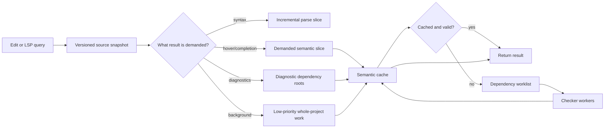
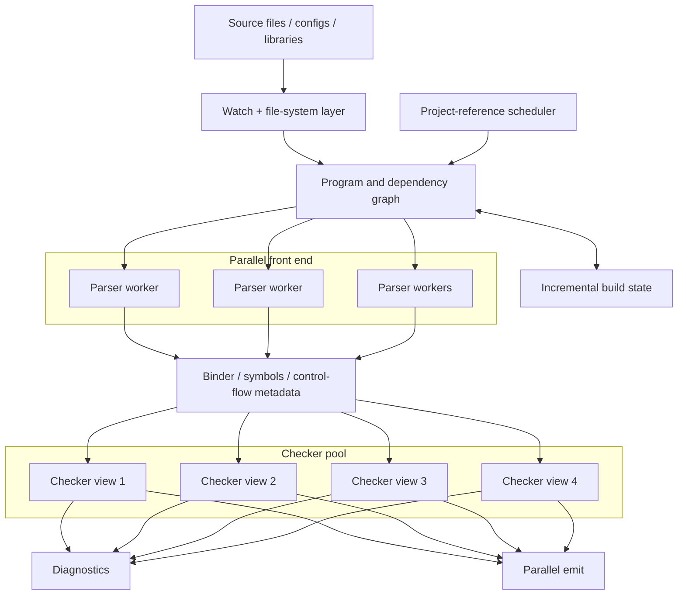
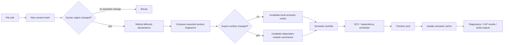
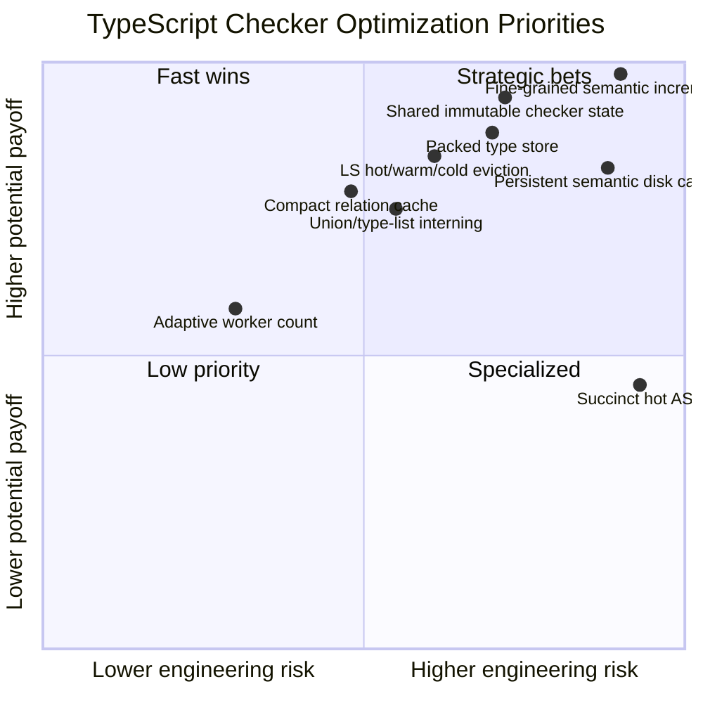

# Optimizing Computationally and Memory-Intensive Compilers: Algorithms, Data Layout, Parallelism, and a TypeScript Type-Checker Roadmap

## Executive summary

Compiler and type-checker performance is rarely dominated by one “slow algorithm.” At scale, it emerges from the interaction of **algorithmic repeated work, representation density, cache locality, allocation rate, dependency invalidation, I/O, and scheduling**. The strongest optimizations therefore change the *unit of work* and the *lifetime and representation of state*, rather than merely making individual functions faster.

For type checkers, five principles dominate.

**First, avoid computation before optimizing computation.** Incremental checking, demand-driven evaluation, laziness, dependency-directed invalidation, and memoization can eliminate orders of magnitude more work than micro-optimization. Self-adjusting-computation research formalizes the idea of recording dependencies so that a changed input propagates only to affected computations, while TypeScript itself already applies this principle at file/project granularity through incremental compilation and project references. citeturn2search2turn2search11turn16search3turn17view3

**Second, compiler memory layout is an algorithm.** Dense contiguous arrays, small-vector layouts, integer IDs, bit fields, arenas, slabs, and interning can simultaneously lower memory use, allocation/GC cost, cache misses, and pointer-chasing. LLVM's `SmallVector` explicitly places small arrays inline to avoid heap allocation, while its `BumpPtrAllocator` gives objects a common arena lifetime. Current TypeScript 7 source already moves in this direction: the Go checker uses 32-bit type/signature IDs and bit-packed flags, and selectively allocates checker metadata from arenas. citeturn14search0turn13search13 fileciteturn12file0

**Third, the right algorithm depends on TypeScript's semantics.** Union-find is superb for equivalence constraints but cannot replace TypeScript's primary type relation, because TypeScript is a structural type system and assignability is directional, recursive, union/intersection-sensitive, contextual, and sometimes order-sensitive. Current TypeScript instead combines very fast flag-based checks with recursive structural comparison and memoized relation results. Union-find is therefore useful for selected equality classes and inference variables, not as a wholesale replacement for `isTypeRelatedTo`. citeturn15search0turn16search20 fileciteturn2file0

**Fourth, TypeScript 7 has changed the optimization baseline materially.** As of October 15, 2026, TypeScript 7.0 is the current stable release. It is the native Go implementation, and parsing, checking, and emitting can run in parallel. The compiler defaults to four checker workers; workers intentionally have separate views and can duplicate common computation, so adding workers improves throughput at a memory cost. Project-reference builds can also execute concurrently through `--builders`. Microsoft reports roughly 7.7×–11.9× full-build speedups on several large open-source projects versus TypeScript 6, along with lower aggregate memory on those measurements. citeturn16search1turn17view0

**Fifth, the next large TypeScript gains are likely to come from sharing and finer-grained incrementality rather than simply adding threads.** TypeScript 7's own description identifies duplicate work and memory across checker workers as an explicit trade-off. The most promising next architecture is therefore a hybrid:

1. a **shared immutable semantic substrate** for libraries, declaration interfaces, canonical names and types;
2. **worker-local transient state** for inference, recursion, diagnostics, and non-shareable relation caches;
3. **fine-grained dependency fingerprints** beneath the existing file/project incremental layer;
4. **packed canonical representations** for common type forms;
5. **demand-driven language-server snapshots** with explicit hot/warm/cold residency; and
6. **content-addressed on-disk semantic summaries** for stable module interfaces.

TypeScript 7 already creates a checker pool with file-affinity hints, and the current implementation defaults that pool to four checkers, making this evolution compatible with the architecture rather than a replacement for it. fileciteturn5file0 fileciteturn5file1

The highest-return concrete proposals, in approximate order, are:

| Proposal | Expected CPU effect | Expected memory effect | Engineering risk | Priority |
|---|---:|---:|---:|---:|
| Share immutable library/declaration/type state across checker workers | High reduction in duplicate work | **Very high reduction** | High | **Highest** |
| Fine-grained semantic dependency cache below file granularity | **Very high on edits/watch/LS** | Moderate increase unless bounded | Very high | **Highest** |
| Pack hot type/node metadata into ID-indexed arrays | High through locality | **Very high reduction** | High | **Highest** |
| Replace pointer-heavy relation-map entries with compact/sharded pair-ID tables | High in relation-heavy programs | High reduction | Medium-high | **High** |
| Canonicalize/hash-cons common unions, intersections, substitutions, and type lists | High where type construction repeats | Medium-high reduction | Medium-high | **High** |
| Worklist/SCC machinery for recursive flow/type computations | Medium-high | Neutral to lower | Medium | **High** |
| Demand-driven LS project residency plus semantic-summary eviction | High latency/footprint impact | **Very high reduction** | High | **High** |
| Content-addressed persistent semantic summaries | High warm-start impact | RAM reduction, disk increase | Very high | Medium-high |
| More checker workers | Medium-high throughput | **Increases memory** | Low | Workload-dependent |
| Succinct full-AST representation | Moderate | Very high reduction | Very high; may hurt hot paths | Selective only |

These rankings are analytical rather than measurements; they should be validated with the profiling regime described later.

## Algorithmic foundations for high-performance compilers

The useful way to classify compiler optimizations is by what they reduce: **work performed, asymptotic complexity, memory traffic, allocation traffic, synchronization, or latency to first useful answer**. A technique that reduces one can worsen another.

### Incremental checking, demand-driven evaluation, and laziness

A conventional batch compiler approximates:

\[
T_{\text{batch}} \approx \sum_{f \in \text{program}} 
(T_{\text{parse}}(f)+T_{\text{bind}}(f)+T_{\text{check}}(f)+T_{\text{emit}}(f))
\]

for every invocation. An incremental compiler wants instead:

\[
T_{\text{edit}} \approx T_{\text{change detection}}
+\sum_{x \in \operatorname{affected}(\Delta)}
T_{\text{recompute}}(x)
\]

The performance question becomes the quality of `affected(Δ)`.

Self-adjusting computation formalizes this by recording a dynamic dependence structure and propagating a small input modification through only computations whose dependencies changed. Research by Acar and collaborators combines dependence tracking, change propagation, and memoization precisely because simple memoization alone cannot capture all reuse after an input is modified. citeturn2search2turn2search11turn2search23

This is directly relevant to type checking. An edit to the body of:

```ts
export function square(x: number): number {
    return x * x;
}
```

need not invalidate downstream modules if its externally visible type remains:

```ts
(number) => number
```

A file-timestamp dependency graph says “file changed.” A semantic dependency graph can say “implementation changed, exported surface did not.” Project references partly realize this at project boundaries by having consumers load a referenced project's emitted declarations rather than its implementation. citeturn17view3

Demand-driven checking pushes the same idea from *edits* to *queries*. An editor asking for a hover at one location rarely needs every diagnostic, every inferred return type, every module auto-import candidate, and every declaration rendering. The legacy TypeScript language-service architecture explicitly separated syntax and semantic work and supported per-file diagnostics and single-file emission so hosts could avoid paying unrelated costs. Its snapshots also expose change ranges for incremental parsing. citeturn18search3

The ideal language-server model is therefore:



The hard problem is not laziness itself; it is **correct cache invalidation**. TypeScript features such as declaration merging, ambient/global declarations, module augmentation, contextual typing, overload resolution, and control-flow narrowing mean some computations have larger dependency sets than their syntax suggests. Consequently, the safest design records actual semantic dependencies rather than trying to infer them solely from AST parentage.

### Constraint solving and inference

A type checker can often be viewed as generating and solving constraints such as:

\[
T_x = T_y,\qquad
T_x <: T_y,\qquad
T_x \in \{T_1,\ldots,T_n\}
\]

Classical Hindley–Milner inference is dominated by equality/unification constraints, for which efficient destructive unification and union-find are natural. Constraint-based formulations can separate constraint collection from solution and improve diagnostic provenance. citeturn15search3turn15search11

TypeScript is significantly less reducible to this model. Its checker has generic-inference state containing candidate types and performs inference over rich structural forms; current source includes explicit `InferenceState`/`InferenceInfo` machinery and candidate handling rather than a single global unification table. fileciteturn9file0

That distinction matters because a tempting optimization—

> “Replace TypeScript inference with union-find.”

—is mostly wrong.

Union-find efficiently answers equivalence-class questions. Tarjan's classical analysis establishes the extraordinary efficiency of weighted union/path compression for disjoint-set operations. citeturn15search0 But TypeScript usually asks something closer to:

```text
Is S assignable to T under:
    structural member comparison,
    variance rules,
    optionality,
    call signatures,
    generic substitution,
    unions/intersections,
    indexed access,
    conditional-type simplification,
    recursion state,
    contextual information?
```

That is a directed relation, not equivalence.

A **selective DSU** is still useful for TypeScript where true equalities occur: temporary inference-variable equivalence, canonical alias groups, or equality constraints in a restricted solver. It should sit *inside* richer inference, not replace it.

### Graph algorithms, fixed points, and worklists

Compilers are graph machines even when their implementation looks recursive.

Relevant graphs include the import graph, project-reference graph, control-flow graph, symbol/reference graph, type-instantiation graph, inheritance graph, and the implicit graph of type-relation queries.

Kildall's foundational data-flow framework casts optimization as equations over a control-flow graph iterated to a fixed point. Worklists improve the naïve strategy of repeatedly scanning everything: when one node's state changes, only dependent nodes are re-enqueued. citeturn15search1 More sophisticated interprocedural analyses likewise reduce problems to graph reachability under suitable conditions. citeturn15search2turn15search6

TypeScript's binder constructs control-flow information, and its flow representation points relevant nodes toward antecedents; loops induce cycles. Checking a reference can traverse this graph backward to determine the narrowed type. citeturn18search0 Current Go checker code continues to perform union construction as part of flow narrowing. fileciteturn8file1

A recursive implementation is simple, but an explicit worklist offers several advantages for expensive cyclic computations:

```go
type Fact uint32

func solve(initial []NodeID, dependents [][]NodeID) {
    queue := append([]NodeID(nil), initial...)
    inQueue := make([]bool, len(dependents))

    for _, n := range queue {
        inQueue[n] = true
    }

    for len(queue) != 0 {
        n := queue[len(queue)-1]
        queue = queue[:len(queue)-1]
        inQueue[n] = false

        old := fact[n]
        next := transfer(n, fact)

        if next == old {
            continue
        }
        fact[n] = next

        for _, d := range dependents[n] {
            if !inQueue[d] {
                queue = append(queue, d)
                inQueue[d] = true
            }
        }
    }
}
```

The key optimization is not the queue; it is **monotonic state plus dependency-targeted reprocessing**.

For TypeScript, strongly connected components are particularly useful at module/project and recursive-semantic boundaries. An import graph can be condensed into a DAG of SCCs, allowing independent components to run concurrently while cycles stay local. The same pattern is potentially useful for recursive type aliases or mutually dependent semantic summaries.

### Memoization and relation caching

Memoization is disproportionately valuable in structural type checking because the same pair of types can be compared repeatedly through different enclosing operations.

The current TypeScript 7 relation implementation contains exactly such a cache:

```go
type Relation struct {
    results map[CacheHashKey]RelationComparisonResult
}
```

`isTypeRelatedTo` performs cheap canonicalization and fast simple checks, consults the relation cache for structured object types, and invokes deeper checking only when necessary. fileciteturn2file0

This is the correct architecture conceptually:

\[
\text{relation}(S,T)
=
\begin{cases}
\text{fast flag result} & \text{if decidable cheaply}\\
\text{cache}[S,T] & \text{if cached}\\
\text{recursiveCompare}(S,T) & \text{otherwise}
\end{cases}
\]

The optimization opportunity is therefore less “add memoization” than **make memoization cheaper and reusable at the right lifetime**.

A general Go `map` is flexible, but relation keys with dense 32-bit type IDs admit far denser representations. A pair can fit naturally into 64 bits:

```go
type TypeID uint32
type PairKey uint64

func relationKey(a, b TypeID) PairKey {
    return PairKey(a)<<32 | PairKey(b)
}
```

If each relation kind has a separate table, a result can often be represented with a handful of states:

```go
const (
    relUnknown uint8 = iota
    relInProgress
    relTrue
    relFalse
)
```

A compact open-addressed array or paged pair table can avoid map-object and pointer overhead and improve locality. Real TypeScript keys also encode relation-specific recursion/intersection state, so production keys would need those bits or separate tables; the sketch illustrates the data-layout opportunity rather than the exact upstream structure. Current source already exposes 32-bit `TypeId`, making such packing practical. fileciteturn12file0

### Heuristics and controlled complexity

Some type operations can grow combinatorially: distributive conditional types, large unions/intersections, repeated generic instantiation, template-literal expansion, mapped types, and structural comparison over wide object types.

The right engineering response is a hierarchy:

\[
\text{exact fast path}
\rightarrow
\text{memoized general path}
\rightarrow
\text{cycle/fixed-point handling}
\rightarrow
\text{complexity budget}
\]

A budget must not silently make TypeScript semantically approximate. A budget exhaustion should instead produce the language's defined complexity failure, defer lower-priority editor analysis, or change the algorithm while preserving the answer. This is where compiler heuristics differ from search-engine heuristics: “probably assignable” is not an acceptable replacement for a deterministic type relation.

GCC provides a broader precedent for exposing internal complexity limits because compiler analyses can otherwise consume disproportionate time or space; GCC also exposes GC heap-expansion parameters specifically because collection frequency trades memory against compilation speed. citeturn12search6turn12search9

## Data structures and memory engineering

For a compiler, the most important memory metric is often not peak bytes by itself but:

\[
\text{cost} \approx
\text{bytes touched}
+
\text{pointer indirections}
+
\text{allocations}
+
\text{GC-visible pointers}
+
\text{cache misses}
\]

Reducing object count can matter as much as reducing byte count.

### Compact ASTs, IRs, packed representations, and read-only arrays

Pointer-oriented ASTs are attractive APIs:

```text
Node {
    kind
    pos
    end
    parent*
    child1*
    child2*
    symbol*
    ...
}
```

but expensive internally. A million-node AST multiplies every unnecessary 8-byte pointer, object header, alignment hole, and heap allocation.

An ID-indexed arena can instead use:

```go
type NodeID uint32
type StringID uint32

type NodeHot struct {
    Kind       uint16
    Flags      uint16
    Pos        uint32
    End        uint32
    Parent     NodeID
    PayloadIdx uint32
}
```

A 32-bit ID addresses over four billion objects, far beyond realistic AST node counts for a process, while halving the size of references versus 64-bit pointers on common platforms. The actual trade-off is an extra array-base calculation and loss of direct pointer APIs.

For types, a hot/cold split is even more attractive:

```go
type TypeID uint32
type SymbolID uint32

// Frequently touched during relation checks.
type TypeHot struct {
    Flags   uint32
    Aux     uint32
    Symbol  SymbolID
    Payload uint32
}

// Rare or kind-specific data lives elsewhere.
type UnionPayload struct {
    Start uint32
    Count uint32
}
```

Then all union constituents can reside in a large read-only `[]TypeID` pool. Most relation code reads the compact hot record; only union-specific paths touch union payload storage.

The current TypeScript 7 source already makes several enabling choices: `TypeId` and `SignatureId` are 32-bit, while `TypeFlags` and many other semantic flags use 32-bit bitsets. It also separates optional checker-link structures so extra information is allocated only when needed. fileciteturn12file0 This argues for extending—not reinventing—the compact-layout direction.

Read-only arrays are particularly useful after binding/canonicalization. A sorted immutable member array:

```text
[NameID, SymbolID] [NameID, SymbolID] ...
```

may beat a hash table for small and medium symbol sets because it avoids bucket overhead and enables sequential scanning or binary search. Hash maps remain preferable for frequently mutated large scopes. A hybrid representation—small sorted vector that promotes to a hash table—is often appropriate.

LLVM's `SmallVector` implements precisely the general small-buffer principle: elements below a chosen threshold live inline, avoiding a separate heap allocation while retaining vector semantics when the sequence grows. citeturn14search0 TypeScript has many candidates for an analogous layout: union constituents, type arguments, declarations per symbol, call signatures, inference candidates, diagnostic arguments, and short dependency lists.

### Arenas, slab allocation, pooling, and lifetime grouping

Compilers have unusually clean object lifetimes:

```text
request temporary
< expression/check operation
< source-file snapshot
< checker/program
< language-server process
```

Allocating according to these lifetimes can drastically reduce allocator and GC overhead.

LLVM's `BumpPtrAllocator` allocates successively from backing slabs and intentionally does not support individual deallocation; object lifetime is tied to the allocator. citeturn13search4turn13search13 That model is ideal for AST nodes or semantic records that all die when a program/snapshot dies.

Current TypeScript 7 source already uses arena allocation for some optional symbol-link metadata (`valueSymbolExtraArena.New()`), demonstrating that arena-style lifetime management is not merely theoretical for the Go implementation. fileciteturn12file0

The next step should be systematic lifetime classification:

| Lifetime | Good representation |
|---|---|
| Single relation/inference operation | stack/local slices; reusable scratch buffer |
| Single source-file analysis | file arena/slab |
| Checker worker | worker arena plus bounded caches |
| Whole Program snapshot | immutable program arena |
| Shared libraries/declarations | process-wide immutable store |
| Cross-process persistent state | serialized content-addressed cache |

**Object pooling should be selective.** Pool buffers, temporary vectors, byte blocks, and other objects whose reuse genuinely avoids repeated allocation. Avoid indiscriminately pooling pointer-rich semantic objects: keeping such objects reachable may preserve whole object graphs and increase GC work or resident memory.

For a Go compiler, profiling should precede GC tuning. The Go runtime's diagnostics distinguish CPU, heap, blocking, and mutex profiles; heap profiles can report live bytes/objects and total allocated bytes/objects. citeturn21search0turn21search4 That allows a crucial distinction:

> Is TypeScript using too much memory because it retains too much state, or because it allocates too much transient state?

The fixes are different. Retention calls for data-layout or eviction changes. Allocation volume calls for arenas, reuse, or algorithm changes.

### Hash-consing and canonical representation

Hash-consing converts structural identity into object identity:

```text
construct Type(kind, children)
      |
      v
hash(kind, child IDs)
      |
      +-- existing --> reuse ID
      |
      +-- missing --> allocate and intern
```

This is attractive for types because repeated equivalent unions, substitutions, instantiated forms, or signatures otherwise consume both memory and relation-comparison time.

For example:

```ts
A | B | C
C | A | B
(A | B) | C
```

can, where semantically legal, canonicalize to the same sorted constituent vector:

```text
Union [TypeID(A), TypeID(B), TypeID(C)]
```

The payoff is multiplicative: one object rather than many, cheap equality by ID, reusable hashes, and better relation-cache hit rates.

The trade-offs are nontrivial. Intern tables themselves consume memory; canonicalization needs synchronization under parallel checking; diagnostic order must remain deterministic; and some TypeScript types contain contextual freshness or origin metadata that means superficially equal structures cannot always be merged. The safe policy is therefore **intern semantic cores, preserve diagnostic provenance separately**.

TypeScript 7 already had to confront determinism under parallel checking. The TypeScript 6.0 release discussion notes that the native implementation sorts internal objects such as types and symbols according to deterministic content-based ordering so worker scheduling does not arbitrarily change results. citeturn16search19 Deterministic canonical type IDs would reinforce that strategy.

### Tries, persistent structures, B-trees, and succinct trees

These structures solve different problems and should not be treated as interchangeable “faster maps.”

**Tries** are useful when the query itself is prefix-oriented. Language-server completion and auto-import search fit this shape. Ordinary scope lookup usually does not; a compact hash map or sorted vector is generally a better fit for exact identifier lookup.

**Hash-array mapped tries and persistent maps** are valuable when many snapshots differ slightly. Bagwell's HAMT maps hashed keys through a trie and uses array/bitmap structure to reduce sparse-node cost. citeturn12search14 Persistent-data-structure work by Driscoll, Sarnak, Sleator, and Tarjan establishes how versions can share structure while retaining access to earlier versions. citeturn12search1turn12search4

That is unusually well matched to a language server:

```text
Snapshot N
   root ──────┐
              ├── unchanged symbol map branches ─────────┐
Snapshot N+1  └── changed branch --> new nodes           │
                                                        shared
```

A persistent structure is less compelling for `tsc`'s one-shot hot symbol table, where ordinary mutable arrays/maps minimize constant factors. It is much more compelling for editor snapshots, versioned project maps, and dependency metadata.

**B-trees** were designed around large ordered indexes stored in page-oriented secondary storage; their high branching factor reduces I/O depth. citeturn20search3turn20search7 Accordingly, they are usually the wrong replacement for a hot in-memory `SymbolTable`, but an excellent conceptual fit for an on-disk compiler cache index containing millions of file/module artifacts.

**Succinct trees** approach the information-theoretic minimum while supporting navigation. Work on static trees shows representations near the minimum space bound with efficient navigation operations. citeturn20search1 This is interesting for large *cold, immutable* ASTs or serialized indexes, but usually a poor first choice for the checker hot path: rank/select machinery and indirect field storage can turn cheap pointer/array access into extra instructions.

A practical TypeScript split would be:

```text
Open/recent files        -> rich, hot AST
Referenced declarations -> packed immutable AST/type skeleton
Cold projects            -> compressed/succinct disk form
```

rather than forcing one representation on every use case.

### Compression, streaming, and on-disk caching

Compiler caches should distinguish **source cache**, **syntax cache**, and **semantic cache**.

A semantic cache key needs to include enough context that reuse cannot silently alter type-checking:

```go
type SemanticCacheKey struct {
    CompilerVersionHash uint64
    OptionsHash         uint64
    SourceHash          [16]byte
    DependencyHash      [16]byte
    LibHash             uint64
    ModuleResolutionHash uint64
}
```

A persistent artifact might contain:

```text
module identity
exported symbol/name table
canonical exported type skeletons
declaration fingerprint
diagnostic-independent dependency fingerprints
module-resolution results
```

It should generally *not* serialize every transient inference candidate, recursion marker, diagnostic object, or worker-local relation result.

Compression works particularly well here because disk artifacts tolerate more decode CPU than checker-hot memory. Candidate techniques include string interning, varints for IDs, delta encoding of source spans and sorted IDs, bitsets for flags, dictionary compression for repeated module paths, and block compression so portions can be decoded independently.

Streaming is likewise best applied at boundaries. File enumeration, cache loading, trace processing, diagnostics publication, and declaration emission can stream. Semantic checking itself repeatedly jumps around the symbol/type/AST graph and therefore benefits from random-access in-memory structures rather than a purely streaming representation.

## Concurrency, I/O, build systems, and engineering patterns

### TypeScript's current parallel architecture

TypeScript 7.0 changed TypeScript from a primarily single-process JavaScript/TypeScript implementation into a Go implementation able to use native shared-memory parallelism. Microsoft states that parsing, type checking, and emitting are parallelized. Parsing and emitting are comparatively independent by file; type checking has cross-file dependencies and is substantially harder. citeturn17view0

The current architecture can be summarized as:



TypeScript 7 deliberately creates a fixed number of checker workers, each with its own view; workers may repeat shared work, but files are divided deterministically. Four checker workers are the default, configurable by `--checkers`. More workers can reduce wall-clock time on large projects while increasing memory. citeturn17view0 Current source exposes a `CheckerPool` abstraction with optional source-file affinity, and the project implementation defaults the maximum checker count to four. fileciteturn5file0 fileciteturn5file1

For project references, `--builders` controls concurrent project builders. Checker and builder parallelism multiply: Microsoft specifically warns that `--checkers 4 --builders 4` may result in up to 16 checkers and therefore excessive resource use on some machines. citeturn17view0turn17view1

This leads to a general scheduling rule:

\[
\text{parallelism target}
=
\min(
\text{available CPU},
\text{dependency parallelism},
\text{memory-budget parallelism}
)
\]

—not simply `runtime.NumCPU()`.

### Task decomposition and sharding

The best tasks have three properties:

1. large enough to amortize scheduling;
2. minimal mutable shared state;
3. explicit dependencies.

Parsing source files satisfies all three. Whole-module semantic checking partly does. Individual relation calls usually do not.

A good TypeScript scheduler should use **coarse semantic shards**, likely modules/files or SCCs, and let each checker process many internal operations sequentially. Fine-grained parallelization of each type relation would introduce more synchronization, cache-line movement, and task overhead than computation saved.

A future scheduler could look like:

```text
project graph
    ↓
SCC condensation
    ↓
ready semantic components
    ↓
memory-aware work-stealing queue
    ↓
checker worker with file/SCC affinity
```

Affinity is important because checker-local memoized types and relation results become warmer if related files repeatedly land on the same worker. The existing `CheckerPool` already permits a file to act as an affinity hint. fileciteturn5file0

### Immutable sharing versus locks

The lowest-cost synchronization is no synchronization.

TypeScript's best parallel-memory architecture is therefore not “put locks around every symbol/type map,” but:

```text
                Shared
   ┌─────────────────────────────────┐
   │ immutable lib declarations      │
   │ interned strings / NameIDs      │
   │ canonical stable type cores     │
   │ module export summaries         │
   │ read-only ASTs                  │
   └─────────────────────────────────┘
          ↑              ↑
          │              │
   ┌──────┴─────┐  ┌─────┴──────┐
   │ checker 1  │  │ checker 2  │
   │ inference  │  │ inference  │
   │ recursion  │  │ recursion  │
   │ scratch    │  │ scratch    │
   │ diagnostics│  │ diagnostics│
   └────────────┘  └────────────┘
```

Lock-free queues, atomics, and concurrent hash tables are useful around scheduler boundaries, but they are not substitutes for ownership. A lock-free table that every core modifies can still suffer cache-line contention. Sharding by `TypeID`/file/SCC and making most data immutable usually scales more cleanly.

A compact shared relation cache would need extra care. A successful result for a genuinely context-independent canonical pair can potentially be shared; relation states that depend on worker-local recursion, diagnostics, freshness, or transient substitution should remain local.

### Incremental builds, project references, and watch mode

TypeScript's `--incremental` mode saves project-graph/build information into `.tsbuildinfo` so later runs can determine a cheaper recheck/re-emit plan. citeturn16search3 Project references divide a program into smaller projects, and consumers see referenced projects through their `.d.ts` outputs; `tsc --build` performs the corresponding dependency-aware build orchestration. citeturn17view3

These mechanisms illustrate two powerful concepts:

\[
\text{implementation dependency}
\neq
\text{interface dependency}
\]

and

\[
\text{build invalidation}
\neq
\text{semantic invalidation}
\]

The closer a compiler gets to tracking semantic interfaces rather than timestamps, the less unnecessary work it performs.

TypeScript 7 also rebuilt watch mode around a Go implementation derived from Parcel's watcher after the team found polling too computationally expensive for large dependency trees. citeturn17view1 This is a reminder that “compiler performance” includes the idle system: a 2× faster checker that burns a core continuously polling `node_modules` is a worse development tool.

### Language server scheduling

TypeScript 7's new language server is based on LSP and can use multiple threads for simultaneous requests. Microsoft reports substantially lower server failure/crash rates compared with TypeScript 6 in its telemetry, as well as major latency improvements on large codebases. citeturn17view0

Interactive workloads should not be scheduled like builds.

A useful priority hierarchy is:

```text
Priority 0: cancellation, text synchronization
Priority 1: completion, hover, signature help, go-to-definition
Priority 2: diagnostics for active file
Priority 3: referenced-file semantic warming
Priority 4: whole-project diagnostics/indexing
Priority 5: speculative auto-import/index maintenance
```

Every long-running semantic operation should have an inexpensive cancellation checkpoint. Batch API calls should be preferred over thousands of tiny requests:

```go
// Better boundary
GetTypes(snapshot SnapshotID, nodes []NodeID) []TypeID

// Worse boundary
GetType(snapshot, node) // repeated 50,000 times over RPC/API
```

Diagnostics should also have a compact internal form:

```go
type DiagnosticRecord struct {
    Code       uint32
    File       FileID
    Start      uint32
    Length     uint32
    ArgsStart  uint32
    ArgsCount  uint16
}
```

and format human-readable strings only when publishing them. This separates semantic error detection from string construction, localization, and protocol serialization.

### Technique comparison

The following is a qualitative engineering matrix. “CPU” and “memory” describe the usual direction of improvement for a well-matched use case; they are not benchmark measurements.

| Technique | CPU impact | Memory impact | Implementation complexity | TypeScript suitability |
|---|---|---|---|---|
| Incremental dependency checking | **Very high gain on edits** | Cache metadata cost | Very high | **Excellent**; existing file/project basis can be refined. citeturn16search3 |
| Demand-driven/lazy checking | **Very high for editor queries** | Often lower materialization; caches add state | High | **Excellent**, especially LS; historical TS services already exploit laziness. citeturn18search3turn19search0 |
| Memoized type relations | **Very high** | Medium cache cost | Medium | **Core technique already used**. fileciteturn2file0 |
| Constraint worklists | High when dependencies are sparse | Medium | Medium-high | **High** for inference/flow/recursive semantic problems. citeturn15search1 |
| Union-find | Very high for equality constraints | Low | Low-medium | **Selective only**; not a replacement for structural assignability. citeturn15search0turn16search20 |
| SCC/graph scheduling | High on cyclic dependency graphs | Low-medium | Medium | **Excellent** for project/module/task scheduling |
| Hash-consing | High when structures repeat | Usually lower objects; intern table cost | High | **High** for canonical type cores |
| Packed ID-indexed stores | High via cache locality | **Very high reduction** | High | **Excellent**; current 32-bit IDs make this natural. fileciteturn12file0 |
| Small-inline vectors | Medium | High for tiny sequences | Low-medium | **Excellent** for type lists/candidates; validated as a compiler pattern by LLVM. citeturn14search0 |
| Arena/slab allocation | High allocation/GC gain | Lower metadata; possible lifetime retention | Medium | **Excellent**; TS7 already uses arenas selectively. fileciteturn12file0 |
| Succinct trees | Can cost CPU | **Extreme reduction** | Very high | Medium for cold AST/indexes; low for hottest checker structures. citeturn20search1 |
| Persistent/HAMT structures | Medium incremental gain | Structural sharing | High | High for LS snapshots; lower for one-shot batch tables. citeturn12search14turn12search4 |
| Tries | High for prefix lookup | Moderate | Medium | High for completion/auto-import; low for ordinary exact symbol lookup |
| B-tree/on-disk index | I/O gain | Disk-oriented | Medium-high | High for persistent cache metadata, low for hot semantic maps. citeturn20search3 |
| Compression | More CPU to decode | **High storage/RAM gain** | Medium | High for cold/on-disk state |
| More parallel checker workers | Lower wall-clock CPU-bound time | **Higher memory** | Already implemented | High for large batch builds; tune by machine. citeturn17view0 |
| Sharded immutable state | High scalability | Lower duplication | High | **Excellent next-step architecture** |
| Lock-free work queues | Medium under contention | Neutral | High | Useful scheduler primitive; not a primary checker optimization |

## TypeScript compiler and language-server architecture

### The semantic pipeline

Conceptually, both the legacy TypeScript implementation and the new native compiler perform the familiar phases:

```text
source text
    ↓
scanner/parser
    ↓
AST / SourceFile
    ↓
binder
    ├── symbols and scopes
    └── control-flow structure
    ↓
Program + module/project graph
    ↓
type checker
    ├── name/symbol resolution
    ├── contextual typing
    ├── inference
    ├── flow narrowing
    ├── type construction/reduction
    └── assignability/subtyping/identity relations
    ↓
diagnostics / declarations / JS emit / language-service answers
```

The TypeScript binder creates symbols for declarations and stores them in symbol tables associated with scopes. Multiple declarations can merge into one symbol where the language permits it. The binder also establishes control-flow structure used later by narrowing. citeturn18search0

Historically, compiler internals were aggressively lazy: binding identified symbols, while the checker calculated more semantic information on request and cached it in side structures such as `NodeLinks`. citeturn19search0 That approach matters for understanding TypeScript 7 because Microsoft describes the native checker's semantic logic as a methodical port, rather than a wholesale redesign of TypeScript's type system; the performance revolution primarily came from native representation/runtime choices and parallelism, while preserving compatibility. citeturn16search11turn17view2

### Structural type relations

TypeScript's structural type system means that compatibility depends principally on shape rather than declaration identity. citeturn16search20

The checker therefore spends substantial effort in type relations.

Current TypeScript 7 source illustrates a layered implementation:

```text
isTypeRelatedTo
   │
   ├─ normalize fresh literal forms
   │
   ├─ pointer/identity fast path
   │
   ├─ primitive/flag-based simple relation
   │
   ├─ relation-result cache lookup
   │
   └─ full structural relation
          ├─ object members
          ├─ signatures
          ├─ unions/intersections
          ├─ generic/reference types
          ├─ conditional/indexed types
          └─ recursion handling
```

The actual Go implementation first compares trivial cases and flag combinations, consults relation caches for structured objects, and then invokes the deeper relation machinery when needed. fileciteturn2file0

This is exactly why representation density matters. A type-relation hot loop may execute millions of:

```text
load flags
branch
load other flags
branch
load cache key IDs
hash/probe
load child type
```

operations. Saving an allocation at program construction helps once; removing a cache miss from a relation executed millions of times can dominate an entire build.

### Inference, unions, and control flow

The current checker retains explicit candidate-based inference state. fileciteturn9file0 Flow narrowing repeatedly forms unions in response to program conditions and assignments; current `flow.go` directly calls the union-construction machinery. fileciteturn8file1

Union/intersection efficiency is consequently not a niche concern.

Suppose a flow operation repeatedly constructs:

\[
U = A \cup B \cup C \cup D
\]

across branches. If `U` is rebuilt as a fresh slice plus fresh type object each time, cost includes:

```text
allocate constituent slice
copy four pointers
deduplicate/reduce
allocate union object
compute/check metadata
later structurally compare it again
```

With canonical constituent IDs:

```text
sort/deduplicate IDs
hash packed IDs
lookup canonical UnionID
```

the repeated case can approach a few integer operations plus a table lookup.

The caveat is TypeScript's extensive “fresh” literal and contextual type semantics. Current relation code explicitly normalizes fresh literal forms before comparison, showing that object identity and semantic equivalence are not always identical. fileciteturn2file0 Canonicalization therefore needs a deliberate distinction between **semantic canonical identity** and **source/provenance identity**.

### Symbol tables

For exact compiler lookup, the core representation should be optimized around interned names:

```text
source identifier string
      ↓ intern once
    NameID
      ↓
scope map NameID -> SymbolID
```

This avoids repeated string hashing/comparison and makes symbol records packable.

TypeScript's symbol IDs are already integer-addressable in current native code paths; current API code maps symbols to numeric handles, and AST utilities contain numeric symbol-ID generation. fileciteturn11file3 fileciteturn3file5

The optimal table should vary by scope size:

```text
0–4 members      inline sorted entries
5–32 members     contiguous sorted vector
large/mutable    compact open-addressing table
prefix index     trie/FST separate from symbol table
```

This prevents a tiny object type such as:

```ts
{ x: number; y: number }
```

from carrying a full hash-table allocation merely to store two members.

### Incremental mode and project references

TypeScript's existing incremental stack operates at several levels.

`--incremental` persists information about the previous compilation so subsequent invocations can choose a cheaper check/emit path. citeturn16search3

Project references split the program into compilation units whose consumers use declaration outputs, and `--build` orders/builds referenced projects as needed. citeturn17view3

The language service historically tracked file versions and `ScriptSnapshot` change ranges, enabling incremental parsing and reuse of unchanged `SourceFile` objects through a shared document registry. citeturn18search1turn18search3

TypeScript 7 adds multi-project build parallelism and a rebuilt watcher. citeturn17view0turn17view1

The remaining gap is that these layers are still coarser than the semantic facts manipulated by the checker. The natural evolution is:



The distinction at “export surface changed?” is particularly valuable in monorepos.

### Current language server and transitional architecture

TypeScript 7.0's new language server uses LSP and multi-threaded request handling. citeturn17view0 However, TypeScript 7.0 does not yet ship the stable programmatic compiler API expected by many ecosystem integrations; Microsoft's 7.0 announcement says TypeScript 7.1 is expected to provide the new API. Consequently, tools that embed TypeScript's API, including several framework language integrations, may still rely on the TypeScript 6 implementation during this transition. citeturn17view0

This matters for optimization analysis because there are effectively two relevant architectures in October 2026:

| Concern | TypeScript 6-era stack | TypeScript 7 stack |
|---|---|---|
| Implementation runtime | JavaScript/TypeScript | Native Go |
| Checker architecture | Lazy, memoized, largely single-thread-oriented | Ported semantic logic with checker pool |
| Language server | `tsserver`-centric architecture | New LSP foundation |
| Parallel type checking | Limited | First-class checker workers |
| Project build parallelism | More externally constrained | `--builders` |
| Stable embedding API | Mature | Not yet shipped in 7.0 |
| Optimization focus | Avoid JS allocation/object-shape overhead; reuse LS state | Sharing, packed data, worker scaling, Go allocation/GC |

The important lesson is not to optimize TypeScript 7 as though it were still a Node.js program. In the native implementation, heap object count, Go map/slice layouts, goroutine scheduling, shared immutable state, and GC-visible pointers become first-class performance variables.

## Concrete optimization roadmap for the TypeScript checker

The proposals below intentionally build on optimizations already present rather than assuming a blank-slate checker.

### Shared immutable semantic substrate across checker workers

This is the highest-confidence architectural target.

TypeScript 7's own documentation states that separate checker workers can duplicate common work and that increasing checker count increases memory consumption. citeturn17view0

A large fraction of many projects is intrinsically shareable:

```text
lib.d.ts-family declarations
node_modules .d.ts files
resolved package metadata
interned names and file paths
bound read-only ASTs
stable exported symbol tables
canonical primitive/library types
canonical declaration signatures
```

Move these into a process-wide immutable store:

```go
type SharedSemanticStore struct {
    Names        []string
    Files        []PackedSourceFile
    Symbols      []SharedSymbol
    Types        []SharedType
    TypeLists    []TypeID
    ExportTables []ExportEntry
}

type CheckerWorker struct {
    shared *SharedSemanticStore

    // Mutable, worker-private state:
    inferenceArena Arena[InferenceInfo]
    recursion      RelationStack
    relations      LocalRelationCaches
    diagnostics    []DiagnosticRecord
    scratch        ScratchBuffers
}
```

The difficult boundary is determining what is truly immutable. TypeScript historically stores lazily computed checker metadata in side tables/links; shared objects must not acquire worker-specific mutable fields. The solution is **immutable core + worker-local overlays**:

```text
SharedTypeID -> immutable TypeCore
                 +
CheckerLocalTypeLinks[SharedTypeID]
```

Expected gain: reduced duplicate `lib`/declaration/type state and improved last-level-cache behavior. Primary risks: synchronizing canonical interning, deterministic IDs, and accidentally sharing context-dependent type state.

### Fine-grained semantic incremental cache

Current incremental compilation is already valuable, but a checker can go below the file boundary.

Give stable semantic regions an identity based on syntax and environment:

```go
type SemanticKey struct {
    StableNodeHash uint64
    ContextHash    uint64
    OptionsHash    uint64
    DependencyHash uint64
}
```

Cache facts such as:

```text
resolved symbol
declared type
inferred return type
context-independent expression type
export surface
overload candidate set
control-flow summary
diagnostic summary
```

Every cached item records the facts it read:

```go
type CacheEntry[T any] struct {
    Value T
    Deps  []DependencyID
    Epoch uint32
}
```

Then invalidate through a reverse graph:

```go
func invalidate(changed DependencyID) {
    queue := []DependencyID{changed}

    for len(queue) > 0 {
        d := pop(&queue)
        for _, dependent := range reverseDeps[d] {
            if cache[dependent].Valid {
                cache[dependent].Valid = false
                queue = append(queue, dependent)
            }
        }
    }
}
```

This follows the dependence-graph/change-propagation principles established in self-adjusting computation. citeturn2search2turn2search11

Do **not** initially cache every expression. Start with facts that have clean boundaries: module exports, declared signatures, explicitly typed declarations, instantiated generic signatures with canonical inputs, and isolated declaration summaries. Expand only after invalidation tests are comprehensive.

### Interface fingerprints as the invalidation boundary

For module `M`, compute:

\[
F_M =
H(
\text{export names},
\text{canonical export types},
\text{global augmentations},
\text{module augmentations}
)
\]

An implementation edit with unchanged `F_M` does not need to invalidate semantic consumers of `M`.

This essentially generalizes what project references achieve with declaration outputs, but makes the boundary cheaper and potentially file-level rather than project-level. Project references already demonstrate the sound architectural principle that consumers can depend on declaration interfaces instead of implementations. citeturn17view3

A fast fingerprint can be hierarchical:

```text
symbol fingerprint
   ↓
file export fingerprint
   ↓
module fingerprint
   ↓
project public-surface fingerprint
```

so a changed leaf does not force rehashing a giant serialization.

### Compact type store and hot/cold split

The current checker has 32-bit Type IDs and bit flags, so it is well positioned for an ID-centric store. fileciteturn12file0

A more aggressive representation:

```go
type TypeID uint32
type SymbolID uint32

type TypeKind uint8

type TypeHot struct {
    Flags   uint32   // main fast-path discriminator
    Symbol  SymbolID
    Payload uint32   // index into kind-specific table
    Aux     uint32   // cached hash / object flags / short metadata
}

type TypeStore struct {
    Hot []TypeHot

    Unions       []UnionPayload
    Objects      []ObjectPayload
    TypeParams   []TypeParamPayload
    Conditional  []ConditionalPayload
    Literals     []LiteralPayload

    TypeIDs      []TypeID // backing store for all compact lists
}
```

Advantages:

\[
\text{smaller hot record}
\Rightarrow
\text{more types/cache line}
\Rightarrow
\text{fewer cache misses}
\Rightarrow
\text{faster relation loops}
\]

It also reduces GC scanning because large arrays of integer IDs contain no pointers.

Trade-offs include less ergonomic Go code, explicit bounds/indexing, more complicated debugging, and migration cost. This should therefore be applied first to the most common/high-volume type classes identified by heap profiling.

### Compact AST with side tables for cold metadata

A similar model can separate parser/binder hot data:

```go
type NodeCore struct {
    Pos       uint32
    End       uint32
    Parent    NodeID
    ChildBase uint32
    Kind      uint16
    Flags     uint16
}
```

with kind-specific fields in payload arrays.

Cold data—JSDoc structures, textual escape information, transform annotations, uncommon parser metadata—should not inflate every node.

Succinct tree encodings should remain a second-tier optimization for cold/declaration-only trees. Succinct representations can approach information-theoretic tree space bounds, but their access model is not automatically faster than direct indexed nodes. citeturn20search1

### Canonical union/intersection/type-list interning

A type-list interner can exploit immutable sorted `TypeID` sequences:

```go
type TypeListRef struct {
    Offset uint32
    Length uint16
}

func internTypeList(ids []TypeID) TypeListRef {
    sortTypeIDs(ids)
    ids = dedupe(ids)

    h := hashTypeIDs(ids)
    if old, ok := listTable.find(h, ids); ok {
        return old
    }
    return listTable.insert(ids)
}
```

Union keys then become:

```text
(kind, TypeListRef, reduction mode, relevant flags)
```

not freshly allocated pointer slices.

For tiny lists, use inline packing:

```go
type SmallTypeList struct {
    Count uint8
    A, B, C uint32
    Overflow uint32
}
```

LLVM's success with inline-storage vectors makes the general principle well established in compiler engineering. citeturn14search0

Potential benefit is especially high because flow analysis, generic inference, conditional types, and overload handling repeatedly create short type sequences.

### Relation cache redesign

The current relation cache's semantics are good; optimize its representation.

Instead of:

```go
map[CacheHashKey]RelationComparisonResult
```

for every hot relation, evaluate a specialized table:

```go
type relationEntry struct {
    key   uint64
    state uint8
}

type relationShard struct {
    entries []relationEntry
    mask    uint32
}
```

Use open addressing, generation counters, and power-of-two sizing. If a relation result has only a few states, pack multiple state values per byte separately from keys.

For concurrency, either:

```text
worker-local cache — zero locking, maximum duplication
```

or:

```text
shared read-mostly canonical cache
    +
worker-local recursion/transient cache
```

is preferable to one globally locked mutable map.

Measure at least:

\[
\text{hit rate},\quad
\text{bytes/entry},\quad
\text{probes/hit},\quad
\text{probes/miss},\quad
\text{cache construction CPU}
\]

before choosing the design.

### Worklist-based recursive checking and SCC detection

Current relation code already contains recursion-state machinery. fileciteturn2file0 For the most pathological recursive cases, make cycles explicit.

Conceptually:

```text
relation query (A,B)
      ↓
create graph vertex
      ↓
discover child relation queries
      ↓
SCC detection
      ↓
solve SCC together / apply recursion rule
      ↓
memoize result
```

This avoids repeatedly rediscovering recursive shapes through call stacks.

The same idea can drive recursive conditional-type reduction and flow-state convergence. It should be introduced only for traces showing substantial repeated recursion; ordinary acyclic type checks are best left on very cheap direct paths.

### Language-server hot/warm/cold residency

A large workspace does not need every project's complete semantic state resident simultaneously.

Use three tiers:

```text
HOT
open files + immediate dependency closure
full AST + semantic cache + completion indexes

WARM
recent/referenced projects
packed AST + export/type summaries

COLD
inactive projects
file metadata + on-disk semantic summary only
```

Promote on demand:

```text
cold -> warm: project referenced / search candidate
warm -> hot: file opened or latency-sensitive semantic request
```

Demote based on a memory budget, not merely elapsed time.

Legacy TypeScript language-service documentation already recognized that open files merit retained ASTs and that shared document registries reduce memory when multiple projects use the same source files. citeturn18search1turn18search3 The native server can generalize that principle to semantic data.

### Persistent content-addressed semantic store

For warm editor startup and CI builds, add a disk cache:

```text
cache/
    objects/
      ab/cdef...      canonical semantic artifact
    manifests/
      projectHash...  project -> object IDs
    index/
      B-tree or embedded KV index
```

An artifact key:

\[
K =
H(
\text{compiler version},
\text{compiler options},
\text{source contents},
\text{resolved dependencies},
\text{library versions}
)
\]

Content addressing naturally deduplicates unchanged dependencies across branches/worktrees.

B-tree-style indexing is suitable because this is page-oriented secondary-storage access, the use case for which B-trees were developed. citeturn20search3

The cache should be **correctness-disposable**: deleting it must never affect semantics, only performance. A mismatched version/options/dependency fingerprint is a miss, not a best-effort reuse.

### Adaptive parallelism under a memory budget

TypeScript currently exposes `--checkers` and `--builders`, correctly acknowledging that optimal worker count is workload-dependent. citeturn17view0

The compiler can go further by estimating worker memory:

\[
W_{\max} =
\min
\left(
C_{\text{CPU}},
\left\lfloor
\frac{M_{\text{budget}}-M_{\text{shared}}}
{M_{\text{worker-est}}}
\right\rfloor
\right)
\]

A checker pool can monitor:

```text
live heap
GC CPU fraction
active work queue
average checker memory
available ready SCCs/projects
```

and avoid starting another worker when memory is already the bottleneck.

This is particularly important for build parallelism because `builders × checkers` can multiply concurrency. citeturn17view0

### Qualitative payoff-versus-risk chart

The following is a design prioritization, not measured benchmark data.



The sequencing matters. Shared state and packed layouts improve every workload. Fine-grained persistent incrementality can be transformative but has greater correctness risk and therefore needs stronger dependency instrumentation and test coverage first.

## Profiling, benchmarking, and optimization governance

Optimization without workload-specific measurement is particularly dangerous in compilers because the benchmark distribution is highly skewed: a change that improves ordinary object types can regress pathological generics; an optimization that halves full-build time can worsen completion latency; an extra cache can cut CPU while doubling language-server footprint.

### What to measure

At minimum, every proposed TypeScript optimization should be tested on these workload classes:

| Workload | Primary metrics |
|---|---|
| Cold clean build | wall time, CPU time, peak RSS, allocations |
| Warm clean build | wall time, page-cache sensitivity |
| Incremental no-op build | startup + cache-validation cost |
| Private one-line implementation edit | affected nodes/files, latency, allocations |
| Exported signature edit | invalidation fan-out, recheck time |
| Project-reference monorepo edit | projects rebuilt, builder/checker utilization |
| Watch idle | CPU wakeups, RSS, file descriptors |
| LS startup | time to first diagnostics / usable completion |
| Hover/completion | P50/P95/P99 latency |
| Find-all-references/rename | latency, peak memory |
| Pathological union/conditional/mapped types | relation calls, instantiations, cache hit rate |
| Parallel scaling | 1/2/4/8 checker speedup and memory |
| Long-lived server | steady-state RSS, heap growth, GC CPU, eviction behavior |

For interactive operations, mean latency is not enough. A language server whose completion mean is 30 ms but P99 is 2 seconds still feels broken. Record percentiles and cancellation latency.

### Compiler-level tracing

TypeScript provides `--extendedDiagnostics` for detailed compiler-performance reporting and `--generateTrace` for event/type traces; Microsoft's `@typescript/analyze-trace` processes those traces and identifies expensive compilation regions. citeturn21search22turn18search10turn21search3

A useful investigation sequence is:

```text
extendedDiagnostics
        ↓
phase regression?
        ↓
generateTrace
        ↓
hot file/type/relation?
        ↓
Go CPU/heap profile
        ↓
allocation or algorithm?
        ↓
microbenchmark + full corpus
```

Do not begin with a microbenchmark. Begin with a real workload trace, extract the hot operation, *then* create the microbenchmark that isolates it.

### Native Go profiling

Because TypeScript 7 is native Go, use the runtime's profiler directly. Go's diagnostics support CPU, heap, mutex, block, goroutine, and related profiles, while `pprof` can identify flat and cumulative hot paths. citeturn21search0turn21search1

For memory, inspect at least:

```text
inuse_space    — retained bytes
inuse_objects  — retained object count
alloc_space    — cumulative allocation volume
alloc_objects  — cumulative allocation count
```

The distinction is crucial. citeturn21search4

Interpretations:

```text
high alloc_space, modest inuse_space
    -> transient churn
    -> scratch reuse, arenas, small vectors

high inuse_space
    -> retained state
    -> compact representation, sharing, eviction

high inuse_objects with modest bytes
    -> tiny-object/object-header problem
    -> packing/slabs/SoA

high mutex/block time
    -> synchronization issue
    -> ownership/sharding, not allocator tuning

high GC CPU
    -> too many heap objects/pointers or too small heap target
    -> first reduce allocation/object graph, then tune GC
```

CPU and precise memory profiling can perturb one another, and Go's official diagnostics explicitly recommends using tools separately when interference matters. citeturn21search0

### Measure cache behavior explicitly

Every cache should expose:

```text
entries
bytes
hits
misses
evictions
invalidations
average lookup probes
reuse across requests
reuse across builds
```

A cache with a 99% hit rate may still be poor if its 1% misses correspond to expensive invalidation storms or if it retains gigabytes of stale types.

For semantic incremental caching, record:

\[
\text{reuse ratio}
=
1 -
\frac{\text{semantic facts recomputed}}
{\text{semantic facts reachable before edit}}
\]

alongside correctness tests.

### Benchmark experimental discipline

For each optimization:

1. build the baseline and candidate from adjacent commits with the same compiler/runtime/toolchain;
2. benchmark both cold-file-system and warm-file-system conditions separately;
3. include several repetitions and report distribution rather than the best run;
4. pin or record CPU topology, memory limit, checker count, builder count, and relevant Go runtime settings;
5. distinguish wall-clock time from aggregate CPU time;
6. retain peak RSS and allocation metrics alongside time;
7. run the existing compiler conformance suite;
8. add deterministic-output checks across different checker counts;
9. include adversarial/pathological type-system tests, not merely representative applications.

The determinism test is especially important for TypeScript 7 because parallel scheduling interacts with semantic ordering; Microsoft has explicitly addressed deterministic internal ordering and notes that rare order-dependent results can still make checker-count consistency relevant. citeturn16search19turn17view0

### Engineering patterns for keeping optimizations maintainable

The deepest performance architectures fail when every API exposes implementation pointers.

Prefer stable IDs and snapshots:

```go
type SnapshotID uint64
type FileID uint32
type NodeID uint32
type TypeID uint32
type SymbolID uint32
```

over external ownership of concrete semantic objects. That gives the implementation freedom to pack, move, mmap, intern, shard, or evict internal state.

Prefer **batch interfaces**:

```go
ResolveSymbols(snapshot, []NodeID)
CheckFiles(snapshot, []FileID)
FormatDiagnostics([]DiagnosticID)
```

over fine-grained call boundaries.

Prefer **lazy diagnostic materialization**:

```text
semantic failure
    ↓
compact code/span/argument IDs
    ↓
only when requested
string formatting
    ↓
LSP/console serialization
```

Prefer **deterministic heuristics**. If an optimization depends on visitation order, define an ordering by stable IDs or source order rather than goroutine timing.

Prefer **explicit cache ownership**:

```text
request cache
worker cache
snapshot cache
process cache
disk cache
```

instead of one unbounded global cache whose correctness and lifetime become impossible to reason about.

Finally, optimize in this order:

\[
\boxed{
\text{less work}
\rightarrow
\text{better algorithm}
\rightarrow
\text{denser representation}
\rightarrow
\text{fewer allocations}
\rightarrow
\text{better locality}
\rightarrow
\text{parallelize}
\rightarrow
\text{micro-optimize}
}
\]

That ordering captures the strongest evidence from compiler practice. TypeScript's own history is illustrative: incremental/project-reference mechanisms avoid work; the native port removes runtime/representation overhead; TypeScript 7 adds shared-memory parallelism; the checker already caches structural relations; and its current Go representation has begun adopting compact IDs and arena allocation. citeturn16search3turn17view3turn17view0 fileciteturn2file0 fileciteturn12file0

The next frontier is to combine those strands: **make semantic state more canonical and compact, share the immutable majority across workers and projects, record dependencies finely enough that edits invalidate facts rather than files, and let the language server materialize only the semantic world the user is actually asking to see**.