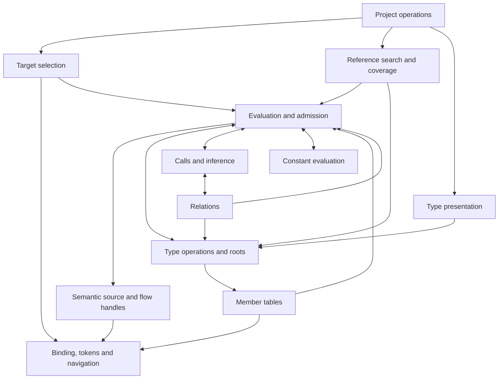

# Native types and member queries: technical design

Status: T/Q3/Q4 completed 2026-10-16 under the user-approved single-user
resource policy and documented TypeScript compatibility profile. The
[completion checkpoint](types-completion-correctness-2026-10-13.md) records the
final validation and supersedes the historical implementation-stage proof
obligations below, including per-operation resource accounting. Current process
protection and user-facing behavior are described in [types.md](types.md).

This document retains the selected contracts and internal ownership, starting
from repository revision `ea23d8b`; it does not authorize the ticket's other
capabilities. Historical implementation plans and reviews are available in Git
history. [Option inventory](types-options.md),
[compiler evidence](types-design-evidence.md),
[member relationship fixtures](types-member-relations-evidence.md), and
[corpus observations](types-corpus-evidence.md) retain their own measured scopes.

## Purpose and operating envelope

An agent should be able to inspect an inferred type and locate references to a
particular method without confusing it with unrelated methods of the same name.
Q3 also filters references to calls and omits test files on request. Q4 expands a
type far enough to explain its structure without unbounded recursive output.

Keep the native Rust implementation, TypeScript **7.0.2** baseline, unpublished
checkout-built distribution, and local CLI/library consumers. One explicit
tsconfig supplies disk inputs, including installed dependencies and vendored
libraries. Concurrent CLI clients share the existing serialized Unix service;
direct loading remains available. Queries do not execute application code or
write project files. Files can change between requests; existing snapshot and
refresh guarantees apply. There are no editor buffers, network callers, durable
type indexes, new writer coordination, or project-reference traversal.

The original ticket identifies a native checker as a large compiler investment,
not a small addition to reference filtering. Selecting T is interpreted as
continuing that native direction, consistent with the implemented deliveries.
The compiler-backed alternative is assessed below; adopting it would change
this design's runtime contract.

## Scope and guarantees

| Capability | Proposed delivery |
| --- | --- |
| T | A demand-driven native semantic core: declaration and member identity, type construction and reduction, contextual expression typing, generic inference and instantiation, overload resolution, assignability, and type presentation under the profile below. |
| Q3 | Existing lexical references with call/test filters; member references selected at a declaration or use, including the compiler's contextual, generic, union, and explicit inheritance relationships. |
| Q4 | A selected declaration's type or a supported expression's type, with an optional bounded structural expansion. |

This is a **query checker**, not a project-wide diagnostic command. Successful
queries do not certify that a project type-checks, that an edit is type-safe, or
that a reference will execute at runtime. The existing parse `--check` and
editing validation keep their syntax contracts. Full diagnostic parity, emit,
rename, missing-property inspection, affected tests, flow/narrowing queries,
dependency propagation, and incremental recomputation are outside this delivery.

TypeScript defines semantic answers within the profile. An unsupported construct
is never approximated by `any`, `unknown`, an empty object, or an empty reference
set. Genuine TypeScript `any` and `unknown` remain valid, distinct types. An
unresolved/error type produced during checking remains a semantic failure, even
where the compiler's display would spell its recovery type `any`.

### Fixed global identities and lazy factories

`initializeTypeChecker` establishes Object, Function, Array, ReadonlyArray
(with its Array fallback), and ThisType before query evaluation. Their identity comparisons
share one fixed-global owner. Lazy materialization preserves the entire stored
completion, but observing the installed identity does not replay startup
recovery as a new query acquisition. Actual array construction still consumes
that stored dependency, and an interrupted acquisition remains a failure.
Promise/Iterable and other lazy runtime getter closures retain their separate
native acquisition semantics; this identity rule is not a general recovery
filter.

### Initialized symbols and source-free types

The binding store retains the actual initialized globalThis Module before
source globals merge. Its raw Exports is the global table itself. Native
compatible merges retain this mutable identity, while conflicting declarations
leave it intact; the compiler's separate declaration diagnostic does not turn
its ordinary value type into recovery. This replaces an evaluator-only symbol
overlay that could diverge from identifier and alias lookup.
Its identity is independent of whether a source merge retained all metadata.
Raw `node.Symbol` and merged declaration-symbol reads share attachment
eligibility, but retain different identities. A missing pre-merge snapshot must
fail before a raw read can observe the initialized target's metadata. The same
rule applies to a source-file symbol merged by module augmentation.

Implementation exposed a broader ownership constraint: `cloneSymbol` creates
an actual third header, and one-way merges can create different contextual
clones. A raw/merged view flag cannot represent those identities. Binding will
therefore retain actual native headers and tables in one Store-owned arena,
with an explicit `getMergedSymbol` map. The lexical union-find and meaning
slots remain navigation projections. Raw metadata reads never follow those
projections; checker clone/merge operations record their own header and table
writes at the native operation. This also gives private keys, raw Parent,
LocalSymbol and ExportSymbol one identity owner. Missing raw metadata
continues to fail until that producer and its readers are migrated together.

Load-time JSON augmentation exposed the next boundary: resolving a merge target
can require checker-created object properties and type-dependent widening.
The shared initialization contract uses one initializer over immutable checker
inputs, with a temporary evaluator during load and fresh initialization in each
request. Raw binder associations
remain captured; checker-created headers, merge links, types, and caches belong
to that evaluator. The completed lexical projection/index remains the Q1
product. This replaces load-native cache import with replay of the same owner,
without a cloned checker-state seed. Native diagnostic acquisitions retain their
order before the separate existing load admission policy. The shared bootstrap
and actual JSON declaration carriers are connected and have scoped public/load
proof. Final compatibility and replay receipts are recorded in the
[completion checkpoint](types-completion-correctness-2026-10-13.md).
At that composition boundary, Project::load returns the existing AnalysisError
envelope so an interrupted initializer retains semantic reason and causes.
Legacy Input errors keep their CLI/service wire fields; direct Rust callers
must match AnalysisError::Input (an explicit unpublished-library API refinement).
Session construction stays path-only; failed refreshes publish no generation.


Its anonymous type starts without a source consumer. Member demands carry their
actual consumer for attribution. Shared anonymous member resolution applies the
global export filter, then the same class/index/enum/function/constructor work
used for other merged symbols. An absent source declaration is ordinary absence;
an interrupted metadata read remains a failure. A nominal summary alone does
not prove the member inventory or merged signatures.

### Proposed semantic profile

The profile is about the obligations needed to answer a query, not a ban on
opening projects containing other syntax. Capture unsupported constructs with
their source sites. Demand on one produces a located explanation. An unrelated
JSX body, for example, must not prevent reading a fully annotated interface.

| Area | Required for this delivery | Boundary |
| --- | --- | --- |
| Declarations | Type aliases, interfaces and merges, classes and class/interface merges, overloads, functions, variables, parameters, enums, namespaces, import/export aliases, module/global augmentations. Instance and static sides are separate; private/protected origins, accessors and parameter properties retain their distinctions. | JavaScript/JSDoc binding, expando assignments and dynamic prototype construction remain unsupported. |
| Type algebra | Primitives and literals; `any`, `unknown`, `never`, nullability; objects, call/construct/index signatures, unions/intersections, arrays, optional/rest/variadic/readonly tuples, type parameters, constraints/defaults, `this` types, unique symbols and enum types. | An unsupported demanded type is a blocker, not an opaque stand-in assumed compatible with other types. |
| Type operators | Alias substitution, `typeof`, `keyof`, indexed access, mapped types with modifiers/key remapping, conditional types with distribution and `infer`, template literal types, and compiler intrinsic/global alias hooks (four string mappings, `NoInfer`, `BuiltinIteratorReturn`, and `Awaited`). | Compiler-defined limits and product resource budgets have different outcomes, specified below. Deferred operators over still-free parameters remain symbolic as in TypeScript; they are not unsupported merely because they cannot reduce yet. |
| Inference | Annotation and initializer types, literal freshness/widening, `as const`, assertions, `satisfies`, object/array literals and spreads, binding patterns, generic functions/classes, call/new/tagged-template signatures and overload choice. Contextual parameters, object members, arguments, and returns participate. | No guessed best candidate, union of failed overloads, ad hoc utility-name shortcuts, or execution of application functions. Compiler constant evaluation of syntax is included. Compiler-defined intrinsic/global-type hooks remain explicit, ported rules with one owner. |
| Bodies | Expression typing, function-end reachability, and inferred returns whose dependencies pass admission. Annotated callable signatures can be read without validating their bodies, provided the annotations' own dependencies are supported. Async return/`await` types use declared Promise/thenable relationships. | Generator inference, inferred predicates, JSX expression/attribute typing, and decorator checking are deferred. Unsupported bodies affect queries only when their types are demanded. |
| Flow | The binder flow graph, checker admission, and end reachability are required infrastructure; reads succeed through supported read setup and identity cases of the compiler flow operations. | Flow-sensitive reads, narrowing, assignment-based refinement, inferred predicates, definite-assignment analysis and interprocedural value-flow belong to F. A demand that would require them reports `flow_required`; it does not return the unnarrowed type as a use-site answer. |
| Inputs | The existing TypeScript/TSX, declaration-library, JSON-module, resolution, and searched-file profile. JSON retains value kinds, recursive array structure and every exact key occurrence; module types widen scalar literals. | Parsing TSX is not a claim of JSX typing. No project-reference traversal, new JavaScript support, or Q4 anchors inside JSON files. |

This is deliberately substantial: standard libraries and real application types
use conditional/mapped types and contextual generics. Supporting only annotated
properties and a few named utility types would not fulfill T. Support for these
families is a delivery obligation, subject to their explicit exclusions and
resource limits, rather than an invitation to silently ship an arbitrary subset.

**Flow admission uses the compiler's graph, not a second syntax screen.**
Binding owns graph construction: `createFlowCondition`/`isNarrowingExpression`,
`bindAssignmentTargetFlow`, `maybeBindExpressionFlowIfCall`, loop/try/switch
binding, and function `EndFlowNode`. Semantic source exposes those immutable
flow handles at reads and function ends. Evaluation owns interpretation through
`checkIdentifier`, `getNarrowedTypeOfSymbol`, `getNarrowableTypeForReference`,
`getFlowTypeOfReference` and their related property/type-query operations.
Neither selection nor reference search decides that a read is safe from syntax.

Syntax references retain their own source-file identity, independently from
the flow graph being interpreted. Aliased conditions can recursively enter an
initializer in another file while retaining the original reference and graph.
The same distinction applies to correlated destructuring: a declaration-owned
pseudo-reference can borrow a flow from its use site. Matching, contextual
typing, constant-reference checks, and returned discriminant candidates consume
complete syntax identities. Callers cannot reinterpret those nodes in the
current graph's file. Native constant-condition inlining retains the checker-wide
five-level scope and restores it before returning or propagating an interruption.

Admission is a restricted interpreter with three outcomes: an exact read type
from supported setup/identity cases, `flow_required`, or a distinct failure.
Follow compiler flow-node dispatch and reference matching, including alias and
destructuring dependencies, execution boundaries and optional-chain roots.
`isMatchingReference` alone does not settle all those questions. A node may be
skipped only under the compiler rule that proves it irrelevant to this read;
if relevance or its effect requires an excluded narrowing operation, refuse.
Never substitute “not understood” for “unrelated”. Joins and cycles need a
bounded, memoized proof; resource exhaustion is not proof of no effect.

Exact intermediate fact reductions belong to that proof. Optionality and
truthiness can change a branch's type and then rejoin to the original read
type, just as assignment and switch intermediates can. Keep those established
types through native branch ordering and test the completed read for identity;
rejecting every changed intermediate falsely refuses an unchanged final read.
A final changed type still reports `flow_required`. This does not permit a
missing narrowing operation to return its input type or an approximation.

Native flow recursion and product resource depth are distinct. Port
`getTypeAtFlowNode`'s depth-2000 check before Shared cache lookup; tail traversal
does not increase that recursive depth. Overflow consumes the compiler's error
type and disables subsequent flow analysis in its native checking scope, so it
is `InvalidSemantic`/`error_type`, rather than a product resource failure.
That producer is distinct from later product output exhaustion: repeated Shared
completion acquisitions can make the exact omitted-cause count unrepresentable.
The existing `OutputLimit` then takes precedence; causal counts are never clamped
or deduplicated to manufacture an `error_type` answer. Linear guard chains prove
the native 1,999/2,000/2,001 boundary independently of branching replay, while
empty-if diamonds prove the separate output limit.
Shared caching belongs to the reference invocation's native window, and stores
only the last Shared node in a normally completed tail frame. General memoization
of every flow node cannot replace that schedule. The strict/loose natural
boundary and long flat controls are recorded in the historical implementation
plan, available in Git history.

* Compute the compiler's declared/initial inputs and read setup first.
  `getNarrowedTypeOfSymbol` can itself ask about destructured pseudo-references;
  it recursively uses admission rather than being assumed flow-free. Graph Start
  and absent-flow cases return initial or declared types as the compiler does. Constraint
  positions can substitute a type parameter's union constraint; defaulted
  parameters remove optionality as `removeOptionalityFromDeclaredType` does.
  Optional-chain interior reads have their own context. Test these questions
  separately from whether a previous assignment or guard changes a read.
* Initializer refinement in `getTypeAtFlowAssignment` is keyed on the declared
  type being a **union**, whether annotated or widened. Thus reads following
  `let flag = false` or a union annotation can require F. A non-union annotation
  such as `const host: Host = createHost()` is not refused merely for having an
  initializer. Automatic/evolving types and required definite-assignment or
  capture analysis remain blockers. The final `checkIdentifier` used-before-
  assignment branch is `flow_required` when its exact declared/flow undefined
  distinction consumes definite-assignment analysis; its diagnostic alone is
  not an error-type marker. Assignment-position checking retains its native
  early declared-type return and separate literal-base conversion.
  `typeof x` in an annotation follows the
  value-read operation at that site; annotations are not an admission bypass.
* Call effects are considered at actual `FlowCall` nodes, through
  `getEffectsSignature`/`getTypeOfDottedName` and explicitly typed names. A
  demand for an unsupported assertion/never effect is a blocker. Do not invent
  arbitrary side-effect analysis of application calls.
* Predicate inference ports `getTypePredicateFromBody` and
  `checkIfExpressionRefinesAnyParameter` through the point where the compiler
  returns no predicate without narrowing. Otherwise establish through the same
  flow interpreter that the condition cannot refine any eligible parameter, or
  return `flow_required`. No blanket “non-union parameter cannot narrow” rule:
  `{}` and unconstrained `T` can be refined by `typeof`, including via a boolean
  alias. A textual search of the return expression is insufficient. Explicit
  return annotations bypass inference only where TypeScript does.

Function-end reachability is a separate evaluation operation required by T,
porting `functionHasImplicitReturn`, `mayReturnNever`, `isReachableFlowNode` and
its caches, `getEffectsSignature`, and `isExhaustiveSwitchStatement`. Its switch
and effect dependencies pass normal admission. It decides implicit `undefined`
and empty/never return aggregation, with `strictNullChecks` as the compiler
applies it. `mayReturnNever` distinguishes function forms for empty aggregates;
it does **not** forbid a function declaration or class method from inferring
`never` from an explicit `return fail()` where `fail(): never`.

Required fixtures include aliased/discriminant/destructured guards, optional
chains, default parameters, constraint positions, widened boolean/enum initial
reads, `typeof` dependencies, exhaustive/non-exhaustive switches, infinite loops,
asserting/never calls, and explicit-return versus trailing-call inference for
all callable forms. Run null-sensitive cases with strict null checks on/off.

F still supplies value narrowing and assignment refinement; T supplies the graph
and reachability needed to answer its own questions. This has a real cost:
predicate-dependent `filter`/`find`/`findLast`/`every` calls and JSX attribute
relationships can produce gaps. Measure those query refusals on the fixed
real-project corpus below. Syntax counts in the review are motivation, not a
measured semantic coverage rate.

### Compiler options are semantic inputs

Extend the existing configuration owner; never parse options again in the
checker. It resolves inheritance, defaults and per-option overrides into typed
snapshot inputs. In 7.0.2 the strict family defaults **on when `strict` is
unset** (`GetStrictOptionValue`); explicit per-option values override it.

| Effective input | Owner that consumes it |
| --- | --- |
| `strictNullChecks`, `exactOptionalPropertyTypes`, `noUncheckedIndexedAccess` | Type construction/read/write operations and relations. Preserve missing versus explicit `undefined`. |
| `strictFunctionTypes` | Relations' variance and signature checks. |
| `strictBindCallApply` | Calls and intrinsic/global callable hooks. |
| `strictBuiltinIteratorReturn` | Type operations' `BuiltinIteratorReturn` intrinsic (`undefined` versus `any`). |
| `noImplicitAny`, `noImplicitThis`, `useUnknownInCatchVariables` | Evaluation's fallback, contextual `this`, and catch declaration types; diagnostic suppression does not authorize a recovery answer. |
| `target`, `lib`, module/resolution settings and the resolver's per-file module format | Program owns their effective values; evaluator/alias typing consumes read-only resolution facts rather than redetecting file format. |
| `strictPropertyInitialization` | `getFlowTypeOfAccessExpression` constructor read setup and recovery, as well as diagnostics. Excluded initialization refinement passes the same flow-admission boundary; it is not silently treated as diagnostic-only. |
| `noPropertyAccessFromIndexSignature`, `skipLibCheck`, `noCheck` and diagnostic directives | Diagnostic policy, not new read types or a project-check command. TS4111 alone does not invalidate the unchanged property type. |
| `deduplicatePackages`, effective `allowJs`, `checkJs`, decorator/metadata flags, class-field policy and configured JSX names | Retained configuration inputs for their existing loader or demanded semantic operations. Retaining them does not implement the deferred features. `GetAllowJS` falls back to `checkJs` only when `allowJs` is unset. |
| `noErrorTruncation` | Native diagnostic type serialization (`typeToStringEx`/node builder), whose bounded traversal can acquire otherwise-lazy semantic dependencies. Default false; retain inheritance, explicit overrides and null reset through configuration. This is separate from Q4 display budgets. |
| `stableTypeOrdering` | Retain the catalog's effective value (default true). No checker consumer was found in the pinned source; do not invent a different ordering algorithm for false. |

Checkpoint 1 enumerates **every accepted option** from the pinned catalog as
used by one of these operations, diagnostic-only, emit-only, or affecting a
demanded deferred feature. The latter yields a located unsupported operation;
no option is silently ignored. Removed options such as `keyofStringsOnly` are
configuration errors. The pinned compiler also rejects disabled
`alwaysStrict`/`esModuleInterop`/`allowSyntheticDefaultImports`; it does not offer
those old false modes. At `ea23d8b` the config owner ignored these settings;
implementation corrected that acceptance before retaining checker inputs.
Do not add checker branches for the removed modes. Existing conversion/inheritance and exact-key rules stay
with configuration. Test unset/true/false and inherited overrides separately.

**Invalidity follows data dependencies.** Evaluation owns a typed result that
records whether a demanded value came from a compiler recovery path: unresolved
symbols, error-type results, `getCandidateForOverloadFailure` and its helpers,
or compiler-limit error results. Such a value cannot establish an exact type or
reference. Record the operation and causal site, not just a displayed `any`.
Genuine `any` is valid. An ordinary compiler relation of false is valid data,
including when it rejects an overload candidate at the compiler's prescribed
stage. An unsupported operation is not a false relation.

Two reached async-from-sync iteration branches have no native type result:
7.0.2 panics when an iteration triple has an absent yield/return field, and
when it tries to report an invalid thenable with a nil diagnostic message.
Both are reproduced through the ordinary public API as well as the compiler
hook. These exact branches report located `unsupported_semantic_form`, after
preserving preceding native acquisitions. They do not fabricate Any recovery.
Ordinary checked await and the async iterator resolver keep their distinct,
nonnil-message behavior. [Iteration evidence](../fixtures/types/native-iteration-protocol/README.md)
records the compiler frames and controls.

The declared-type absence probe is also ordinary data:
`tryGetDeclaredTypeOfSymbol` returns nil when a symbol has no declared-type
flags, and `getDeclaredTypeOfSymbol` wraps that nil in its `errorType` sentinel.
That branch consumed no failed declaration. Preserve the sentinel so native
callers can test it, including the import/export RHS value-type fallback and
declaration serializer's name tracking. A failed alias or annotation still
carries recovery evidence through those same callers; it cannot become absence.

Compiler-hook probes already demonstrate why a root-only `isErrorType` check
cannot implement this contract: the instantiation-depth boundary can produce a
tuple whose root is valid but whose demanded rest contains recovery data.
Propagate provenance at the operation that consumes the dependency, through
the type constructor and final query outcome.

`checkSatisfiesExpression` returns its expression type unchanged after a failed
final assignability check; that diagnostic alone is **not** invalidity. Its
target can still be a dependency when it contextually types the expression, or
when an invalid target makes checking return `errorType`. Unrelated diagnostics
and unvalidated bodies of annotated signatures are not global blockers. A query
must follow actual value dependencies and their operation-specific recovery
markers, not all diagnostics lexically inside its target. This same rule owns
Q3 gaps and Q4 invalid errors.

Some native operations continue after creating a recovery value. For example,
mixed number/bigint arithmetic can still check a compound setter and evaluate a
shift constant. Retain the actual recovery identity for those native decisions
and keep its product failure separately; successful continuation cannot erase
that failure. Collect later semantic causes in native order, and stop on a
resource, I/O, or internal failure. Only an explicit native recovery producer may
create this identity; arbitrary unsupported or failed demands cannot substitute
it. Assignment elaboration shares one owner with `satisfies`, including its
reporting node, separately elaborated expression, contextual frame lifetime,
and diagnostic-only type and symbol acquisitions.

Missing-property reports likewise own their complete native acquisition order,
including the report-key cache and node `TypeChecked` publication. Property
access and relation reporting share the native spelling and never-intersection
elaboration operations where they ask the same question.

Implementation uses a private `NativeCompletion<T>` for the established native
value and typed recovery evidence. Its sequencing operation owns causal order
and whole-failure precedence; an outer error means no completed native result.
Imperative native workers use an operation-local `NativeSequence` over that
same policy, finishing only after their frame cleanup. It carries explicit
child results; it adds no evaluator-wide or relation-session failure journal.
Comma, conditional and `typeof` can return a healthy native value after
consuming recovery, so their final product admission must still fail. Native
cache installation is a separate fact from invocation success: a false
resolution pop cannot manufacture an installed value after interruption, and
later diagnostic failure cannot erase a value already installed. Preserve
source-free recovery markers in cached results and locate observation copies,
including secondary causes under an already located primary. Bounded public
cause lists retain an aggregate classification of omitted dependencies so an
omitted invalid cause cannot authorize an unsupported Q4 leaf. The wire schema
and output cause cap remain unchanged.

Relation cache entries retain the acquisitions of the comparison that actually
installed them. A recursive `Maybe` assumption does not retroactively acquire
errors found later by its ancestor or a sibling. Keep the native assumption,
commit and diagnostic rollback schedules; neither rollback nor a later
successful overload may remove failures already consumed by its invocation.
An interrupted comparison stops before subsequent root key acquisition,
overflow installation and display, preserving slots installed earlier.

## Agent and library contract

Use the existing executable, request boundary, source positions, output
delivery, and project service. New semantic queries always require `--project`;
there is no implicit tsconfig discovery or file-only fallback.

```sh
tsparse --references --project tsconfig.json --name run --calls --no-tests
tsparse --references --project tsconfig.json --name RunHost.observe --calls
tsparse --references --project tsconfig.json --at src/runs/host.ts:42:10
tsparse --type --project tsconfig.json --name createRunHost --expand
tsparse --type --project tsconfig.json --at src/runs/host.ts:42:10 --expand --depth 3 --json
```

`--direct` changes transport only. Output format/delivery is explicit:

| Result | Default output | With `--json` | Exit |
| --- | --- | --- | --- |
| References complete/partial | Text result to stdout or `-o`; with `--pretty`, the indented JSON document | JSON document to stdout or `-o`; `--pretty` indents JSON | 0 / 1 |
| References dotted selector not found/ambiguous | Stderr diagnostic naming the selection; with `--pretty`, the indented selection document to stdout or `-o` | JSON selection document to stdout or `-o` | 1 |
| References analysis/target failure | Stderr diagnostic, leaving `-o` untouched (existing behavior) | Error document to stdout or `-o` | Existing kind's code |
| Type found or partial expansion | Text result to stdout or `-o`, headed `TYPE` or `PARTIAL TYPE` | Type document to stdout or `-o` | 0 / 1 |
| Type unselected/analysis failure | Stderr diagnostic; no replacement of `-o` | Selection/error document to stdout or `-o` | 1 except exit-2 kinds |
| Usage or transport failure | `CODE: message` on stderr | `"error"` document: a usage failure's on stdout, never `-o`; a transport failure's on stdout or `-o` ([channels](navigation.md#exit-codes-and-channels)) | 2 |
| Delivery failure | Stderr only; never a second result document | Same | 2 |

A delivered partial text result is a result with exit 1, requiring an explicit
result-versus-diagnostic distinction at the existing delivery owner; do not route
it through the current rule that sends all nonzero text to stderr. References
have no separate text renderer in this deliverable. `outcome` near the top of
their JSON makes partial status prominent.

One parsed-request owner rejects invalid combinations: `--calls`/`--no-tests`
only on references; `--expand` only on type; type `--depth` only with `--expand`.
Type depth defaults to 3, accepts integers 0–32, and does not accept `all`.
`--pretty` requires JSON except that reference results already are JSON; preserve
existing format validation where it is stricter. Administration gains no
semantic options. New queries always require an explicit project.

Conceptual library operations (private Rust names remain open):

```rust
impl Project {
    fn references(&self, request: ReferenceRequest)
        -> Result<ReferenceAnswer, AnalysisError>;
    fn type_of(&self, request: TypeRequest)
        -> Result<TypeAnswer, AnalysisError>;
}
// ReferenceAnswer = Selected(ReferenceResult) | Unselected(SelectionFailure)
// TypeAnswer = Selected(TypeResult) | Unselected(SelectionFailure)
// SelectionFailure = NotFound | Ambiguous { candidates }
// ProjectSession::execute refreshes first, then dispatches.
```

Results own their data and outlive the snapshot. No internal type/symbol IDs,
arenas or checking protocol escape. Extend `ReferenceResult` additively with
outcome, coverage and filters. Legacy `find_references(ReferenceQuery)` keeps its
existing result type and lexical-name selection; the shared owner projects its
selected result, with ordinary target errors on its existing `At` failure paths.
Dotted selectors belong to the new request, not an unannounced reinterpretation
of the old library Name variant. Constructors/tests migrate with the additive
fields. There is no known external Rust consumer requiring another adapter.

### Selection

One **Target selection** owner maps a request to a typed target and question
kind, or a selection failure. It consumes Q2's catalog for selectors and
binding's **single token-target table** for positions. It owns dual-role
precedence, alias meaning, declaration-versus-expression selection and replay
anchors. Reference search and type presentation consume its result.

A semantic site is a snapshot-local source-node identity **plus role** (lexical
parameter, parameter-property member, namespace segment, declaration, expression
or type). Semantic source provides it from `(FileId, source span, syntax kind,
structural slot)`; roles distinguish declarations that share a token. Projection
and navigation bridge through that owner, not spelling or a discarded parser
arena's `NodeId`. The handle is private and valid only for that snapshot.

* An undotted reference `--name` retains all matching lexical declarations/
  import/export groups. FILE narrows seeds, not searched results. It does not
  search members, but returns `unsearchedMembers: {count, selectors}` when the
  catalog contains matching exact decoded member keys; suggestions include file,
  optional selector and Q2 declaration anchor. This key question is distinct
  from selector containment, including an empty key. Count distinct file/selector
  entries, retaining the earliest Q2 anchor for display duplicates. Unspellable
  keys/ancestors have `selector:null` and are distinct by file/anchor; never
  fabricate a selector or hide these matching sites. Order by exact file,
  optional selector (null first), then anchor, without semantic checking. This is
  advisory, not a promise that every inferred member is in Q2. The implemented
  advisory anchors replay Q2 `show`, not a new semantic member role: a
  parameter-property name still selects its lexical parameter under Q3.
  The member modifier/replay rules below remain implementation obligations.
* Dotted reference names and type names use the Q2 catalog's declaration
  selectors, not expression paths. Resolve candidate sites to the queried
  symbol/meaning **before** deciding ambiguity. Overloads and merged sites of
  one symbol and question collapse to one candidate retaining all origins.
  Distinct symbols, or distinct requested meanings, stay ambiguous.
  An origin set alone is not symbol identity: a parameter property's local
  parameter and instance member can share the same declaration node and span.
  Retain their distinct binding identities and source roles through
  normalization; never merge them because their displayed origins coincide.
* Reference `--at` targets a supported name-bearing token. A lexical role on a
  shorthand/parameter-property name keeps precedence. To select the parameter
  property's member with no use site available, its first property-producing
  modifier (`public`, `private`, `protected`, `readonly`, or `override`) is a
  new product anchor. A dotted namespace selector anchors its actual segment,
  not Q2's enclosing declaration's first segment. No whitespace/comment fallback.
* Ambiguity candidates have `selector`, `file`, `question`, `declarations` and
  `anchor: {file,line,column}`. Selection must prove that feeding **its own**
  anchor to the same operation's `--at` selects the same seed and meaning.
  Do not copy Q2 display anchors unexamined. Existing Q2 output is unchanged.
* Type `--at` checks declaration anchors first, then the smallest supported
  expression or type node whose token contains the position. Property-name
  tokens in `a.b` select the access; the string in `a["b"]` selects the literal;
  `]` selects the access result. A callee name selects its callable value type;
  closing `)` or the closing backtick of a tagged template selects the result.
  Whitespace and parent statements do not select a nearby expression.

The table closes the questions for catalog/position forms. It ports
`getTypeOfNode`/`isTypeDeclaration` where indicated; selection deviations are
product rules, listed also in [references.md](references.md#proposed-tq3q4-differences).

| Anchor form / meaning | Q4 question and answer |
| --- | --- |
| Type alias, interface, class declaration, type parameter | `declared`: declared type; class is instance side. |
| Enum declaration / enum member | `declared`: enum type / `value`: member's enum-literal type. A value use of the enum asks its export-object type. |
| Instantiated internal namespace / external-module namespace import or import-equals | `value`: namespace export-object type. A type-only external module can have `{}`. |
| Noninstantiated internal namespace declaration | `UnsupportedTarget`: do not invent an export-object value type. |
| Variable, binding, ordinary parameter, property, method, function, overload family | `value`: `getTypeOfSymbol`, preserving overload order. Parameter-property name is the parameter; its modifier anchor is the member. |
| Getter or setter declaration | `value`: member read type; expansion can also show distinct write type. |
| Import/export alias to a type-only target | `declared`: followed target's declared type. |
| Ordinary import/export alias to a type-and-value target | `value`: target's value type (class constructor side). |
| Type-only import/export alias to a type-and-value target | `declared`: target's declared type. Type-only aliases of value-only functions still expose their value *type*, without authorizing runtime use. |
| Default alias | Apply the same resolved-target meaning table; export-default expressions use their expression type. Unresolved aliases fail. |
| Final name in a type reference / supported type syntax | `type`: containing type-node's type, with type arguments. This deliberate useful-anchor rule avoids `getTypeOfNode`'s error-type answer on some bare type-reference identifiers. |
| Other supported expression, call result or tagged-template result | `expression`: type at that node, subject to admission. |
| Constructor keyword, call/construct/index signature catalog site, module block, anonymous/default site without a typed anchor | `UnsupportedTarget`. Inspect the containing class/object/type or the actual expression instead; do not invent a type for every Q2 site. |
| Any position inside a JSON input | `UnsupportedTarget` for Q4. Query its TypeScript import/property use; Q3 still supports JSON key occurrences. Direct JSON positions ask different literal/duplicate-key questions. |

Alias inspection intentionally gives useful types for import-equals, type-only
exports and default aliases where raw position typing differs. Ordinary imported
class versus class declaration asymmetry is TypeScript's own, not a deviation.
Name and position agree for the **same site, role and question**. Results expose
the source location and `kind: "declared" | "value" | "expression" | "type"`; `type` means
interpretation of the selected type syntax, including substitutions.
Both clause-level and specifier-level type-only markers use this table, as do
both renamed sides in Q4 (Q3 retains its distinct lexical roles). Value-only
variables follow the same rule as functions. A type-query operand uses its
value question; earlier namespace segments in a qualified type reference are
unsupported rather than silently selecting the final type. `new` can select
its NewExpression even without parentheses; `export = expression` follows the
export-default expression rule. Annotations are never silently substituted for
inferred type information.

### Q3: references, relationships and calls

There are three separate questions:

1. **Identity:** which declared member does this expression denote? Instantiating
   `Box<string>.value` changes the value type but keeps its declaration origin.
   Unrelated structurally equal objects do not gain a shared symbol.
2. **Reference relationship:** which other symbols should be searched from this
   selected site? TypeScript relates contextual object members, base/override
   members, implemented interfaces, synthetic union/intersection members,
   shorthand properties and parameter properties. This relationship can be
   directional and selection-site-dependent. It is not a union-find merge.
3. **Call role:** is this occurrence the direct target of call syntax? This is a
   syntax question, not a reachability or runtime-dispatch question.

The member-search owner ports `getReferencedSymbolsForSymbol`, including
`skipPastExportOrImportSpecifierOrUnion`, `populateSearchSymbolSet`,
`forEachRelatedSymbol`, and `getRelatedSymbol`. For an inline type-literal union
seed, substitution to the union property occurs only where every constituent
has that property; an interface-union seed can behave differently. Selected
site and meaning remain part of matching. Assignability is not relatedness.

Type operations owns `GetRootSymbols` and preserves instantiation roots,
union/intersection constituent origins, mapped `syntheticOrigin` and spread
`leftSpread`/`rightSpread` links when the compiler creates synthetic symbols.
Ordinary spreads can reuse original symbols. Check Partial/Readonly/Pick/Omit,
readonly-changing and set-only spreads, and optional-overlap spreads separately.
Reference search consumes these roots without inspecting type storage.

Q3 uses the **resolved combined member** after
`getResolvedMembersOrExportsOfSymbol`, independent of a cold checker’s first
seed. Internal early members still matter for re-entrance; they are not a second
public identity. This deliberate normalization fixes cold/warm declaration/use
asymmetry. It does not add nonliteral computed-key tokens as member occurrences.
Test cold, warm, reversed and cross-file seed orders, recording raw compiler
outputs and an explicit origin-based normalization; merely warming the oracle
with a convenient use is not evidence of order independence.

Groups retain referenced symbols' declaration sets, including origins outside
searched files. An occurrence may appear in more than one group when the
selected search relates it to several roots. Deduplicate by group and location,
combine roles in existing enum order, and order groups/declarations/occurrences
by exact normalized path (UTF-8 ordinal comparison, as pinned Go
`CompareStringsCaseSensitive`) then start/end position. Origins use the same order;
no ephemeral compiler IDs escape. Relatedness remains directional.

JSX attributes are compiler candidates related through contextual props types.
Demanding that deferred operation produces `jsx_typing_required`; property-access
tag names such as `<host.Panel/>` use ordinary member resolution. Measure the
props-query gap rate separately instead of claiming TSX parsing covers JSX.

`--calls` retains only occurrences used as the direct callee of a call, optional
call, constructor invocation, or tagged template. Peel parentheses, non-null
assertions, type assertions/`as`, `satisfies`, and instantiation wrappers using
the existing syntax owner, adding `skipOuterExpressions` alongside its
narrower `SkipParentheses` operation without broadening old callers. `isCallOrNewExpressionTarget` plus
explicit tagged-template handling owns the call role. Implicit `@decorator` invocations and JSX tags
are excluded, as is `instanceof`; `@factory()` still contains an explicit
CallExpression, so `factory` is a call occurrence. A member access contributes its member token, not the
receiver; `ns.run()` marks `run`, not `ns`. Exclude argument values,
`const f = host.observe`, and `host.observe.call(...)` as calls to `observe`.
For `const f = host.observe; f()`, references to `observe` include the read but
not the later call through `f`; F would be required for such value propagation.
Overloads form a reference family; the filter does not restrict results to one
chosen overload or predict virtual dispatch. Declaration metadata remains in a
group even when no call occurrences survive. An empty filtered set is success
if its coverage is complete.

`--no-tests` is a documented path filter, not affected-test analysis or test
runner discovery. Match case-sensitively on normalized project-relative `/`
paths: directory segments `test`, `tests`, or `__tests__`, and basenames ending
`.test.ts`, `.spec.ts`, `.test.tsx`, `.spec.tsx`, `.test.mts`, `.spec.mts`,
`.test.cts`, or `.spec.cts`. Do not guess `fixtures`, `spec`, or arbitrary runner
configuration. These product rules have one owner, independent of TypeScript's
config wildcard semantics. Loading, symbol selection, declaration metadata,
and type dependencies still include test files. The filter limits reported
occurrences and the candidate sites whose completeness is claimed. Return the
effective filter in the answer so an agent can understand the omission.
Filtering before occurrence resolution may remove related groups whose only
occurrences were filtered. Retain the seed group even when it has no surviving
occurrences, using `getRelatedSymbol`'s same root-versus-synthetic decision:
ordinary transient/instantiated seeds keep their root group, while synthetic
seeds retain their own group. Import/export headers are a separate search dependency: native
continuation discovers reverse edges such as `const run = ...; export { run };`
by inspecting the export specifier, which is not a declaration of the local
symbol. Skipping that header under `--calls` would incorrectly lose calls via
its exported aliases. The shared inventory retains a pure syntax admission bit
for those headers; traversal asks their native identity/meaning questions even
when their occurrences are filtered. It does not acquire ordinary excluded
member receivers or their types. Header failures remain located dependency
failures in the coverage ledger. Import/export direction, name-change stops,
and declaration order still follow the compiler. This revision separates
occurrence eligibility from the dependencies needed to reach eligible uses.

### Q3 coverage and failures

A selected result has `operation: "references"`, `outcome: "complete" | "partial"`,
`project`, `groups`, `filters`, `coverage` and `unsearchedMembers`. Coverage has
`baseline: "lexical" | "member"`, `status` equal to outcome, and `gaps`.
“Complete” is relative to that named operation and its filters:

* `lexical` is the existing documented lexical binding operation. It does not
  certify all same-symbol receiver uses or binding keys that TypeScript's
  broader reference operation might include. Member suggestions disclose that.
* `member` is 7.0.2 static reference search, with the explicit decoded-name,
  combined-member and fresh-request evaluation-order normalizations specified
  in this design. It is not all runtime value accesses.

Binding owns one token inventory, including name-bearing tokens and explicit declaration
anchor tokens (parameter-property modifiers), with their syntax roles,
lexical targets and exact keys: identifiers, private names, string/template/
numeric literal names, literal element accesses, binding-property names, JSX
attributes and JSON keys. Reference search owns candidate eligibility, porting
`getPossibleSymbolReferencePositions`, `isValidReferencePosition` and
`getMeaningFromLocation`. It requests inventory entries for the selected key,
then filters, resolves and accounts for each eligible candidate.

7.0.2's raw identifier-bounded text search is normalized here to exact **decoded**
key identity, so escaped identifiers and alternate numeric spellings are not
missed. That is a documented product difference with paired raw/normalized
fixtures. The decoded inventory also uses the actual `getSymbolScope` container
interval with absolute source offsets. Native 7.0.2's raw scanner initializes
its first match relative to `text[container.Pos():]` without adding that start
offset; a later private class can consequently examine earlier unrelated
tokens. Paired cold controls preserve those raw groups and diagnostic demands,
while the product normalizes candidate admission to the actual scope interval.
Arbitrary computed-key expressions such as `host[key]` and `[key]`
are **not** wildcard member candidates, even when typing knows the value of
`key`. A token spelling the queried key but resolving lexically to a variable
is not that member occurrence. Delete the proposed separate unresolved/computed
inventory: it added unrelated work and changed completeness.

A gap has `reason`, candidate `location`, `message`, and an optional bounded
causal chain. Never drop a blocked candidate or emit a spelling match as a
reference. A proven `any` receiver with no symbol is a non-reference; `unknown`
or a recovery value does not grant a guessed property. Unsupported semantics
and invalid recovery dependencies become gaps for candidates; unsupported or
unresolved **selected seeds** remain errors. Product resource, I/O and internal
failures abort the whole operation without returning a partial ledger.

Gaps are sorted by exact candidate path/start/end, reason, then cause location;
one candidate/reason/cause triple occurs once. Bounded causal chains end with
`omittedCauses` when necessary; do not discard affected candidate locations.
Q3 has no successful output-size truncation. If its full established result
cannot be delivered within resources, fail instead of calling it complete.
Unfiltered searches emit groups established by actual occurrences, without an
additional empty group for a contextual seed whose occurrences belong to another
origin. Filtered searches retain the selected seed declarations even if only
other groups have surviving occurrences. A selected empty filtered search is complete
when no eligible candidate is blocked; an unmatched bare lexical name can have
`groups: []`, with nonempty member suggestions.

Unmatched/ambiguous dotted selectors produce `outcome: "not_found" | "ambiguous"`,
`operation`, `project`, `selection` and `candidates` (empty for not_found), with
exit 1. They are typed `Unselected` results, not nonexistent legacy error shapes.

### Q4: useful, bounded type descriptions

Q4 returns an established root type, a bounded summary and, with `--expand`, a
structured graph. Aliases are semantic facts supplied by type construction,
not invented by the presenter. Preserve alias identity and actual type arguments;
qualify named graph labels with their actual symbol declaration locations.
`TypeDescription.summary` retains the bounded compiler spelling. Every named
alias or ordinary nominal graph node/omitted edge uses that spelling plus
` (file:line:column)` from its actual alias (preferred) or nominal symbol's first
native declaration. Paths retain the existing exact project-relative/external
location policy. This deliberately qualifies even a name that has no collision:
labels remain stable across discovery order, depth, and rolled-back siblings,
without a document-wide collision registry or retroactive byte adjustments.
Different arguments of one declaration share its source qualifier; distinct
same-named declarations have distinct qualifiers. Alias identity fields and
origins remain unchanged. The whole suffix is reserved within the summary limit;
when necessary elide the complete native prefix to `…`. If the location itself
cannot fit, use the normal whole-summary elision and `summaryTruncated`; exact
alias provenance remains in metadata. JSON and text derive from one structured
description; consumers need not parse display strings.

Properties distinguish read type from write type, missing from `undefined`,
optionality, readonly and accessibility. `writeType` appears only when it differs
from the read type; a readonly member has no writable operation. Preserve
accessor and method kinds. Index signatures do not invent enumerated properties.
Private/protected and unique-symbol keys retain identity/origins. Type arguments
and array elements are direct edges: users need not traverse Promise library
members to reach `Promise<Event>`'s `Event`. The default expansion follows those
edges **and** normal members within the same budgets; it does not expand entire
library declarations eagerly or special-case a list of library names.

The presenter preserves the model's order: compiler union order, intersection
insertion order, member enumeration order, overload order and tuple order.
`getNamedMembers` may partition own/inherited class members and sort within
partitions; union members use their own operation's order. No final alphabetic
sort is imposed. All source origins use exact normalized path/position order.

### Q4 graph and limits

The public graph uses the following closed vocabulary. Fields are present only
where stated; TypeRef is `{ref: id}` or a display-only omission edge
`{omitted: "depth" | "nodes" | "bytes", kind, summary, summaryTruncated}`.
An omitted edge has no fabricated semantic identity. Node IDs are local to one
document, assigned in discovery order; they are not cache keys.

| Record | Fields / variants |
| --- | --- |
| Type result | `operation: "type"`, `outcome: "found" | "partial"`, `project`, `target: {location, kind}`, `type: {summary, summaryTruncated, expansion}`, `issues: []` or located unsupported issues. `expansion` is null without expansion. |
| Expansion | `root`, `nodes`, `truncated` (display elision only). Semantic partial status is carried by outcome/issues, independently of this flag. |
| Common node | `id`, `kind`, `summary`, `summaryTruncated`; optional `alias: {name, origins}`; `typeArguments: TypeRef[]` when instantiated; `omittedTypeArguments` when their established vector is unshown; optional `omitted: {reason: "depth" | "nodes" | "bytes", fields: string[]}` for unexpanded child fields; field names must come from that node kind's schema. |
| Node kinds | `any`, `unknown`, `never`, `void`, `undefined`, `null`, `primitive`, `literal`, `unique_symbol`, `enum`, `type_parameter`, `object`, `function`, `array`, `tuple`, `union`, `intersection`, `operator`, `unsupported`. Functions are types with callable/constructable structure. |
| Scalar / parameter / operator | Primitive `name` in `string, number, boolean, bigint, symbol, object`; literal `base` and exact value text; enum/unique symbol `origins`; parameter `name`, optional constraint/default edges; operator `operator` in `keyof, indexed_access, conditional, mapped, template_literal, string_mapping, substitution`, ordered `operands`, and bound parameter descriptors; `omittedOperands` and `omittedParameters` report established unshown counts. A deferred compiler operator is not an unsupported node. |
| Object/function fields | `properties`, `callSignatures`, `constructSignatures`, `indexSignatures`; optional `blockedCollections: [{field, issue}]`, where field is one of those four collection names and issue is `{reason,location,message}` with an unsupported reason; the blocked collection is absent. Each established collection can end early with corresponding `omittedProperties`, `omittedCallSignatures`, `omittedConstructSignatures`, `omittedIndexSignatures` counts. |
| Property | `key`, `kind: "property" | "method" | "accessor"`, `type` (read TypeRef), optional distinct `writeType`, `optional`, `readonly`, `accessibility: "public" | "protected" | "private"`, `origins`. |
| Key | `{kind: "string", name}` for exact decoded string/numeric property identity; `{kind: "private", name, origins}`; `{kind: "symbol", name, origins}`. A display name alone is not identity. Numeric spellings that name one property share its string key. |
| Signature | Ordered `typeParameters`, optional `thisParameter`, ordered `parameters: [{name,type,optional,rest}]`, `returnType`, optional `predicate: {kind: "is" | "asserts_is" | "asserts", subject: "this" | parameterIndex, type?}`, and `origins`. Type parameter descriptors have name/constraint/default and variance when declared. |
| Index / array / tuple | Index `{keyType,valueType,readonly}`; array `element`, `readonly`; tuple ordered `elements: [{type,label?,optional,rest,variadic}]`, `readonly`, and `omittedElements` when established elements remain unshown. Arrays/tuples may also carry bounded object fields. |
| Union/intersection | Ordered `alternatives: TypeRef[]`; `omittedAlternatives` if a wide list is elided. |
| Unsupported leaf | `kind: "unsupported"`, `reason`, `location`, `message`; an encountered failure always retains its issue and partial outcome. Its graph record may be elided by display budgets. |

Ordinary literal `value` is decoded string content, canonical numeric text,
`true`/`false`, or canonical signed decimal bigint text without a trailing `n`,
according to its base. Native byte strings and generated identities use the
exact `parts` encoding specified with the native-identity policy below; they
remain `kind: "literal"`. Numeric and bigint signed zero use `0`. Summaries apply the shared compiler
printer's quoting/escaping or bigint `n` suffix; graph values retain their exact
content independently of summary truncation. [Literal controls](types-literal-evidence.md)
and [constant-expression controls](types-constant-evidence.md) prove the admitted
families without claiming the remaining type/constant profile.

Traversal is breadth-first over semantic types with edges in this stable order:
type arguments; array/tuple elements or alternatives/operator operands;
operator bound-parameter descriptors (constraint then default); parameter constraint/default; properties (read then distinct write);
call then construct signatures (type-parameter constraints/defaults, this,
parameters, return, predicate); indexes (key then value). Alias labels/origins
are metadata, not depth edges. A shared type is expanded at its **minimum**
distance from the root, even if another path first encounters it more deeply.
Cycles and repeated types reuse IDs without setting `truncated`.
`Box<string>` and `Box<number>` remain distinct; `Grow<T[]>` is not a cycle of
`Grow<T>` merely because it has the same declaration.

Display depth counts type edges, defaults to 3 and is bounded to 32. Depth zero
emits the real root kind and bounded summary. The request owner validates this bound
for library and service requests as well as CLI input; invalid operation options
report `InvalidRequest` (exit 2), without clamping or starting semantic work.
Set `truncated` only if actual
structural fields or text were omitted; a primitive at depth zero is complete.
An ordinary Class/Interface reference's real Object/Function graph kind asks
the native structured-member inventory; nominal names or syntax flags do not
decide callability. This required metadata demand runs even at depth zero and
consumes its native dependencies, including index annotations. Optional
property/signature child types outside the admitted display remain lazy. A
summary-only nominal reference need not ask that inventory. The fresh pinned
controls in [reference-shape/README.md](../fixtures/types/reference-shape/README.md)
show that required inventory can consume index error recovery while its nominal
root remains non-error; display depth cannot mask that consumed failure.
Mapped graph kinds likewise use the native `isGenericMappedType` decision:
concrete mapped types expose object members, and generic mapped types expose
the symbolic mapped operator. This mandatory metadata question can acquire a
constraint or remapped name even at depth zero. Subsequent operator operands
and parameter edges remain subject to ordinary display admission; syntax alone
does not establish genericity.
Proposed defaults are at most **2,000 nodes**, **256 KiB (262,144 UTF-8 bytes)**
for compact serialization of the complete `type` field, and **512 UTF-8 bytes**
per summary, including elision markers. Count before pretty indentation, which
does not alter graph contents. Pretty JSON and text render the same admitted
graph. Root metadata too large to represent losslessly yields `OutputLimit`.

Summaries are token-aware, bounded descriptions. Elide complete tokens/clauses,
use `{ … }` or `… N more …` where a count is known, and set `summaryTruncated`.
Never shorten identity fields. Inside a graph use aliases or child summaries/
references instead of recursively inlining the entire subtree at every node.
Reserve envelope/omission space before adding a field. Wide lists emit a stable
prefix with exact omitted counts when enumeration is established. Fixed operator
operand vectors and type-argument vectors are admitted as complete fields,
retaining their full omitted count when unshown. All count fields reserve bytes
with the header and change atomically with their collection. An unsupported
list enumeration uses `blockedCollections` instead of a guessed count; it has
the same partial-result semantics as an unsupported child leaf.
An object with an elided member list remains an object.

Root establishment is atomic: unsupported/invalid root dependencies are errors.
An established lazy object may have unsupported child demands during expansion;
keep the root and established branches, emit typed unsupported leaves, set
`outcome: "partial"`, list issues, and exit 1. An invalid recovery dependency,
resource exhaustion or internal failure still fails the whole Q4 operation.
Summary-only output need not force unshown member types. It may elide them with
`summaryTruncated`, but an **encountered** semantic blocker is never relabelled
as a display limit. A display limit can avoid a demand outside the requested
view; it cannot convert a failed demand into success. Text partial results begin
`PARTIAL TYPE — unsupported details`, then render the same known structure and
located issues. Successful text begins `TYPE`, followed by target, summary,
indented structure and an explicit display-omission note when needed.

If an encountered unsupported node or its containing record exceeds the node
or byte budget, omit that display record using the normal graph omission
contract. Keep the original located issue and partial outcome even when staged
nodes and edges roll back. This separates the semantic failure from its bounded
display and avoids allocating beyond the graph cap. The native byte and node
boundary controls,
including Project GREEN `vrun-5406cf97-5faf-4203-8197-145c50543270` and
`vrun-ebeb92d0-e553-4991-bdd8-84f6163ed542`, prove this distinction for the
admitted lazy-member family. Signature/index/type-argument budgets, recursive
state and the complete semantic/resource matrix remain required gates.

### Response examples and closed failures

Locations use existing one-based UTF-16/exclusive-end positions. With
`--json`, this Q3 result of `--name RunHost.observe --calls` is delivered as
this document and exits 1, even with no established call occurrences:

```json
{
  "operation": "references",
  "outcome": "partial",
  "project": "/work/tsconfig.json",
  "selection": {"name": {"name": "RunHost.observe", "file": null}},
  "groups": [{
    "declarations": [{"name": "observe", "location": {"file": "host.ts", "start": {"line": 1, "column": 18}, "end": {"line": 1, "column": 25}}}],
    "occurrences": []
  }],
  "filters": {"calls": true, "excludeTests": false},
  "unsearchedMembers": {"count": 0, "selectors": []},
  "coverage": {
    "baseline": "member",
    "status": "partial",
    "gaps": [{
      "reason": "flow_required",
      "location": {"file": "use.ts", "start": {"line": 8, "column": 6}, "end": {"line": 8, "column": 13}},
      "message": "Receiver typing requires an unsupported refinement"
    }]
  }
}
```

A primitive Q4 result at depth zero hides no structure and exits 0:

```json
{
  "operation": "type",
  "outcome": "found",
  "project": "/work/tsconfig.json",
  "target": {"kind": "value", "location": {"file": "types.ts", "start": {"line": 1, "column": 5}, "end": {"line": 1, "column": 9}}},
  "type": {
    "summary": "string",
    "summaryTruncated": false,
    "expansion": {
      "root": "t0",
      "nodes": [{"id": "t0", "kind": "primitive", "name": "string", "summary": "string", "summaryTruncated": false}],
      "truncated": false
    }
  },
  "issues": []
}
```

Existing input/query error kinds retain their meanings and delivery. New
semantic error kinds are `UnsupportedSemantic`, `InvalidSemantic`,
`SemanticMemoryLimit`, `SemanticDepthLimit`,
`SemanticDeadline`, `OutputLimit`, and `Internal`. All are exit 1 except
`Internal` (exit 2); a thread-start I/O failure remains exit 2. Existing parse
`ResourceLimit` is not reused for checker or presentation limits. Documents use
`operation`, `outcome: "error"`, `project`, and `error: {kind, reason, message,
path, position, causes?, omittedCauses?}` through the shared error presenter.

Closed semantic reason vocabulary for this delivery:

| Category | Reasons |
| --- | --- |
| Unsupported | `flow_required`, `jsx_typing_required`, `generator_inference_required`, `decorator_typing_required`, `javascript_semantics_required`, `expando_semantics_required`, `unsupported_semantic_form`, `unrepresentable_identity` |
| Invalid | `unresolved_symbol`, `error_type`, `overload_recovery`, `circular_type`, `instantiation_limit`, `conditional_tail_limit`, `union_complexity_limit`, `subtype_complexity_limit`, `relation_depth_limit`, `relation_complexity_limit` |
| Product resource / internal | `semantic_memory_limit`, `semantic_depth_limit`, `semantic_deadline`, `output_limit`, `internal_failure` |

Unsupported forms not otherwise named use `unsupported_semantic_form` plus an
explanatory source site; new public reasons require a deliberate contract change.
Q3 gaps permit only unsupported/invalid reasons. Q4 unsupported leaves permit
only unsupported reasons. Causes use the same vocabulary. A cause's `location`
is optional: compiler global-type failures without a declaration site retain
that absence; the consuming operation's error still identifies its own source
position. Never fabricate a declaration location from the consumer. Sort issues/causes by
exact site then reason, retaining causal order within each chain; cap each chain
at 16 entries with `omittedCauses`. Selection failures are their own outcomes,
not semantic reason codes.

The Rust `SemanticError` record retains an internal, serde-skipped complete
`Location` when the failure-producing operation has that exact range. This
field survives conversions through `AnalysisError` and `DemandError`; wire
errors keep their existing `path`/`position` shape. A Q3 gap remains located at
its candidate and prepends a different or unlocated primary dependency to its
ordered causes. The internal range is independent of `TypeIssue`: retaining
an invalid failure's location never makes it eligible for a Q4 unsupported
leaf. Deserializing a wire error cannot recover that internal range, and
callers must not reconstruct one from its start position.

## Hierarchical ownership

A small `Project::type_of` interface is insufficient if the implementation is a
checker-sized tangle. The following are **knowledge boundaries**, not a promise
to create one file or one trait for every row. Each operation must be usable
without reading the private representation of its provider.



| Owner | Hidden decision / complete operations | Must not know |
| --- | --- | --- |
| Program/configuration/sources | Effective options, exact file identity, resolver/per-file module facts, source snapshots and searched-file policy. | Type algebra, output or filters. |
| Binding | Lexical scopes/meanings/merges/imports/exports; name-use attachment; flow-graph construction; one token inventory and pending member recipes. | Computed-key types, overload choice, formatting. |
| Semantic source | Source-node/role identity and descriptions of declaration/type/expression/body context, projected from captured source; access by `(FileId, site)` without exposing parser arenas. | Type reduction, flow relevance, target policy. |
| Target selection | Selectors/positions to one typed seed and question; dual roles, alias inspection meaning, ambiguity collapse and verified replay anchors. | Inference algorithms or output graph layout. |
| JSON facts | Value kinds/arrays, exact key occurrences/last-value links, JSON member/token projections; shared load-time shape questions. | Contextual inference, reference grouping. |
| Member keys | Exact literal/numeric, private and unique-symbol key identity, shared by inventory and member tables. Named compiler conversions, with distinct early-syntax and typed-computed-key operations. | Whether a token is a reference candidate or a symbol is related. |
| Type model/construction | Alias-bearing type identity, substitutions, immutable records, provenance and canonical constituent order. Constructors enforce compiler invariants; storage sharing preserves them. | Query options, raw syntax traversal or presentation budgets. |
| Member tables | `getResolvedMembersOrExportsOfSymbol`, `lateBindMember`, `addDeclarationToLateBoundSymbol`, accessors and early/late combination for one owner/side; combined public lookup. | Lexical re-binding, assignability, search policy. |
| Type operations | `getDeclaredTypeOfSymbol`, apparent/widened types, substitution/reduction, property/signature/index lookup and `GetRootSymbols`; returns compiler-ordered members. | CLI, formatting, value initializer inference. |
| Relations | Relation kind/direction/options, variance, recursion/Maybe/overflow protocol and established applicability results. | Search candidates or parser collection. |
| Calls/inference | Complete call/new/tag checking; shared call-site contextual state, candidate inference state, ordered applicability and signature resolution. | File filters or output grouping. |
| Evaluation | `getTypeOfNode`/`GetTypeAtLocation`, `getTypeOfSymbol`, expression/contextual types, read admission, reachability/inferred returns, recovery-dependency propagation, checking schedule and operation-specific memo keys. | Private relation/member caches, output formatting or service state. |
| Constant evaluation | `evaluator.NewEvaluator`, `evaluateEntity`, `evaluateEnumMember`, `computeEnumMemberValues`/`computeEnumMemberValue`; constant value or compiler-defined nonconstant outcome. | Application execution or reference policy. |
| Reference search | Candidate eligibility/meaning, directed relationships, filters and coverage. Consumes token inventory and type roots. | Key decoding, inference state, graph layout. |
| Presentation | Finite structured output, labels/escaping, breadth-first traversal and display budgets; preserves semantic ordering. | Alias identity, relations, recovery interpretation. |

These are knowledge boundaries, not one file/trait per row. Evaluation, calls,
relations, type operations and member resolution are mutually dependent;
the diagram includes those back-edges. Each requests typed operations, not
another owner's mutable tables or a monolithic Project/checker context.
General scheduling and resource charging are shared mechanics; each compiler
operation owns its semantic cache keys, re-entry and limit outcomes. No generic
query engine, backend plugin layer, or collection of pass-through traits is
required.

Checker inspection must not call the product's selector to obtain a type.
`getTypeOfNode` has its own ordered syntax dispatch: class heritage acquires the
declaring class before checking the heritage node and then applies its actual
`this` argument. Contextual-union discrimination asks the type of each actual
property declaration, including accessors and methods, rather than only an
initializer. Source supplies these roles; Evaluation owns the semantic demands.
Q4's useful type-reference anchors remain the deliberate selection policy above.

Raw alias identity, immediate alias target, target-of-alias-declaration, and
final alias resolution are separate checker questions. They share the retained
binding resolver's lookup rules, but keep their native caches and error policy.
An ignored missing entity can yield no symbol; a missing module consumed while
resolving an alias remains a dependency failure. A final target cannot replace
an immediate target in reference continuation or skip the declaration-target
question in `getTypeOfAlias`.

Q4 alias selection resolves its actual target through that request's evaluator,
including checker-created export-value properties. Source supplies the selected
alias declaration's own type-only syntax. Selection applies the declared/value
preference and deduplicates candidates by actual symbol identity and question;
it does not use the binding resolver's narrower target domain. An unknown alias
target fails before preference or ambiguity construction. Candidate metadata
uses the same name/declaration projection as Q3, while ordinary target type
establishment stays after the selected site's checking prelude.

Missing exports still execute the native diagnostic dependencies before alias
resolution installs its unknown target. Evaluation owns the complete
`errorNoModuleMemberSymbol`, `reportNonExportedMember`, and
`reportNonDefaultExport` operations: module-only resolved exports feed spelling
suggestions, while default/local/export-equals checks read raw tables. Spelling
shares one candidate owner parameterized by the native meaning mask; ModuleMember
accepts raw aliases before target resolution, unlike Value. Diagnostic NoCheck
suppression follows each native operation's own gate. Qualified module display
retains the enclosing source context while suppressing lexical symbol-chain
lookup. Diagnostic text remains outside the query result, but its acquired
failures cannot be discarded.

Module-specifier display reads the loader's raw resolved path, independently of
whether that import admitted a program source. Query membership and raw resolver
filenames are separate facts: two symlink spellings can denote one captured
source without being equal in `computeModuleSpecifiers`. Its ordered module paths
and the raw resolved filename determine which existing import wins. Comparing a
resolved path never opens the filesystem or demands the imported symbol. Native
`SourceFile.Imports` excludes synthetic helper/JSX requests, while the language
service's `forEachImport` includes them. These observations share the retained
request inventory without conflating their different questions. Resolution mode
retains native None through request and cache identity; only the resolver's
`GetConditions` owner supplies its mode-dependent default. Existing spelling
reuse honors the first matching import's mode before considering a new spelling.

The checker owns the complete `getSpecifierForModuleSymbol` operation. Its
declaration/export-equals prefix precedes cache access. The actual enclosing
declaration selects the cache/preference mode, independently from the original
override passed into generation; an original specifier with native None is
distinct from no original specifier. The symbol cache retains completion evidence
under the fixed context-file identity and effective mode. Ambient namespace
exports use raw exports, actual export-assignment value declarations, completed
`GetSymbolAtLocation`/alias acquisitions, and raw declaration-symbol equality.

Fresh spelling consumes an immutable program-owned environment containing
effective configuration, native resolution/symlink facts, package metadata, and
file-probe answers. Query evaluation has no filesystem handle. Capture and
generation share the path transforms that determine index-collision probes;
relative probes follow native host-cwd normalization, including paths/rootDirs
transformations. Captured absence, a deferred input failure, and a missing
capture invariant remain distinct. Speculative capture does not fail an otherwise
valid load; a query reports a retained failure when its native operation reaches
it. The service must include these observations in freshness checks. The closure
can contain a quadratic number of distinct importer-directory/index-target
probes; it stores deduplicated facts, not a matrix of final spellings.

Observation caches use the compiler's canonical filename operation. Package
contents retain one parsed identity, while each lookup supplies the caller's
directory spelling, matching native WithPackageDirectory. Typed input errors
keep their original path. Package runtime dependencies are decoded from ordered
raw JSON fields before JSONValue normalization: duplicate fields and partially
decoded invalid maps affect native symlink inference. The shared manifest owner
performs that interpretation once. Compiler host cwd remains independent of the
configuration directory in both production capture and the oracle.

Compiler evidence must preserve filesystem operations as well as source files.
A positive existence check can resolve a TSX/JS input that is never admitted or
read. The oracle therefore captures all five API filesystem callbacks and replays
their exact answers. A hook-only uncaptured operation aborts that pass, captures
the missing answer, and starts a fresh checker; only a complete replay is evidence.
Previously captured inputs must remain unchanged throughout this process. This
evidence workflow does not authorize filesystem access during product queries.

`combineValueAndTypeSymbols` uses the same declaration-backed created-symbol
worker as checker merges. Its native shortcuts retain input identity; the
fresh case owns a new identity, concatenated declarations, the value side's
ValueDeclaration and Exports, and the type side's Members. It has no fabricated
target link or precomputed value type. Two such factories can produce identical
public origins while remaining distinct Q4 candidates.

Module export traversal has one owner shared by loading and evaluation. It
owns export-star order, identity-based visitation, collision alias acquisitions,
default exclusions, export-equals supplemental types, and type-only overrides.
The loader adapter preserves alias suspension; the evaluator adapter operates
on actual retained or created symbols. Each caller owns its native cache and
publication point. Request evaluation imports already-installed loader links
without forcing new work. A late-container exports worker does not populate
the separate module export cache or its type-only map. Type-only observations
read installed links without resolving exports, and the module worker always
returns an allocated table, including an empty result.

Canonical ordering consumes actual construction facts. Binding retains native
symbol names as exact bytes (including reserved non-UTF-8 names), native symbol
associations and first declaration nodes; selection anchors and display names
cannot reconstruct them. Its shared `compareSymbols` operation serves member
enumeration and type ordering. Model owns established mapper identity/data and
`CompareTypes`; Evaluation executes substitutions. Comparison must preserve a
required fact's failure and cannot force unrelated type or source work.

Numeric AST spelling and numeric property-name classification share one
`jsnum.Number.String` owner. Scanner/radix conversion and exact index identity
remain separate questions. Property lookup owns ordered applicability, string
fallback and multi-index combination, so its callers do not reproduce numeric
classification or relation policy.

Failures carry the identity of the native question that failed through display
and dependent read/write wrappers. A property read reused by its write question
therefore produces one Q4 issue and one unsupported graph node. An independently
failed setter remains a different question even if it has the same location or
message. This provenance does not merge successful read/write caches or erase
invalid/resource failures.

### Preserve and extend existing owners

At `ea23d8b`, Project loading builds a Program and binding Index, then drops
most binding facts. Index retains lexical targets/groups; Q2 intentionally
omits much type syntax. Neither navigation signatures nor reference groups are
a substitute for scope-aware semantic source.

Binding's new frozen `BoundProgram` retains canonical lexical symbols, resolved
lexical name uses, declarations/scopes, flow handles, member recipes and the
single name-bearing token inventory. Existing lexical indexes project those
identities once. Binding still resolves its present lexical/qualified namespace
and import/export questions at load; type-dependent receiver/member paths become
typed pending obligations, not a second name-only linker in the checker.
Existing hard load failures must remain hard failures. Migration checkpoint 2
must specify and test each old resolved/unsupported/absent projection before
removing it; do not move an old failure into tolerated Unsupported accidentally.

Member tables complete static/computed recipes after key types are established,
using shared member-key identity. Early members remain available **internally**
when late-binding recursion asks for them, as 7.0.2 does. Established lookup and
Q3 use the combined result; unsupported key evaluation blocks that table demand,
not every same-name query in the project. Declaration origins can include
computed declarations even when their key-variable tokens are not member
occurrence candidates. Completing a table never mutates frozen lexical symbols.

**Term representation is private and measured.** Semantic source provides
complete descriptions by `(FileId, site)`; evaluators retain no parser arena or
layout assumptions. Compare two implementations at checkpoint 2: compact eager
terms built during final-tree capture, versus on-demand reprojection from the
already captured text (with request-local description caches). Existing parser,
traversal, exact names and span owners perform both. Reprojection never rereads
disk or rebinds lexical names. It may regenerate syntax to attach existing
site/role identities and binding/flow handles. Eager capture of every expression
would resemble a second AST; do not claim a memory benefit without measurement.

On-demand reprojection is the starting candidate, consistent with Q2/editing;
select eager retention only if measured first/repeated semantic latency needs
it and the added load/refresh/retained cost is justified against the same corpus.
The comparison must include old-operation load and refresh, not just semantic
query time. Checkpoint 2 closes the concrete representation, migration map and
source-site round-trip before a full checker is built. Consumers are insulated
from either choice. No permanent source substring copies per semantic term.

Descriptor acquisition measurements alone cannot
settle semantic latency. Use the same bounded native vertical consumer for both
representation candidates, covering actual cross-file demands established by
the baseline; keep reprojection provisional until that comparison exists.
This permits measurement scaffolding and exact vertical prototypes before the
full checker, without declaring either the representation or delivery complete.

Template implementation retains cooked UTF-16 fragments until the complete
native `getTemplateLiteralType` normalization decides whether they survive.
This admits surrogate pairs joined across interpolation boundaries and allows
a later invalid placeholder to widen to String before text validation. Only
retained source text must satisfy the existing surrogate-admission policy.
Native-generated string values also contain exact non-UTF-8 bytes and opaque
symbol identities. One canonical value owner serves literal payloads and
property keys; neither printed escapes nor replacement characters become their
identity. Template concatenation, capture and intrinsic mapping must retain
that value domain. A reached operation that has not yet been ported remains an
implementation failure, not a successful mismatch. Normalized segments and
placeholder TypeIds form the interned template header; display text never stands
in for this identity. Intrinsic string mapping retains its
actual alias symbol and target, and casing uses the pinned compiler's Unicode
tables.

Implementation may also graduate a compiler-pinned vertical operation through
the complete `Project::type_of` contract while these checkpoints remain open.
Its relevant selection, inference, ordering and failure questions must first
have exact compiler controls. This is incremental construction of T, not a
smaller delivery: unimplemented demands retain located failures, and the full
baseline, representation comparison and resource gates still precede release.
Keep the semantic-source operation independent of the provisional storage choice
so the same native evaluator can compare both candidates. The first such
operation follows an ordinary import/export alias to a value-only variable and
infers its object initializer. It does not claim flow admission for arbitrary
expression reads.

[Representation evidence](types-representation-evidence.md) compares partial
structural descriptions and a direct primitive-annotation consumer on 18 hashed inputs.
It proves replay of 662,181 final-tree sites and request-cache teardown for that
prototype. Its 29,135,892-byte partial payload and 16-file reprojection costs do
not measure complete terms, canonical bindings or full native type journeys.
The experiment therefore leaves the representation choice and checkpoint 2
open; it supplies source-cost observations for the complete comparison.

**JSON has one fact owner.** Extend the existing JSON reader's product to
`JsonFacts`: kinds, recursive array elements, exact key identities, every key
span, and last-value links for duplicate property semantics. Imported module
and property types use `getWidenedType(getWidenedLiteralType(...))`; scalar
payloads are unnecessary for that question. `null`, empty arrays and arrays of
unlike object shapes still require the compiler's option-dependent rules.
Direct Q4 positions inside JSON are excluded: they ask literal/per-occurrence
type questions, and a duplicate key can differ from the imported last value.
Q3 retains every declaration/key origin. JSON feeds common member recipes and
the token inventory through JsonFacts, without a TypeScript-AST collector.

The existing linker operation is `Linker::value_property`, not `json_property`.
Document its deliberately narrow `getPropertyOfType` question. It returns
known-present, known-absent or a deferred semantic obligation, with hard failures
kept distinct. Direct JSON keys and already captured library member names are
shared fact lookups; full receiver-type lookup belongs to Type operations.
Do not introduce a semantic evaluator during load or silently use a narrow
name-only answer for a full type query. Preserve existing JSON/augmentation
binding behavior through end-to-end compatibility fixtures.

Every compiler-derived operation names the pinned function(s) in its doc
comment. Before implementation, search that name and equivalent decisions;
reuse an owner only for the same question. Related narrow rules get distinct
operations and an explanation, not a shared helper that broadens all callers.
Product anchors, filtering and decoded-name normalization are labelled as such.

### Within the semantic core

**Identity and ordering.** Type construction attaches aliases with
`getAliasSymbolForTypeNode`/`getAliasForTypeNode`; aliased instantiation keys
include alias symbol and alias type arguments (`instantiateTypeWithAlias`).
Do not intern `A1` and `A2` into one type because both instantiate the same object
shape. `CompareTypes` and `addTypeToUnion` own canonical union order/ties and
origin retention; `addTypeToIntersection` preserves insertion order. These
orders affect reductions, overloads and selected member origins. Preserve
private/unique-symbol origins, freshness, optionality and instantiated roots.
Member enumeration ports `getPropertiesOfType` and its operation-specific
ordering, including own/inherited partitions; presentation never reorders it.

Property metadata has one semantic owner for original, instantiated and created
symbols. Source member inventories retain the actual symbol and acquisition
context; they do not duplicate readonly/accessor/optional/modifier or origin
policy. The property-symbol facade projects those facts and supplies canonical
read/write and serialization questions. A display question is keyed by the
actual symbol and reads its actual mapper; a second display-only mapper chain
must not drift from `instantiateSymbol`'s identity-preserving paths.
`createUnionOrIntersectionProperty`, the augmented/unaugmented caches and
`getReducedType` share this owner. Complete property enumeration precedes the
ordered intersection-discriminant checks; a failed property demand poisons the
provisional reduction state instead of becoming a later successful observation.

Index-signature records also carry native identity. One `newIndexInfo` factory
returns immutable shared records with actual declaration/component associations;
inventory copies preserve their identity, and `instantiateIndexInfo` allocates
only when the value changes. The Any-base index is a single startup record.
This avoids attaching stable identities to mutable value copies. Mapped
types reuse this factory, the lazy-object member installer, and the
property-symbol owner.

**Call context and inference.** `chooseOverload` owns per-call-site state and
its transition from skipping context-sensitive arguments to normal checking.
`contextuallyCheckFunctionExpressionOrObjectLiteralMethod`,
`assignContextualParameterTypes`, and `assignParameterType` establish contextual
parameter/return facts once per node as 7.0.2 does. A rejected candidate can
establish those facts for later candidates. Candidate-specific inference
contexts and speculative diagnostics are separate state; do not roll back the
shared context or key it universally by `(node, expectedType)`. Preserve compiler
candidate/pass/argument order. Only **established inapplicability at that pass**
rejects a candidate. Unsupported semantics, invalid demanded recovery or product
resource failures cannot be treated as rejection to try a convenient later
candidate. No broad wildcard error-to-inapplicable conversion.

Contextual type frames and inference frames are separate native stacks. Type
lookup selects the oldest matching frame and distinguishes an explicit cached
absence from no frame; inference lookup walks backward through containing
nodes, including explicit nil entries. An array's cached contextual frame must
not hide an active inference context. Cleanup restores each stack on failure.
Synthetic spread arguments carry fresh node identities with captured parents;
parent ancestry must not substitute for the synthetic node's cache key.

Intra-expression inference asks the object-element contextual owner directly
for methods and the general contextual owner for other sites. It preserves
NoConstraints, current site order, and clearing only after a completed pass.
Contextual property/index/mapped lookups retain completed recovery while later
constituents continue. Their conditional branch caches store the native value
and consumed evidence together. Contextual object discrimination preserves the
same completion contract through key-map selection, source and absent-optional
discriminants, and the shared lazy comparison loop. Context-free expression
results retain recovery in their existing cache and restore the actual Any
context after publication. A key-map hit skips fallback member inventory; a
failed discriminator cannot eliminate every candidate.

An actual signature owns the contextual type-parameter and this-parameter slots
observed by all handles for that signature. Native clone/instantiation factories
create fresh slots; copying a Rust handle preserves the existing identity.
Contextual installation and factory-only replacement are separate operations,
so a factory cannot silently mutate a signature already published to callers.

**Type acquisition and source checking are different questions.** The shared
`getQuickTypeOfExpression` operation can return an assertion's annotation
without checking its operand or the annotation's constraints. A checked
assertion consumes the operand first and then `checkSourceElement` on its type;
`satisfies` checks the target source elements before the expression. The shared
source-check owner preserves argument/parameter/child order, diagnostic-only
relation outcomes, consumed failures, and instantiation-count resets. Lazy
`getTypeFromTypeNode` cannot replace that owner.

**Re-entrance is per operation.** There is no universal “evaluating means cycle”
policy. Type resolution ports `pushTypeResolution`,
`findResolutionCycleStartIndex` and `popTypeResolution`: keys include target and
property, and a cycle marks every participant until the resolution boundary.
`getResolvedSignature` owns its resolving-signature sentinel, temporary
resolution window and deferred/inner-established result. Member tables expose
early members only in their permitted late-binding re-entry. Relations preserve
True/False/Maybe, assumptions and commit/cache behavior from
`recursiveTypeRelatedTo`; active pairs and deeply nested comparisons are not
unconditional error or unconditional true. Legal deferred recursive types remain
ordinary values. Invalid cycles and incomplete flow demands stay distinct.

**Compiler limits are language-operation outcomes.** Constants, reset points,
cache effects and return paths are ported inside the named owner, never tuned by
performance measurements:

| Compiler operation | Required 7.0.2 rule |
| --- | --- |
| `instantiateTypeWithAlias` | Depth `== 100` or instantiation count `>= 5,000,000` returns error type/TS2589 before cache lookup; preserve count resets in `checkSourceElement`, `checkDeferredNode`, `checkExpressionEx`. |
| `getConditionalType` | Tail count `== 1000` returns error type/TS2589. |
| `checkCrossProductUnion` | Product size `>= 100,000` fails into error type/TS2590. |
| `removeSubtypes` | At comparison count 100,000, estimate `(count / (length-i))*length`; estimate `> 1,000,000` follows the complexity error path. |
| `recursiveTypeRelatedTo` / `checkTypeRelatedTo` | Active keys and both deeply nested sides (threshold 3) can return Maybe. Source/target relation depth `== 100` or exhausted relation allowance returns False with overflow metadata. Initial allowance `(16,000,000 - relation.size()) / 8` and cache commits remain operation-owned. |

Error-producing paths propagate their invalid reason through real dependencies.
An established False relation can reject an overload or choose a conditional
branch; a Maybe follows the compiler's assumption protocol. Neither is
automatically a Q3 gap/Q4 error. Overflow is a distinct comparison outcome even
where TypeScript recovers with False: a query consuming that comparison reports
`relation_depth_limit` or `relation_complexity_limit`, rather than presenting
the selected branch as established. Preserve overflow provenance on cached
comparison results (`RelationComparisonResultStackDepthOverflow` and
`RelationComparisonResultComplexityOverflow`), distinct from ordinary Failed and
the active-key/deep-nesting Maybe protocol. A query that ultimately consumes
overload-failure recovery is likewise invalid. Events elsewhere in a checking
history are insufficient to invalidate an unrelated demand. Boundary tests must
assert final query outcomes and consumed dependencies, not only counters or the
root type's error flag.

[Natural relation/subtype evidence](types-relation-limit-evidence.md) establishes
the overflow False dependency through a conditional, a subtype-reduction error
inside a non-error array root, and admitted active/deep Maybe controls. Its
allowance family agrees between the fresh public API and same-checker hook;
whole-program diagnostics are a distinct recorded history. These are baseline
facts, not proof of native recovery tracking or complete cache/reset behavior.

**Product resources are separate.** For initial single-user use, the CLI
protects read-only queries with one process watchdog. Its defaults are a
6144 MiB physical-memory threshold and 60 seconds elapsed time, configurable
through `TSPARSE_MAX_MEMORY_MB` and `TSPARSE_QUERY_TIMEOUT_MS` (positive integers).
A service reads these from its startup environment; restart it after changing
them. Memory is sampled every 25 ms, using macOS physical footprint or Linux
resident plus swapped memory. This permits overshoot and cannot guarantee
recovery from an allocator abort. It replaces per-operation work and cumulative
allocation quotas, as authorized by the user on 2026-10-16.

The evaluator retains native cycle rules and an explicit recursion guard.
Compiler limits and presentation limits remain separate. Defaults must admit
the isolated compiler-boundary fixtures and representative release corpus;
limit failures remain distinct whole-query failures, never successful partial
answers. A process-level failure discards the warm service cache; the next
request restarts and reloads. Editing file application runs outside this guard.
The Rust library does not impose process termination on its embedding caller.

Request-local caches retain the immutable Project API and require no locks or
incremental invalidation. They do not by themselves guarantee the compiler's
checking history; the baseline and schedule below are part of the semantic
contract, including source/argument ordering and each counter reset. Measure
first/repeated queries before accepting the cost, rather than silently adding a
shared mutable checker cache.

### Evaluation-order baseline

Semantic identities retain their actual symbol, type and source-node
associations. Compiler-process numeric IDs are not inputs to Project results.
Where native cache keys concatenate IDs and user-name bytes, use distinct
identity components and exact byte components. Adjacent name bytes still
concatenate according to the native operation, so ordinary named-dot key
collisions remain native behavior. A user name cannot collide with an encoded
symbol, type or node identity.

Identity-generated private and unique names likewise retain their actual
identity and exact textual components instead of decimal process-ID spellings.
One request-local lazy ordering owner observes symbols at flow-key writes,
generated-key acquisition and the final identity tie of `compareSymbols`.
Observe the left symbol before the right at a tie; native declaration and name
comparisons still precede that tie. Binding retains symbolic components without
seeding request order. Eager display metadata and equality-only presentation
bookkeeping do not allocate ordering identities. Any additional semantic
identity-order consumer must join this owner with an explicit observation rule.
The tool's deterministic fallible stable sort defines the comparison schedule
for newly observed identity ties. This is part of the identity-order exception;
it does not promise the native pdqsort comparison schedule or tie order.

Private generated keys compare their identity order, then exact description;
unique generated keys compare their exact underlying name, then identity order.
Preserve the native reserved-prefix family order (`FE#`, `FE@`, fixed `FE`-letter
names) and exact ordinary/fixed names. These identity-key and generated-name
ordering rules deliberately differ from native process-global ID serialization.
Generated-name contributions to native approximate display length count each
opaque identity component as one logical unit, with every fixed prefix,
separator and exact textual byte counted normally. Nested generated names use
the same rule recursively. Measuring length never observes identity order.
The native `SymbolName` special case for a real private-name declaration still
runs before this calculation. This deliberately also changes truncation and
the dependencies acquired beyond a generated-name cutoff: process-global
decimal ID width is not an input to a deterministic request. Ordinary and
fixed-name lengths and cutoff comparisons remain native behavior.
The [compiler identity evidence](references.md#compiler-identity-evidence)
records a final native type that changes solely with unrelated prior symbol
allocations and the deterministic identity policy chosen for this tool. Adopting
this rule does not claim those factories or controls are already implemented.

Native source probes now establish that a generated private name can become
an inferred string literal through contextual generic mapped types. A template
can also split the decimal symbol ID: an otherwise identical private access
fails with a one-digit ID and succeeds after enough unrelated declarations
produce a two-digit ID. The identity exception therefore extends to these
observations. Whole opaque identities preserve equality, slicing at their
boundaries, and their positive-decimal lexical fact. A demand for an actual
digit, a slice inside that decimal spelling, or a numeric value derived from
it reports `unrepresentable_identity`. Counting an atom as one display unit
does not authorize treating it as one digit or returning a false match.

The generated-key ordering exception does not apply to `CompareTypes` string
literal values or template text spans. Those operations compare native bytes,
including exact generated-looking prefixes. Fixed bytes and equal whole atoms
can decide order without spelling an identity; a reached comparison requiring
its decimal digits reports `unrepresentable_identity`. It never substitutes
request ordering ranks or type IDs. Separating these questions also preserves
transitivity: the adopted underlying-name order for unique property keys can
differ from the byte order of a literal containing that same key.

Exact fixed bytes remain printable through the native escape owner: raw FE
prints as `\\uFFFD`, while an actual U+FFFD stays a different value. A generated
atom has no permitted decimal output spelling. Q4 must expose such a value
through a clearly symbolic projection with presentation-local identity
references, preserving ordinary literal output. It must not print an invented
TypeScript string or use declaration origins as identity. The output extension
keeps `kind: "literal"` and its `base`. Ordinary `value` remains a JSON string;
an exact value requiring native bytes or generated identities uses
`value: {parts: [...]}`. Parts are `{kind: "text", value: string}`,
`{kind: "bytes", value: lowercaseHex}`, or
`{kind: "symbol", ref: "s0", origins: Location[]}`. The hex encoding preserves
every byte; a fixed run uses text exactly when it is valid UTF-8. Empty origins
are permitted, and origins never decide equality. Canonical fixed runs and
whole symbol atoms retain their order without inventing decimal digits.

One presentation-owned identity registry assigns local `s0`, `s1`, ... references
in first retained presentation encounter order, shared by the root summary,
node summaries, and graph values. It never observes
or advances native symbol ordering. Omitted summary parts and graph rollback also roll back newly
assigned presentation references. Exact parts and origin metadata count in
ordinary graph byte accounting; the root cannot silently drop identity data.
The summary uses an explicit algebraic form such as
`string(bytes("fe23"), symbol(s0), "@#field")`. An ordinary string containing that
text is still quoted as a string literal. Bounded summaries may elide the whole
expression; exact admitted graph values remain intact. Implementation and the
bounded-delivery proof are in progress; until implemented, an acquired opaque
spelling is an explicit failure.

The private-name binder factory now captures the actual nearest class before
checker merges. Its containing-class context crosses function and type
containers independently of lexical scope, and an unnamed class receives its
own header before its members bind. Declaration naming owns both that private
identity and the distinct parent-sensitive default-export rule. A malformed
private declaration with no containing class receives the native missing-name
attachment without a table entry. This metadata implementation does not by
itself establish private-expression checking or the remaining generated-name
cutoff proofs; final private inventories are checked separately.

The baseline is **one fresh compiler-checker session per public semantic
request**, with a defined prelude, not arbitrary interactive API history or an
implicit full-project diagnostics pass. In the oracle and native evaluator:

1. Obtain selected syntax nodes and parent links without semantic warmup.
2. Before typing/resolving a site inside call/new/tag syntax, visit its containing
   call-like nodes **outermost to innermost** and perform the complete
   `getResolvedSignature` operation. This establishes contextual callbacks in
   the compiler's candidate/argument order before querying their subnodes.
3. Ask `getTypeOfSymbol` for declaration values, `getDeclaredTypeOfSymbol` for
   declared targets, or `getTypeAtLocation` for the selected expression/type
   node as the selection table requires. Those operations demand initializers
   and dependencies under their normal compiler rules; there is no added
   whole-file check.
4. Member Q3 establishes its seed and directed search set, then resolves eligible
   candidates in exact normalized path/start/end/role order in that same fresh
   request state. Apply the same call prelude to each site. Shared roots/tables
   are memoized once; output ordering never depends on transient IDs. Within
   each compiler operation retain its own source/argument order and counter
   resets; do not reset compiler work at each candidate for convenience.
   Lexical Q3 remains binding/syntax-only, including call filters and catalog
   member suggestions; it never runs this semantic prelude.
5. Q4 expansion uses its specified breadth-first demand order after establishing
   the root. A blocked prelude demand propagates normally; it cannot be skipped
   to inspect a conveniently cold subnode. Discard all scratch checking state
   when the public request ends. Direct and service requests use this schedule.

Thirteen fresh 7.0.2 API sessions demonstrate the call prelude is callable and
fixes the H1 callback/member examples in forward, reverse and singleton queries.
Requesting semantic diagnostics alone **did not** settle that API checker in
those probes. A language-server reference request can also use different
checker state. Therefore never claim a diagnostics-first API/LS run has normalized
history without checking the actual semantic operations used.

Implementation verified that the pinned API's language-server reference handler
acquires a separate checker from the persistent API checker. Holding the latter
and issuing the former is also prohibited by the compiler's checker-lifetime
contract. The public member oracle therefore records this separation explicitly.
The same-checker baseline uses a source-pinned **test-only** Go overlay: it calls
the actual directed-reference owner with the supplied request checker and inserts
candidate checking after that owner's search-set construction. This hook is not
a production backend or proof that all candidate forms have been covered.

This schedule deliberately defines query behavior independently of a full
`tsc` source-order check. Record history-sensitive differences prospectively in
[references.md](references.md#proposed-tq3q4-differences). Compare both raw fresh
and diagnostics/LS observations in the oracle; expected normalized answers must
come from the pinned semantic operations in the sequence above. For combined
late members, additionally apply the explicit origin normalization already
specified. No blanket claim of equality with every warmed compiler history.

Checkpoint 1 must prove the whole Q3 schedule, non-call contextual forms,
recursive aliases and compiler-limit counters with a callable oracle and exact
fixtures. The call probes prove only that vertical slice. If a required internal
operation lacks public API access, add a pinned compiler test-harness hook for
that operation; do not guess expected roots/limit outcomes from this tool. An
unreproducible normalization blocks implementation of that contract until the
oracle or the design is corrected. This is an explicit feasibility obligation,
not a runtime heuristic that pretends to detect all history-sensitive programs.

### Change scenarios that exercise the boundaries

| Change | Intended owner and affected contracts |
| --- | --- |
| Fix optional-property assignment under `exactOptionalPropertyTypes` | Effective configuration plus relations/type read operations; query handlers and presentation do not implement the option themselves. |
| Add inference from another supported argument form | Semantic-source description and expression/call checking; reference search keeps requesting established member origins. |
| Correct generic union-member roots | Type operations' provenance and reference relation matching; no global symbol merges and no changes to literal name decoding. |
| Fix a computed accessor or late/early member combination | Member-table resolution and its declaration-combination rules; the frozen lexical program and reference relationship owner keep their separate questions. |
| Support a new flow construct later | Extend the same restricted flow interpreter with the compiler narrowing operation over Binding's existing graph; Q4 and Q3 retain the same exact/unsupported contracts. |
| Change what counts as a test file | One product file filter and its tests; no tsconfig loader, checker or service changes. |
| Change type printing or depth budget | Presenter and delivery assertions; type inference, relation keys and reference identity stay unchanged. |
| Change semantic storage layout | Bound program/type model and their constructors/views; callers still ask complete semantic questions. |

These scenarios are review obligations. If implementation requires editing
several independent copies of one rule, repair ownership before adding the next
feature. Large cohesive algorithms are acceptable; merely splitting a checker
across small files that share every mutable table is not a complexity reduction.

## Integration, compatibility and failures

Add requests/responses at `project::ProjectRequest`/`ProjectResponse`, operand
handling at their existing owner, and CLI validation/delivery at its existing
boundaries. The service transports them unchanged. Every service query refreshes
before starting semantic work. All semantic terms, declaration IDs and caches
belong to that snapshot; a failed refresh never answers from its predecessor.
Direct and service answers must be equal for the same captured inputs, filters
and display options.

Keep existing S/C/Q1/Q2/E behavior usable when a semantic query is unsupported.
Capture should represent unsupported semantics without triggering them while
building navigation or lexical-reference indexes. Source parse/I/O/binding
failures retain their existing whole-project effect. The new retained semantic
facts incur a memory cost even for old operations; measure and justify it, and
remove duplicated facts during the BoundProgram migration. No hidden type
checking is added to editing preparation or application.

Semantic errors follow the closed kinds and delivery table above; never route
checker failures through the loader's tolerated dependency `Unsupported` path.
No strict/best-effort switch creates two inference implementations.

Semantic work runs on a named scoped worker thread. Checked recursion and
explicit traversal stacks protect actual recursive paths; native cycle and
instantiation rules remain with their semantic owners. A private typed unwind
carries a denied recursion operation to the whole-query boundary. Ordinary
unwinding panics remain Internal failures. Neither transport catches stack
overflow or allocator aborts.

The CLI watchdog covers direct query acquisition/evaluation and service query
execution, including project refresh. Normal completion cancels and joins the
watchdog. A memory or time threshold reports the corresponding whole-query
error through the existing delivery boundary and exits the process without
unwinding evaluator state. Failure reporting is best effort if the OS or
allocator has already exhausted memory. File application is never inside the
watchdog scope. Response serialization and socket delivery keep their existing
I/O policy and timeouts.

The service remains serialized and its state is rebuildable. A limit failure
may also disconnect clients queued on that process. There is no transparent
retry of the failed query and no claim of unbounded queue fairness. The next
request restarts the service. Validate limit failure, successor recovery, normal
watchdog cancellation, exact direct/service results, and practical release
latency/memory against the final source. Per-allocation fee proofs and bounded
cooperative teardown are no longer release requirements.

## Alternatives considered

| Decision | Meaningfully different alternative | Choice and cost |
| --- | --- | --- |
| Semantic backend | Run the pinned TypeScript 7 API in production; the installed API exposes type, contextual, relation, property, and reference operations. | Native core, consistent with T and current runtime. It costs much more compiler work. A compiler-backed design would reduce semantic implementation cost but add a production compiler process/package, unstable API dependency and a different snapshot boundary. Do not conceal that tradeoff behind a backend trait. |
| Query support | Restrict T to explicit annotations and Q3 to property spelling. | Reject: factories, contextual callbacks, generics and overloads motivate the delivery; spelling cannot establish member identity. Accept broad declaration/type algebra with explicit expression/flow boundaries instead. |
| Member references | Merge all related or structurally compatible methods into one identity. | Keep declaration identity, instantiated provenance and directed search relationships distinct. Compiler probes disprove the merged-equivalence model. |
| Representation | Eager compact semantic terms versus request-local reprojection from captured text. | One semantic-source interface hides the choice. Start with reprojection; checkpoint 2 compares semantic latency and old-operation load/refresh/memory before selecting. Never reparse from disk or bind twice. |
| Checking strategy | Eagerly type-check the entire project before any query. | Demand evaluation plus complete candidate accounting for Q3. This allows useful queries despite unrelated unsupported code; it requires honest gaps rather than claiming completeness from only the types touched successfully. |
| Caching | Shared persistent type database with dependency invalidation and concurrent queries. | Request-local caches, one immutable bound program, existing serialized service. Lower state complexity; repeated semantic work is a measurable risk. |
| Expansion | Unbounded recursive text, or a new public compiler type graph. | Bounded presentation graph with document-local references. It supplies agent-readable structure without exposing internal IDs or recursive storage. |

## Evidence and implementation proof

Documentation and throwaway measurement probes have no behavior to pin in a
red-green loop. Production changes use behavior-level TDD and the registered
command scoped to the individual test file.
The pinned compiler supplies expected language outcomes, not the new Rust code.

The probe at [types-design-evidence.md](types-design-evidence.md) establishes API
availability, contextual/directed reference relationships, generic member roots,
recursive aliases, literal widening, optional reads and flow-sensitive types.
It does **not** establish native feasibility, full conformance, or production
latency. In particular, the existing semantic oracle explicitly normalizes
members to unsupported; passing it cannot prove Q3. The distinct member/type
oracle path preserves these lexical comparison rules. Its focused successes
do not close the full baseline gate.

Implementation checkpoints establish the following in dependency order. These
are proof obligations, not implementation authorization or a separate workflow.

1. **Freeze the semantic baseline.** Implement the compiler prelude specified
   above in a standalone oracle, demonstrate history/reset behavior, and retain
   both raw and normalized expected results. Freeze selection/result/graph
   examples, the accepted-option classification, all rejection branches and
   call pass ordering. Any uncallable prelude or unexplained exact-answer
   mismatch blocks this checkpoint; do not weaken expectations to current Rust
   output. Counter boundaries use just-under/at/over cases and final outcomes.
   This gate applies to the completed delivery. During construction, an exact
   vertical operation may proceed after its own baseline is frozen, as described
   above; unrelated open baseline families do not block its scoped red/green
   implementation.
2. **Close representation, migration and execution choices.** Measure eager
   terms against on-demand captured-text reprojection on the pinned corpus;
   record load, refresh, first/repeated queries, peak/retained memory and old
   operation costs. Choose a representation using the rule above. Record every
   old binding projection's replacement, all resolved versus deferred name uses,
   removed duplicate facts, and site/role round-trip tests. S/C/Q1/Q2/E and JSON/
   augmentation compatibility must remain green. Freeze semantic budget units/
   constants, checking intervals and stack size from boundary measurements.
   A bounded ownership move of existing successful binding facts and the
   unchanged lexical projection can proceed alongside checkpoint 1: it depends
   on the existing lexical/meaning/merge baselines, not on unrelated Q4 graph
   examples. Publish after the complete link sequence, retain sparse IDs with
   one canonical lookup owner, and keep unvisited dependency/alias work explicit.
   It must not add a second token inventory, force previously unrequested work,
   or alter load failures. New semantic roles, JSON structure, remapping and flow
   require their relevant baselines first. This staging closes neither checkpoint
   and does not authorize a reduced semantic deliverable.
3. **Prove T vertically.** Final Project/Session type results cover rejected
   overload context persistence and no false fallthrough; generic factories;
   contextual callbacks; conditional/mapped/variadic/recursive/alias types;
   all intrinsic/global hooks; reachability and read admission distinctions;
   semantic options and exact recovery data dependencies. The H2/H3 cases above
   require positive and refused controls, not helper-only assertions. `satisfies`
   failure with a valid expression type must remain inspectable.
4. **Prove Q3.** Seed declaration/use and reversed query orders independently.
   Cover roots for generics, mapped and special spread members; inline type
   union substitution and interface controls; contextual direction; heritage;
   private/static/instance and late-combined identity; accessors and dual roles;
   decoded escaped/empty/numeric keys; no wildcard computed candidates; JSON
   duplicates; real any/unknown/recovery receivers; JSX props gaps versus member
   tag controls. Account for every eligible site after filters. Test selection
   outcomes, member suggestions and exact anchor replay. Filters may change
   groups only as specified; hard failures never yield partial ledgers.
5. **Prove Q4.** Alias/type/value/expression anchors and every unsupported
   catalog form; distinct accessor writes/missing types; predicates/this/rest/
   variadic signatures; type-argument/array edges; compiler ordering; bounded
   summaries; partial child/collection blockers; shared nodes at unequal depths;
   wide lists, cycles and unbounded generic growth. Test depth/node/byte/summary
   boundaries in declared units, primitive depth zero, long exact names and
   large shallow lists. Display limits cannot relabel observed semantic failure.
6. **Repeat compatibility and real-project evaluation.** Run relevant registered
   Rust/harness/member-type oracle validation; repeat S/C/E after final wiring.
   Compare complete and partial groups/types, selection and error documents,
   exit codes and `-o` behavior through direct/service paths, including fresh,
   repeated, reversed and changed/failed-refresh requests. Inject an unwinding
   semantic panic and prove a following lexical query succeeds. Test the queued
   lexical latency obligation above with deterministic-budget and deadline exits.

Use unchanged Command Center revision
`92fe6ab06fbea2c4b6a305689f8cf336173eef81`, `tsconfig.json` (or record an explicit
new revision/config and regenerate the baseline). The current isolated evidence
baseline uses revision `aa484f422f00dfb64967d2008fac3c4f9a92538e` and an explicit
`tsconfig.native-corpus.json` extending its pristine `tsconfig.json` with
`singleThreaded:true`. Pinned native parallel parsing can vary default-library
external provenance when a lib is reached first through a dependency and later
through a shallower path; unchanged tiny inputs reproduced both a two-discovery
mismatch and an API/replay mismatch. The controlled profile preserves actual
source order and both provenance flags. It changes no product worker policy and
does not establish parallel-native provenance stability. Preserve the original
parallel artifacts and the new configuration/parent hashes as separate evidence.

At checkpoint 1 save a query manifest with source hashes, exact anchors/selectors,
dependency/library lock identity, compiler options and generated-input inventory.
Discovery and demand capture use the same filesystem observation owner. Every
native replay records its actual ordered program sources, default/external
provenance and decoded source hashes; a unique pinned default library may map
its bundled URI to a disk identity only after source equality. Original raw
input hashes remain separate and preserve BOM bytes. API inventory echo and a
sorted non-default source set cannot establish this replay contract. Current
observed source targets are:

| Journey | Seed / representative source |
| --- | --- |
| Annotated production member + call/test filters | `SpecWorkflowCleanupPort.observe` in `src/lib/specs/execution-service.ts`; contextual implementation in `workflow-cleanup-port.ts` and call in `service-factory.ts`. |
| Inferred factory + test mocks | `createAgentGatewayHandlers` in `src/lib/agent-gateway/route-handlers.ts`, with uses in `route-handlers.test.ts`. |
| JSX limitation | `CollapsibleTextProps.maxCollapsedHeight` in `src/components/CollapsibleText.tsx`, including component attribute candidates. |
| Predicate/callback boundary | `modes.filter(...)` in `src/lib/notepads/service.ts` (`agentPermittedModes` region); freeze the actual node anchor in the manifest. |

`RunHost.observe` remains an illustrative fixture, not a claim that RunHost is
present in this revision. Add fixed synthetic generic/overload/untyped controls
to the manifest without modifying the Command Center corpus. Record first and
repeated query latency/work, output size, all established/gap/error counts,
peak/retained memory and load/refresh regressions for every query, not cherry-picked
successes. Predicate and JSX gap counts must be reported separately.

Acceptance requires exact equality to the normalized 7.0.2 answers for every
established fact, honest accounting of every eligible gap, successful inspection
of the annotated member and inferred factory journeys, at least one established
cross-file member use, complete synthetic supported cases, and correct explicit
failures for excluded cases. Representative queries must finish within the
semantic deadline and pass the queued-lexical bound. A corpus dominated by
refusals that cannot complete these concrete journeys fails the checkpoint;
recording measurements alone does not pass it. Revisit caching/support/design if
these criteria fail; no all-project coverage percentage is claimed.

Character classes, names, paths and option distinctions follow AGENTS.md's
end-to-end rule: exact versus folded case, slash variants, decoded names and
unpaired surrogates, UTF-16 positions, BOM and all compiler line breaks, plus
ties and each relevant option state. Compiler/source/version mismatches and
missing/failed oracles fail validation rather than passing skipped cases.

The contract and knowledge ownership above are proposed decisions. Exact Rust
types, private file layout, arena packing and product semantic budget constants
remain implementation choices constrained by these proofs. No unrestricted TypeScript parity or all-project semantic coverage is
claimed by selecting this bounded delivery.
